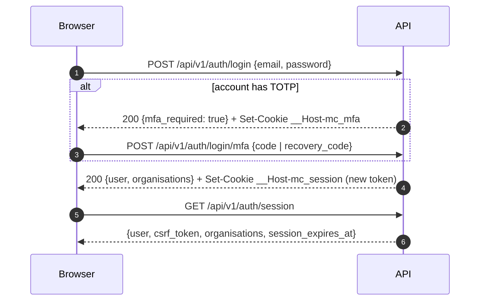

# REST API Design

Status: Phase 0 proposal · Related: [ADR-013](../architecture/DECISIONS.md#adr-013--rest-conventions), [WEBSOCKET-EVENTS.md](WEBSOCKET-EVENTS.md), [MULTITENANCY.md](../architecture/MULTITENANCY.md)

The REST API is the only way clients read and change data. The WebSocket channel delivers events and ephemeral signals; it is not a write path for durable data.

---

## 1. Principles

* **Contract first.** OpenAPI **3.1** documents in `packages/contracts/openapi/` are the source of truth. Their schemas are JSON Schema 2020-12, the same dialect as the WebSocket event schemas, which `$ref` them. TypeScript types are generated with `openapi-typescript`; Go handlers are contract-tested by validating real responses against the same schemas (a 2020-12 validator such as `santhosh-tekuri/jsonschema`). Tool compatibility is confirmed in Phase 1; if a required Go tool lacks 3.1 support, schemas stay 3.1 and only that tool is replaced.
* **Resource-oriented, organisation-scoped.** Tenant resources live under `/api/v1/orgs/{orgId}/…`.
* **Predictable.** Consistent naming, pagination, errors and idempotency across modules.
* **Safe by default.** No secrets in responses, `404` for invisible resources, strict input decoding, rate limits everywhere.

## 2. Base URL and versioning

* Same origin as the web app: `https://<host>/api/v1`. No CORS.
* **Major version in the path** (`/api/v1`). Within v1, changes are additive only: new endpoints, new optional request fields, new response fields, new enum values (clients must tolerate unknown values).
* Breaking changes require `/api/v2` for the affected resources. Deprecated endpoints send `Deprecation` and `Sunset` headers for at least 90 days before removal.
* `GET /api/v1/config` exposes runtime client configuration (LiveKit URL, upload limits, feature flags, build version).

## 3. Authentication

| Mechanism | Detail |
|---|---|
| Session cookie | `__Host-mc_session` (opaque token; `Secure`, `HttpOnly`, `SameSite=Lax`, `Path=/`) |
| CSRF (signed-in) | Every `POST`/`PUT`/`PATCH`/`DELETE` requires a same-origin `Origin` (or `Sec-Fetch-Site: same-origin`) **and** `X-CSRF-Token` (from `GET /api/v1/auth/session`) |
| CSRF (pre-session) | Endpoints used before a session exists — login, MFA step, password forgot/reset, email verification, invitation acceptance, self-service sign-up — require a same-origin `Origin` **and** the custom header `X-MC-Client: web`; browsers cannot send custom headers cross-site without a CORS preflight, which the API never grants |
| CSRF exemptions | Signature-verified webhooks (`/api/v1/webhooks/…`) and the rate-limited CSP report endpoint (no state change beyond logging) |
| One-time tokens | Reset, verification and invitation tokens travel in the **request body**, never in URL paths or query strings (see §9.1) |
| 2FA login challenge | Short-lived `__Host-mc_mfa` cookie (5 min, single use) between password and TOTP steps |
| Step-up | Sensitive operations require `reauthenticated_at` within 10 min (`403 reauthentication_required` otherwise) |

Login sequence:



Responses for unknown email, wrong password and disabled accounts are identical in status, body and timing (enumeration resistance).

## 4. Conventions

| Topic | Rule |
|---|---|
| Format | `application/json; charset=utf-8`; UTF-8 everywhere |
| Field names | `snake_case` |
| IDs | UUID strings (UUIDv7) |
| Timestamps | RFC 3339 UTC with milliseconds (`2026-10-12T09:14:03.120Z`); dates `YYYY-MM-DD`; time zones as IANA names |
| Enums | lower `snake_case` strings |
| Nulls | Optional fields are omitted or `null`; documented per field |
| Partial updates | `PATCH` with JSON Merge Patch semantics (RFC 7396) on documented fields only |
| Creation | `201 Created` + `Location` header + resource body |
| No content | `204` for deletes and idempotent `PUT` toggles |
| Unknown fields | Rejected (`422 validation_failed`) to catch client bugs early |
| Body limits | 64 KB default; 256 KB for message create/edit (a 40,000-character message can exceed 120 KB in UTF-8, e.g. Bangla); other overrides documented per route |
| Caching | `Cache-Control: no-store` on authenticated responses |
| Optimistic concurrency | Mutable admin resources expose `version` and `ETag`; updates require `If-Match` → `412 version_mismatch` on conflict |

### Message markup in JSON

Message `body` is MateCollab markup v1 ([FRONTEND.md](../architecture/FRONTEND.md#10-message-markup)). Mentions are tokens (`<@user-id>`, `<#conversation-id>`, `<!channel>`, `<!here>`); responses include a `mentions` array of resolved users the caller can see, so clients render names without extra requests.

## 5. Pagination

Cursor-based everywhere; offsets are never used.

```json
{
  "data": [ … ],
  "page": { "next_cursor": "eyJrIjoiMjAyNi0xMC0xMlQwOToxNDowMy4xMjBaIiwiaWQiOiIwMTk…", "has_more": true }
}
```

* `limit` default 50, maximum 200 (search: 20 per type).
* Cursors are opaque, base64url-encoded, signed (HMAC) to prevent tampering, and bound to the query's filters.
* **Timelines** use sequence cursors instead: `before_seq`, `after_seq`, or `around_seq` with `limit` over top-level messages; responses include `oldest_seq`, `newest_seq`, `has_older`, `has_newer` and the conversation's current `last_change_seq`.
* **Threads** page by `thread_seq` (`after_thread_seq`, `before_thread_seq`).
* **Change feed:** `GET {org}/conversations/{id}/changes?after=<change_seq>&limit=` returns the current state of every message changed after the cursor (new, edited, deleted, re-reacted, pinned), in `change_seq` order, plus `last_change_seq` and `has_more`. It is how clients converge after missed events ([REALTIME.md §6](../architecture/REALTIME.md#6-client-convergence)).

## 6. Errors

RFC 9457 Problem Details, `Content-Type: application/problem+json`:

```json
{
  "type": "urn:matecollab:problem:validation_failed",
  "title": "Request validation failed",
  "status": 422,
  "code": "validation_failed",
  "detail": "One or more fields are invalid.",
  "instance": "/api/v1/orgs/0199…/spaces",
  "request_id": "870315265bf4066afd97af34d5e4fd7c",
  "errors": [ { "field": "name", "code": "too_long", "message": "Use 80 characters or fewer." } ]
}
```

`type` is always `urn:matecollab:problem:<code>`: stable, resolvable without a documentation domain, and equal to `code` after the prefix. `request_id` matches the `X-Request-ID` response header (Nginx generates it; the API accepts it when well-formed and creates one otherwise). The schema is `ProblemDetails` in `packages/contracts/openapi`.

| Status | `code` examples |
|---|---|
| 400 | `malformed_json`, `invalid_cursor` |
| 401 | `unauthenticated`, `session_expired` (including an organisation's `session_max_age` being exceeded), `mfa_challenge_expired` |
| 403 | `forbidden`, `csrf_failed`, `reauthentication_required`, `org_suspended`, `mfa_enrollment_required`, `edit_window_expired` |
| 404 | `not_found` (also for resources in other organisations or not visible) |
| 409 | `conflict`, `name_taken`, `already_member`, `idempotency_conflict` |
| 412 | `version_mismatch` |
| 413 | `payload_too_large`, `file_too_large` |
| 415 | `unsupported_media_type` |
| 422 | `validation_failed`, `idempotency_key_reused` |
| 429 | `rate_limited` |
| 500 / 503 | `internal_error`, `service_unavailable` (no internal details) |

## 7. Idempotency

| Operation | Mechanism |
|---|---|
| Send message | `client_msg_id` (UUID) in the body. Same sender + conversation + `client_msg_id` → the original message (`200`), never a duplicate. |
| Other side-effecting `POST`s (create support request, schedule meeting, invite, upload init, create action) | `Idempotency-Key: <uuid>` header. Stored per user for 24 h with a request hash. Replays return the stored status and body. Same key + different body → `422 idempotency_key_reused`; concurrent duplicate → `409 idempotency_conflict`. |
| `PUT` toggles (reactions, pins, saved, read markers) | Naturally idempotent |

## 8. Rate limiting

Redis-backed GCRA limits per scope; Nginx adds coarse per-IP limits.

| Class | Scope | Initial limit |
|---|---|---|
| `auth.login` | IP and account | 10/min per IP; 5/min per account with progressive delay |
| `auth.mfa` | challenge | 5 attempts, then the challenge is invalidated |
| `auth.recovery` (password reset, verification resend) | IP and email | 5/hour |
| `messages.write` | user | 30 per 10 s burst, 120/min sustained |
| `reactions` | user | 30 per 10 s |
| `uploads` | user / org | 30 initiations/min per user; org daily byte budget |
| `search` | user | 30/min |
| `invitations` | admin / org | 30/hour per admin, 200/day per org |
| `integrations.test` | org | 10/min |
| `realtime.tickets` | user | 30/min |
| `default` | user / IP | 600/min per user, 1,200/min per IP |

Responses carry `RateLimit-Policy` and `RateLimit` headers (IETF draft format) and, on `429`, `Retry-After`.

## 9. Resource catalogue

`{org}` = `/api/v1/orgs/{orgId}`. Permissions refer to [MULTITENANCY.md §3.3](../architecture/MULTITENANCY.md#33-permission-catalogue-initial). Phase = delivery phase in [PHASES.md](../development/PHASES.md).

### 9.1 Auth, account and session (Phase 2 unless noted)

| Method | Path | Purpose |
|---|---|---|
| POST | `/api/v1/auth/login` | Password step |
| POST | `/api/v1/auth/login/mfa` | TOTP or recovery code step |
| POST | `/api/v1/auth/logout` | Revoke current session |
| GET | `/api/v1/auth/session` | Current user, CSRF token, memberships summary |
| POST | `/api/v1/auth/password/forgot` | Request reset email (uniform response) |
| POST | `/api/v1/auth/password/reset` | `{token, new_password}` — token from the email link's URL fragment |
| POST | `/api/v1/auth/email/verify` · `/resend` | `{token}` in the body · resend |
| POST | `/api/v1/auth/reauthenticate` | Step-up (password, plus TOTP if enabled) |
| GET / DELETE | `/api/v1/auth/sessions`, `/api/v1/auth/sessions/{id}` | List and revoke own sessions (incl. "sign out other sessions") |
| POST | `/api/v1/auth/mfa/totp/setup` · `/enable` · `/disable` | Enrol (QR/secret), confirm, disable (step-up) |
| POST | `/api/v1/auth/mfa/recovery-codes` | Regenerate (step-up; shown once) |
| PUT | `/api/v1/auth/password` | Change password (step-up) |
| GET / PATCH | `/api/v1/me` | Global profile (name, time zone, locale) |
| GET / POST | `/api/v1/me/emails` | List own emails / add one (sends verification) |
| PUT / DELETE | `/api/v1/me/emails/{id}/primary` · `/api/v1/me/emails/{id}` | Make primary (step-up) / remove |
| GET / PATCH | `/api/v1/me/preferences` | Personal settings document |
| GET | `/api/v1/me/organisations` | Memberships for the organisation switcher |
| POST / DELETE | `/api/v1/me/deletion` | Request account deletion (step-up; grace period) / cancel |
| PUT / DELETE | `/api/v1/me/avatar` | Avatar via upload ID (Phase 6) |
| GET | `/api/v1/avatars/{userId}/{version}?size=64\|256` | Avatar image (authenticated; caller must share an organisation with the user); immutable caching (Phase 6) |
| POST | `/api/v1/invitations/accept` | `{token, …}` in the body — accept invitation (creates the account if needed) |
| POST | `/api/v1/orgs` | Self-service organisation creation (only when `MC_ALLOW_ORG_SIGNUP` is enabled) |

Email links carry one-time tokens in the URL **fragment** (`/reset-password#token=…`, `/verify-email#token=…`, `/invite#token=…`), which browsers never send to servers or in `Referer` headers; those pages also send `Referrer-Policy: no-referrer`.

### 9.2 Organisation and membership (Phase 2–3)

| Method | Path | Purpose | Permission |
|---|---|---|---|
| GET / PATCH | `{org}` | Organisation profile | view / `org.settings.manage` |
| POST / DELETE | `{org}/deletion` | Request organisation deletion (step-up; 30-day window) / cancel | Owner |
| GET | `{org}/logo/{version}` | Organisation logo image (immutable caching; Phase 6) | member |
| PUT | `{org}/me/presence` | Own presence override and status text in this organisation | member |
| PATCH | `{org}/me/membership` | Own title and contact email (one of the user's verified emails) | member |
| GET / PUT | `{org}/settings/{section}` | `security`, `messaging`, `meetings`, `files`, `notifications`, `support` (ETag) | `org.settings.manage` / `org.security.manage` |
| GET | `{org}/members` | Directory (filters: role, status, q) | `org.directory.view` |
| GET / PATCH | `{org}/members/{userId}` | Role, status, title | `org.members.manage` / `org.admins.manage` |
| POST | `{org}/ownership-transfer` | Transfer to an Admin (step-up) | Owner |
| GET / POST | `{org}/invitations` | List / create (member and admin invitations in Phase 2; guest invitations with `space_ids` in Phase 3) | `org.members.invite` / `org.guests.invite` |
| DELETE | `{org}/invitations/{id}` | Revoke | inviter or Admin |
| GET | `{org}/audit-logs` | Filter by actor, action, target, time | `audit.view` |
| POST | `{org}/audit-logs/exports` | Async CSV export → file download | `audit.export` |
| GET | `{org}/admin/overview` | Counts, storage usage | Admin |

### 9.3 Spaces and channels (Phase 3)

| Method | Path | Purpose |
|---|---|---|
| GET / POST | `{org}/spaces` | Browse (joined + discoverable public) / create |
| GET / PATCH / DELETE | `{org}/spaces/{spaceId}` | View / update (name, description, overview, visibility) / delete |
| POST | `{org}/spaces/{spaceId}/archive` · `/unarchive` | Archive state |
| POST | `{org}/spaces/{spaceId}/join` · `/leave` | Membership for self |
| GET / POST | `{org}/spaces/{spaceId}/members` | List / add (incl. granted guests) |
| PATCH / DELETE | `{org}/spaces/{spaceId}/members/{userId}` | Space role / remove |
| GET / POST | `{org}/spaces/{spaceId}/channels` | List / create channel (public or private) |
| PUT / DELETE | `{org}/spaces/{spaceId}/support-route` | Default support destination for the Space |

### 9.4 Conversations and messages (Phase 4–5)

| Method | Path | Purpose |
|---|---|---|
| GET | `{org}/conversations` | My conversations (`kind`, `filter=unread|hidden|favorites`, `updated_since`) with unread counts |
| POST | `{org}/conversations` | Create DM (`{kind: "dm", user_ids: [id]}` returns the existing DM if any) or group |
| GET / PATCH | `{org}/conversations/{id}` | Details / update (name, topic, visibility for channels) |
| POST | `{org}/conversations/{id}/archive` · `/unarchive` · `/join` · `/leave` | Lifecycle and self-membership |
| GET / POST / DELETE | `{org}/conversations/{id}/members[/{userId}]` | Membership |
| PATCH | `{org}/conversations/{id}/me` | Favourite, hidden, notification level, mute until |
| PUT | `{org}/conversations/{id}/read-marker` | `{seq}` (monotonic, top-level sequence) |
| GET | `{org}/sync?since=` | Changed conversations since a timestamp: `last_message_seq`, `last_change_seq`, unread, membership (resync) |
| GET | `{org}/conversations/{id}/messages` | Timeline of top-level messages (`before_seq`, `after_seq`, `around_seq`, `limit`) |
| GET | `{org}/conversations/{id}/changes` | Change feed (`after` = `change_seq`, `limit`) — current state of every message changed since the cursor |
| POST | `{org}/conversations/{id}/messages` | Send (`client_msg_id`, `body`, `file_ids`, `thread_root_id`, `quoted_message_id`) |
| GET / PATCH / DELETE | `{org}/conversations/{id}/messages/{messageId}` | Get / edit / delete (policy-checked) |
| GET | `{org}/conversations/{id}/messages/{messageId}/replies` | Thread replies (`after_thread_seq`, `before_thread_seq`) |
| PUT / DELETE | `{org}/conversations/{id}/threads/{rootId}/subscription` | Follow / unfollow (`{notify}`) |
| PUT | `{org}/conversations/{id}/threads/{rootId}/read-marker` | `{thread_seq}` (thread read cursor) |
| PUT / DELETE | `{org}/conversations/{id}/messages/{messageId}/reactions/{emoji}` | Add / remove own reaction (emoji URL-encoded) |
| GET | `{org}/conversations/{id}/pins` | Pinned messages |
| PUT / DELETE | `{org}/conversations/{id}/pins/{messageId}` | Pin / unpin |
| GET | `{org}/saved-messages` | Saved for later |
| PUT / DELETE | `{org}/saved-messages/{messageId}` | Save / unsave |
| GET | `{org}/presence?user_ids=` | Presence snapshot |
| POST | `{org}/realtime/tickets` | WebSocket ticket |

### 9.5 Files (Phase 6)

| Method | Path | Purpose |
|---|---|---|
| POST | `{org}/uploads` | Initiate: `{filename, size_bytes, content_type, sha256?, conversation_id?}` → `{file_id, upload: {method, url, fields/headers, expires_at}}`. Without a conversation the file stays private to the uploader until attached (Files page uploads, files staged for a support request) |
| POST | `{org}/uploads/{fileId}/complete` | Verify object, start scanning |
| GET | `{org}/files` | `view=recent|shared_with_me|space`, `space_id`, `conversation_id`, `q` |
| GET / PATCH / DELETE | `{org}/files/{fileId}` | Metadata / rename / delete |
| GET | `{org}/files/{fileId}/download` · `/preview` | `302` to a short-lived presigned URL after authorization |

### 9.6 Meetings, huddles and calls (Phases 7–8)

| Method | Path | Purpose |
|---|---|---|
| GET / POST | `{org}/meetings` | List (`view=upcoming|today|past`, `from`, `to`) / schedule or start instant (`kind`) |
| GET / PATCH | `{org}/meetings/{id}` | Details / edit |
| POST | `{org}/meetings/{id}/cancel` | Cancel (notifies invitees) |
| PUT | `{org}/meetings/{id}/rsvp` | `{response}` |
| PUT / DELETE | `{org}/meetings/{id}/invites/{userId}` | Invite / uninvite |
| POST | `{org}/meetings/{id}/join` | Authorize → `{status: "admitted", livekit_url, token, expires_at}` or `{status: "waiting"}` |
| POST | `{org}/meetings/{id}/participants/{userId}/admit` · `/deny` · `/remove` · `/mute` | Host controls |
| PUT | `{org}/meetings/{id}/hand` | Raise/lower own hand (`{raised}`) — applied as a LiveKit participant attribute |
| POST | `{org}/meetings/{id}/end` | End for everyone |
| GET | `{org}/meetings/{id}/participants` | Attendance / live roster |
| GET / POST | `{org}/conversations/{id}/huddle` | Current huddle / start-or-join |
| POST | `{org}/conversations/{id}/calls` | Ring DM/group participants (`{mode: "audio" \| "video"}`) |
| POST | `{org}/calls/{meetingId}/decline` | Decline ringing call |

### 9.7 Notifications, Activity and search (Phase 9)

| Method | Path | Purpose |
|---|---|---|
| GET | `{org}/activity` | Feed (`type`, `unread_only`, cursor) |
| POST | `{org}/activity/read` | `{ids}` or `{all: true}` |
| GET | `{org}/unread-summary` | Badge counts (conversations, activity) |
| GET | `{org}/search` | `q`, `type=all|messages|people|spaces|channels|files|meetings`, filters (`conversation_id`, `from_user_id`, `before`, `after`) |
| GET | `{org}/home` | Home aggregates (resume conversations, attention, files, meetings, actions, support) |

### 9.8 Action items (Phase 10)

| Method | Path | Purpose |
|---|---|---|
| GET / POST | `{org}/actions` | `view=assigned|created|completed` / create (optionally from `source_message_id`) |
| GET / PATCH / DELETE | `{org}/actions/{id}` | Details / update (title, assignee, due date, completed) / delete |

### 9.9 Support and integrations (Phase 11)

| Method | Path | Purpose |
|---|---|---|
| GET | `{org}/support-destinations` | Destinations the caller may use |
| GET / POST | `{org}/support-requests` | Mine (`status`) / create (`title`, `description`, `priority`, `destination_id`, `context: {mode, conversation_id, message_id}`, `include_attachments`, `file_ids` for files staged privately by the requester) |
| POST | `{org}/support-requests/context-preview` | Server-built preview of exactly what would be shared |
| GET | `{org}/support-requests/{id}` | Request with context snapshot, attachments, replies, delivery state |
| POST | `{org}/support-requests/{id}/messages` | Reply |
| POST | `{org}/support-requests/{id}/retry-delivery` · `/close` | Retry failed delivery / close |
| GET / POST | `{org}/integrations` | List / create (`kind`, `provider`, `config`, write-only `secrets`) |
| GET / PATCH / DELETE | `{org}/integrations/{id}` | Read (secrets shown only as `{configured: true, updated_at}`) / update / remove |
| POST | `{org}/integrations/{id}/test` · `/test-email` · `/enable` · `/disable` | Connection test, SMTP test email, state |
| GET | `{org}/integrations/{id}/deliveries` | Recent delivery log |
| GET / POST / PATCH / DELETE | `{org}/support-destinations[/{id}]` (admin) | Manage destinations |

### 9.10 Inbound webhooks (no session; signature-verified)

| Method | Path | Verification |
|---|---|---|
| POST | `/api/v1/webhooks/livekit` | LiveKit-signed JWT (`Authorization`) with body SHA-256 claim, verified with the API secret |
| POST | `/api/v1/webhooks/orgs/{orgId}/helpdesk/{integrationId}` | Connector-specific HMAC signature with per-integration secret, timestamp tolerance 5 min, replay cache |

## 10. Examples

**Send a message**

```http
POST /api/v1/orgs/0199a6f0-…/conversations/0199a6f2-…/messages
Content-Type: application/json
X-CSRF-Token: 9pY1…

{
  "client_msg_id": "0199b2c4-7a10-7d3e-9b1f-2f8c0e4b6a11",
  "body": "Quick update: the checklist is ready. <@0199a6f1-…> could you review?",
  "file_ids": ["0199b2c3-…"],
  "thread_root_id": null
}
```

```http
HTTP/1.1 201 Created
Location: /api/v1/orgs/0199a6f0-…/conversations/0199a6f2-…/messages/0199b2c4-8c22-…

{
  "id": "0199b2c4-8c22-…",
  "conversation_id": "0199a6f2-…",
  "seq": 1042,
  "thread_seq": null,
  "change_seq": 5187,
  "client_msg_id": "0199b2c4-7a10-7d3e-9b1f-2f8c0e4b6a11",
  "sender": { "id": "0199a6f1-aaaa-…", "display_name": "Omar Faruque" },
  "body": "Quick update: the checklist is ready. <@0199a6f1-…> could you review?",
  "mentions": [ { "id": "0199a6f1-…", "display_name": "Ayesha Rahman" } ],
  "attachments": [ { "id": "0199b2c3-…", "filename": "release-checklist.md", "size_bytes": 18432, "status": "scanning" } ],
  "reactions": [],
  "reply_count": 0,
  "version": 1,
  "created_at": "2026-10-12T10:04:11.482Z",
  "edited_at": null
}
```

**Join a meeting**

```json
POST /api/v1/orgs/{orgId}/meetings/{meetingId}/join   →   200
{ "status": "admitted", "livekit_url": "wss://rtc.example.com", "token": "eyJhbGciOi…", "expires_at": "2026-10-12T10:14:00Z", "role": "attendee" }
```

**Create a support request with a selected thread**

```json
POST /api/v1/orgs/{orgId}/support-requests      Idempotency-Key: 0199b2d0-…
{
  "title": "Production deployment failure",
  "description": "Health check timed out after restart.",
  "priority": "high",
  "destination_id": "0199a9…",
  "context": { "mode": "thread", "conversation_id": "0199a6f3-…", "message_id": "0199a7…" },
  "include_attachments": false
}
```

The response contains the immutable `context_items` snapshot exactly as it will be delivered.

## 11. Security notes

* Never return secrets, password hashes, token hashes or encryption metadata. Write-only fields (`secrets.password`, `secrets.api_token`) are accepted on create/update and reported only as `configured: true`.
* Never accept object storage keys or LiveKit room names from clients; only resource IDs.
* Emails of other users are omitted for guest callers.
* All list endpoints apply the same visibility rules as single-resource reads; tests assert parity.
