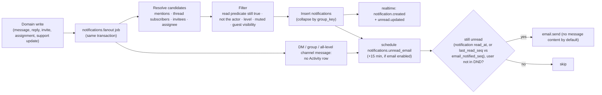

# Backend Architecture

Status: Phase 0 proposal · Language: Go 1.27 (Go 1.25 left security support in August 2026) · Related: [ADR-001](DECISIONS.md#adr-001--modular-monolith-in-a-single-go-module), [ADR-004](DECISIONS.md#adr-004--background-jobs-on-postgresql-river-instead-of-redis-streams--accepted), [MULTITENANCY.md](MULTITENANCY.md), [DATABASE.md](DATABASE.md)

---

## 1. Shape

One Go module, three binaries, one set of domain packages.

```
services/
├─ go.mod                     # module path TBD with the GitHub organisation
├─ api/                       # package main — HTTP API + WebSocket gateway
├─ worker/                    # package main — background jobs (River), schedulers
├─ mcctl/                     # package main — admin CLI: migrate, seed, bootstrap, rotate keys
└─ internal/
   ├─ app/                    # composition root: wires config, platform and modules for each binary
   ├─ platform/
   │  ├─ config/              # typed env config, *_FILE secrets, validation at start-up
   │  ├─ db/                  # pgx pool, InTenantTx, AfterCommit hooks, health
   │  ├─ tenant/              # OrgID/UserID types, Actor, context helpers
   │  ├─ httpx/               # router setup, middleware, JSON decode/encode, Problem Details
   │  ├─ redisx/              # client, key builders, Lua scripts
   │  ├─ jobs/                # River client, Enqueuer interface, tenant-aware job runner
   │  ├─ objectstore/         # S3 abstraction (AWS SDK v2), presigning with public endpoint
   │  ├─ mailer/              # SMTP sender (go-mail), templates, platform vs org transport
   │  ├─ crypto/              # AES-256-GCM keyring, HKDF subkeys, token generation, hashing
   │  ├─ ratelimit/           # Redis GCRA limiter
   │  ├─ netguard/            # SSRF-safe dialer for outbound integrations
   │  └─ telemetry/           # slog setup, OpenTelemetry tracing/metrics
   ├─ authz/                  # permission catalogue + policies (no I/O except injected resolvers)
   ├─ jobargs/                # plain job-argument and domain-event types shared by producers and consumers (no imports of modules)
   ├─ auth/  users/  orgs/  memberships/  spaces/  conversations/  messages/
   ├─ presence/  meetings/  files/  actions/  support/  notifications/
   ├─ search/  integrations/  admin/  audit/  realtime/
   └─ testkit/                # fixtures, factories, Postgres/Redis test containers, fake clock
```

### Binaries

| Binary | Runs | Notes |
|---|---|---|
| `api` | HTTP server (`/api/v1`), WebSocket gateway, LiveKit/HelpDesk webhooks; admin listener for `/healthz`, `/readyz`, `/metrics` on an internal port (`:8091` locally) | Stateless; scale horizontally |
| `worker` | River workers and periodic jobs; admin listener (`:8092` locally) | Scale by queue; same domain code as `api` |
| `mcctl` | Implemented: `prepare` (bootstrap when a superuser URL is set → `migrate up` → `storage init`; the deployment pre-start step), `db bootstrap` (roles; needs admin credentials), `migrate up/down/status`, `storage init` (bucket, CORS, lifecycle), `mail test`, `keys generate`, `config check`, `doctor`, `version`. Added with their features: `seed` (dev only), `org create`, `user create-owner` (prints a one-time password-setup link), `keys rotate` (re-encrypt secrets) | Used in deployment steps and operations |

Module dependencies form a DAG: producers never import consumers. When a module needs another module to react (e.g. `notifications` reacting to a new message), the producer enqueues a job whose argument type lives in `jobargs`; the consumer registers the worker for that type. This keeps, for example, `messages` free of any import of `notifications`.

---

## 2. Module catalogue

| Package | Responsibilities | Owns tables | Emits events (realtime) |
|---|---|---|---|
| `auth` | Login, logout, 2FA (TOTP, recovery codes), password reset, email verification, sessions, CSRF tokens, step-up re-authentication, WebSocket tickets, account security history | user_credentials, user_totp_factors, user_recovery_codes, sessions, auth_tokens, account_audit_events | `session.revoked` |
| `users` | Global profile (name, avatar, time zone, locale), emails, preferences | users, user_emails, user_preferences | `user.updated` |
| `orgs` | Organisation lifecycle, slug, branding, settings sections, counters | organisations, organisation_settings | `org.updated`, `org.settings.updated` |
| `memberships` | Roles, status (suspend/deactivate), per-organisation title/contact email/status text, invitations incl. guest Space grants, ownership transfer | organisation_memberships, invitations, invitation_space_grants | `org.member.updated`, `org.member.removed` |
| `spaces` | Spaces, Space membership and roles, browse/join/leave, archive | spaces, space_members | `space.*` |
| `conversations` *(incl. channels)* | DMs (deduplicated), groups, channels (in Spaces), meeting chats; membership; per-member state (read cursor, favourite, hidden, notification level) | conversations, conversation_members | `conversation.*` |
| `messages` *(incl. threads, reactions)* | Send/edit/delete with policies, threads and subscriptions, reactions, mentions, pins, saved, quote references, revisions, system messages, change feed | messages, message_revisions, message_mentions, message_reactions, pinned_messages, saved_messages, thread_subscriptions, message_attachments | `message.*` (thread updates ride on `message.created`) |
| `presence` | Per-organisation online state, idle, typing (Redis only); manual status is stored on the membership | — (Redis) | `presence.updated`, `typing` |
| `meetings` | Scheduled/instant meetings, huddles, calls, invites/RSVP, waiting room, LiveKit room admin, token issuance, webhook processing, attendance | meetings, meeting_invites, meeting_participants | `meeting.*`, `huddle.*`, `call.*` |
| `files` | Upload initiation/completion, presigned downloads, access checks, scan/preview pipeline, quotas, retention | files | `file.updated`, `file.deleted` |
| `actions` | Action items from messages/meetings, assignment, completion, due reminders | action_items | `action.*` |
| `support` | Support requests, context snapshots, attachments, replies, destinations and routes, delivery orchestration | support_requests, support_request_context_items, support_request_attachments, support_request_messages, support_destinations, support_routes | `support_request.*` |
| `notifications` | Recipient resolution, preference evaluation, Activity feed, unread summaries, email notifications | notifications | `notification.*`, `unread.updated` |
| `search` | Message/people/space/channel/file/meeting search with access filtering | — (read models over others' tables, documented exception) | — |
| `integrations` | Integration configs, encrypted credentials, connector registry (SMTP, HelpDesk), connection tests, delivery log, inbound webhooks | integrations, integration_deliveries | `integration.updated` |
| `admin` | Administration aggregations (member counts, storage usage, org overview) orchestrating other modules | — | — |
| `audit` | Recording audit events, querying, CSV export jobs | audit_logs | — |
| `realtime` | WebSocket gateway, per-node hub, subscription index, Redis pub/sub bridge, event publisher | — (Redis) | transports all events |

### Module boundaries

* A module's tables are read and written **only** by that module's `store` package (sqlc-generated). Other modules call its exported service interface.
* Documented exceptions: `search` runs read-only queries across message/conversation/space/file/meeting tables; `admin` runs read-only aggregates. Both are reviewed as cross-module read models.
* Cross-module calls inside one transaction pass the transaction handle explicitly (`tx db.Tx`), so a command stays atomic without modules sharing repositories.
* An import-lint test (Phase 1) forbids importing another module's `store` package and forbids non-`auth` packages from referencing identity tables.

---

## 3. Inside a module

```
internal/messages/
├─ model.go          # domain types and invariants
├─ service.go        # use cases; owns transactions; calls authz; enqueues jobs; publishes events after commit
├─ policy.go         # module-specific facts for authz (edit window, deletion policy)
├─ http.go           # handlers: decode → service → encode (no business rules)
├─ events.go         # event constructors (match packages/contracts schemas)
├─ jobs.go           # River job args + workers owned by this module
├─ store/            # sqlc-generated queries (db/queries/messages/*.sql)
└─ *_test.go         # unit tests (fakes) and integration tests (real Postgres)
```

Illustrative shape (not final code):

```go
// http.go — transport only.
func (h *Handler) createMessage(w http.ResponseWriter, r *http.Request) {
    actor := tenant.MustActor(r.Context())
    var req contracts.CreateMessageRequest
    if err := httpx.DecodeJSON(w, r, &req, 256<<10); err != nil { // message routes allow 256 KB
        httpx.WriteProblem(w, r, err)
        return
    }
    msg, err := h.svc.Send(r.Context(), actor, req.ToInput(chi.URLParam(r, "conversationID")))
    if err != nil {
        httpx.WriteProblem(w, r, err)
        return
    }
    httpx.WriteJSON(w, http.StatusCreated, toContract(msg))
}

// service.go — business logic, one transaction per command.
func (s *Service) Send(ctx context.Context, actor tenant.Actor, in SendInput) (Message, error) {
    if err := in.Validate(); err != nil {
        return Message{}, err
    }
    var out Message
    err := s.db.InTenantTx(ctx, actor, func(tx db.Tx) error {
        // Lock the conversation row first (SELECT … FOR UPDATE) and authorise (conversation.post).
        // Holding the lock before the idempotency check makes concurrent retries wait and then
        // find the committed original instead of colliding on the unique index.
        conv, err := s.conversations.LockForPosting(ctx, tx, actor, in.ConversationID)
        if err != nil {
            return err
        }
        if existing, found, err := s.store.ByClientMsgID(ctx, tx, actor.OrgID, conv.ID, actor.UserID, in.ClientMsgID); err != nil || found {
            out = existing // idempotent retry returns the original message
            return err
        }
        pos, err := s.store.NextPositions(ctx, tx, actor.OrgID, conv.ID) // seq (top-level) + change_seq
        if err != nil {
            return err
        }
        if out, err = s.store.Insert(ctx, tx, newMessage(actor, conv, in, pos)); err != nil {
            return err
        }
        if err := s.conversations.AdvanceReadCursor(ctx, tx, actor, conv.ID, out.Seq); err != nil {
            return err // own messages never count as unread
        }
        if err := s.jobs.Enqueue(ctx, tx, jobargs.MessageCreated{OrgID: actor.OrgID, MessageID: out.ID}); err != nil {
            return err // job is durable only if this transaction commits
        }
        tx.AfterCommit(func() { s.events.Publish(context.WithoutCancel(ctx), messageCreated(out)) })
        return nil
    })
    return out, err
}
```

### Request pipeline (API)

| Order | Middleware | Purpose |
|---|---|---|
| 1 | Request ID | Accept `X-Request-ID` from Nginx or generate; echo in responses and logs |
| 2 | Real IP | Trust `X-Forwarded-For` only from `MC_TRUSTED_PROXIES`. Nginx, the public edge, replaces any client-supplied `X-Forwarded-For` with the connection address (`infra/nginx/snippets/proxy-headers.conf`), so clients cannot choose the address used for rate limits and audit records; behind a trusted load balancer, Nginx's realip module establishes that address first |
| 3 | Recover | Panic → 500 Problem Details, alert |
| 4 | Telemetry | Span + structured access log (no bodies, no query strings with tokens) |
| 5 | Security headers | `Cache-Control: no-store`, `X-Content-Type-Options`, etc. for API responses |
| 6 | Body limit | `http.MaxBytesReader` per route class |
| 7 | IP rate limit | Coarse per-IP buckets |
| 8 | Session | Cookie → session → user (Redis-cached); sliding idle expiry |
| 9 | CSRF | Unsafe methods: allowed `Origin`/`Sec-Fetch-Site` + `X-CSRF-Token`; pre-session endpoints: allowed `Origin` + `X-MC-Client: web`; signed webhooks exempt |
| 10 | Org context | `{orgId}` → active membership → `Actor`; org status and 2FA-enforcement gates |
| 11 | Actor rate limit | Per-user / per-org buckets by route class |
| 12 | Handler | Decode → service → encode |

### Transactions and side effects

* `db.InTenantTx(ctx, actor, fn)` opens a transaction, sets `mc.org_id`/`mc.user_id` locally, runs `fn`, commits, then runs `AfterCommit` hooks.
* **Durable side effects** (emails, notifications, scans, HelpDesk calls, reminders) are River jobs inserted inside the transaction.
* **Realtime events** are published in `AfterCommit` hooks (never before commit).
* Default isolation `READ COMMITTED`; explicit row locks where invariants need them (conversation row for `seq`/`change_seq` and message idempotency, thread root for `thread_seq`, support number, ownership transfer). Every message-level command takes the conversation lock **first**, before reading anything it will decide on.

### Error model

Services return typed domain errors; `httpx.WriteProblem` maps them to RFC 9457 responses ([API-DESIGN.md](../api/API-DESIGN.md#6-errors)):

| Domain error | HTTP |
|---|---|
| `ErrValidation{Fields}` | 422 `validation_failed` |
| `authz.ErrNotVisible`, `ErrNotFound` | 404 `not_found` |
| `authz.ErrForbidden{Reason}` | 403 `forbidden` |
| `ErrConflict{Code}` | 409 (e.g. `name_taken`, `idempotency_conflict`) |
| `ErrPreconditionFailed` | 412 `version_mismatch` |
| `ratelimit.ErrLimited` | 429 `rate_limited` |
| anything else | 500 `internal_error` (details only in logs) |

Validation is explicit Go code per input type (`Validate() error`), not reflection tags: decoding rejects unknown fields and oversized bodies; services enforce business limits (lengths, counts, allowed values).

---

## 4. Background jobs (River)

| Queue | Concurrency (initial) | Job kinds |
|---|---|---|
| `default` | 20 | `meetings.reminder`, `meetings.livekit_event`, `actions.due_reminder`, `memberships.invitation_email` |
| `notifications` | 20 | `notifications.fanout`, `notifications.unread_email` |
| `email` | 10 | `email.send` (all transactional email) |
| `files` | 4 | `files.scan`, `files.preview`, `files.avatar_process` |
| `support` | 5 | `support.deliver`, `support.add_comment`, `support.sync` (polling connectors) |
| `maintenance` | 2 | `retention.org_purge`, `files.purge_deleted`, `orgs.purge_deleted`, `audit.export`, cleanup jobs |

Rules:

* **Idempotent handlers.** Every job re-reads state and exits early if the work is already done (e.g. `notifications.emailed_at`, `files.status`, `support_requests.delivery_status`). River unique-job options prevent duplicate enqueues where appropriate.
* **Tenant-aware runner.** Job args include `OrgID`; the runner wraps execution in `InTenantTx`, so RLS applies.
* **Retries.** Exponential backoff with per-kind limits (emails 10 attempts ≈ 6 h; HelpDesk delivery 12 attempts ≈ 24 h; scans 8 attempts; notifications 5 attempts). Exhausted jobs are discarded with an error record, raise an alert, and surface user-visibly where it matters (support request "Delivery failed — Retry").
* **Periodic jobs** (River periodic): session/token/idempotency-key cleanup (hourly), notification pruning (daily), retention purge per organisation (nightly, staggered), files purge (daily), organisation purge after deletion window (daily), action due reminders (hourly), support sync for polling connectors (every 5 min).
* **Scheduled jobs**: meeting reminders at `starts_at − 10 min`; unread-message emails at `+ email_delay_minutes`.

---

## 5. Notifications pipeline



* Activity items: mentions (including `@channel`/`@here` for members whose level is not `none`; `@here` only for online members), replies in subscribed threads, meeting invites/updates/cancellations/starting soon, action assignments and due reminders, support updates, being added to a Space or channel.
* DMs, groups and "all activity" channels produce **no rows**; the client raises desktop notifications from realtime `message.created` events according to the user's preferences and DND/quiet hours, and unread-message emails use `conversation_members.email_notified_seq`.
* Desktop notifications are client-side (Notification API) and never contain more than the conversation name, sender and a short preview the user is already entitled to see. Web Push is a later extension.

---

## 6. Search

* **Messages:** `search_tsv @@ websearch_to_tsquery('simple', $q)` with prefix expansion for the last term, ranked by `ts_rank_cd` and recency; highlights via `ts_headline` on the returned page only.
* **Access filter:** the query joins the caller's readable conversations — the single read predicate in [MULTITENANCY.md §3.4](MULTITENANCY.md#34-resource-rules) (active member; or, for public channels, member of the channel's Space) — and runs under RLS; deleted messages never match (empty vector).
* **Names:** trigram similarity on users (via org memberships), spaces, channels, files, meetings — always organisation- and access-filtered (guests see only shared-Space people and content).
* **API:** `GET /api/v1/orgs/{orgId}/search?q=&type=&cursor=` returns typed groups; limit 20 per type for "All".
* **Evolution:** the `search.Engine` interface allows a dedicated engine (e.g. OpenSearch, Meilisearch, Typesense) fed by jobs if relevance or scale requires it.

---

## 7. Email

| Transport | Used for | Configuration |
|---|---|---|
| Platform mailer | Verification, password reset, invitations, security alerts, notification emails (default) | `MC_SMTP_*` per deployment (Mailpit locally) |
| Organisation SMTP integration | Notification emails sent "as" the organisation; SMTP support fallback | Admin → Integrations → SMTP (encrypted credentials) |

Templates are versioned Go `html/template` + text alternatives with the Library PNG lockup; all sending goes through `email.send` jobs; `Message-ID` is deterministic per logical email to help downstream deduplication.

---

## 8. Configuration

Configuration comes only from environment variables (and `*_FILE` variants for secrets), validated at start-up; invalid configuration fails fast. Organisation-specific behaviour lives in `organisation_settings`, never in environment variables.

| Variable | Purpose | Local example |
|---|---|---|
| `MC_ENV` | `local`, `ci`, `staging`, `production` | `local` |
| `MC_PUBLIC_URL` | Browser-facing origin | `http://localhost:8080` |
| `MC_ALLOWED_ORIGINS` | CSRF and WebSocket origin allow-list | `http://localhost:8080` |
| `MC_HTTP_ADDR` / `MC_ADMIN_ADDR` | Public API listener / internal health+metrics listener (set per process) | api `:8081` / `:8091`; worker — / `:8092` |
| `MC_TRUSTED_PROXIES` | CIDRs allowed to set forwarding headers | Docker network CIDR |
| `MC_DATABASE_URL` | Runtime role `mc_app` | `postgres://mc_app:…@postgres:5432/matecollab` |
| `MC_MIGRATE_DATABASE_URL` | Migration role `mc_migrator` (mcctl only) | `postgres://mc_migrator:…@postgres:5432/matecollab` |
| `MC_DATABASE_BOOTSTRAP_URL` | Superuser/admin URL for `mcctl db bootstrap` only; never given to the API or worker in production | `postgres://postgres:…@postgres:5432/postgres` |
| `MC_MIGRATIONS_DIR` | Directory of goose SQL migrations (auto-discovered in a checkout) | `/app/db/migrations` in images |
| `MC_DB_MAX_CONNS` | Pool size per process | `20` |
| `MC_REDIS_URL` | Redis-compatible server | `redis://:…@redis:6379/0` |
| `MC_S3_ENDPOINT` / `MC_S3_PUBLIC_ENDPOINT` | Internal endpoint / browser-reachable endpoint used for presigning | `http://minio:9000` / `http://localhost:9000` |
| `MC_S3_REGION`, `MC_S3_BUCKET`, `MC_S3_ACCESS_KEY_ID`, `MC_S3_SECRET_ACCESS_KEY`, `MC_S3_FORCE_PATH_STYLE` | Object storage | `us-east-1`, `matecollab`, …, `true` |
| `MC_LIVEKIT_API_URL` / `MC_LIVEKIT_PUBLIC_URL` | Server API / client signalling URL | `http://livekit:7880` / `ws://localhost:7880` |
| `MC_LIVEKIT_API_KEY`, `MC_LIVEKIT_API_SECRET` | Token signing and webhook verification | dev keys |
| `MC_SMTP_HOST`, `MC_SMTP_PORT`, `MC_SMTP_USERNAME`, `MC_SMTP_PASSWORD`, `MC_SMTP_FROM`, `MC_SMTP_TLS` | Platform mailer | `mailpit`, `1025`, —, —, `MateCollab <no-reply@localhost>`, `none` (local only) |
| `MC_ENCRYPTION_KEYRING`, `MC_ENCRYPTION_ACTIVE_KEY` | Versioned keyring (`kid:base64key,…`): AES-256-GCM for stored secrets and HMAC keys for recovery codes (key ID stored with each record, so rotation never invalidates data) | generated by `pnpm setup` |
| `MC_HMAC_SECRET` | Root for HKDF-derived subkeys for **ephemeral** values only (CSRF tokens, pagination cursors, WebSocket tickets); rotating it invalidates those values, which clients simply re-fetch | generated |
| `MC_SCANNER`, `MC_CLAMAV_ADDR` | `clamav` or `noop` (non-production only) | `noop` / `clamav:3310` |
| `MC_OTEL_EXPORTER_OTLP_ENDPOINT` | Traces/metrics export | `http://otel-lgtm:4318` (optional) |
| `MC_LOG_LEVEL`, `MC_LOG_FORMAT` | `debug`…`error`; `json` or `text` | `info`, `json` (`.env` uses `text` locally) |
| `MC_MAX_UPLOAD_MB` | Platform upload ceiling (organisations can only lower it) | `100` |
| `MC_ALLOW_ORG_SIGNUP` | Self-service organisation creation | `false` |
| `MC_OUTBOUND_ALLOW_PRIVATE_CIDRS` | SSRF allow-list for on-premises SMTP/HelpDesk endpoints | empty |

The web app receives runtime configuration (LiveKit URL, feature flags, limits) from `GET /api/v1/config`, so one web image serves every environment.

---

## 9. Dependencies

Approved baseline (versions pinned in Phase 1; additions need review for licence, maintenance and security):

`go-chi/chi/v5`, `jackc/pgx/v5`, `sqlc` (build tool), `pressly/goose/v3`, `riverqueue/river`, `redis/go-redis/v9`, `coder/websocket`, `aws/aws-sdk-go-v2` (s3, s3 presign), `wneessen/go-mail`, `livekit/protocol`, `livekit/server-sdk-go/v2`, `golang.org/x/crypto` (argon2, hkdf), `google/uuid`, OpenTelemetry Go SDK + `otelpgx`, `google/go-cmp` and `testcontainers-go` (tests).

Avoid: ORMs, reflection-heavy validation frameworks, global singletons, packages without active maintenance.
