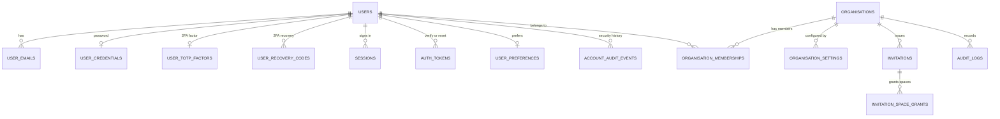
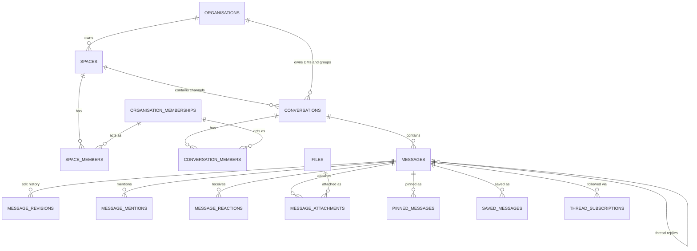
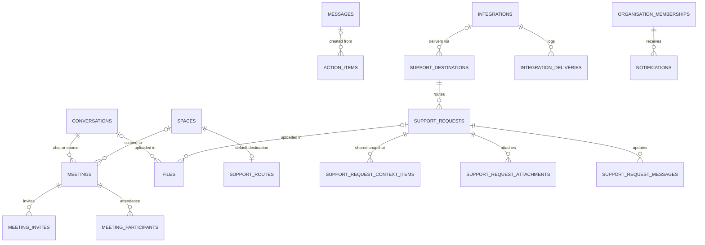

# Database Architecture and Initial Data Model

Status: Phase 0 proposal · Engine: PostgreSQL 18 · Related: [MULTITENANCY.md](MULTITENANCY.md), [ADR-003](DECISIONS.md#adr-003--postgresql-18-uuidv7-goose-sqlc--pgx), [ADR-006](DECISIONS.md#adr-006--normalised-conversation-model)

The SQL in this document is a **design specification**. The authoritative schema is created by versioned goose migrations in `db/migrations/`, introduced phase by phase (see [PHASES.md](../development/PHASES.md)). Column lists may grow; the structural decisions (keys, tenancy, relationships, sequencing) are what Phase 0 fixes. All statements in this document parse with the PostgreSQL grammar and every foreign key has a matching unique target (checked during Phase 0).

---

## 1. Conventions

| Topic | Convention |
|---|---|
| Keys | `uuid` primary keys, **UUIDv7** (time-ordered). Generated in Go (`uuid.NewV7()`); `DEFAULT uuidv7()` as a safety net. Natural keys only where they are truly stable (`(org_id, user_id)` for memberships). |
| Tenancy | Every organisation-owned table has `org_id uuid NOT NULL`. Parents expose `UNIQUE (org_id, id)`; children reference them with **composite foreign keys**. People are referenced as `(org_id, user_id) → organisation_memberships`. |
| Row-level security | Enabled and forced on every organisation-owned table (policy template in [MULTITENANCY.md §2.5](MULTITENANCY.md#25-row-level-security-layer-7)). |
| Sequencing | `seq` orders top-level messages per conversation; `thread_seq` orders replies per thread; `change_seq` is a per-conversation change feed position used for client convergence (see §4.4). |
| Enumerations | `text` + `CHECK (col IN (...))` |
| Time | `timestamptz` (UTC); calendar dates as `date`; user/organisation time zones as IANA names (`text`) |
| Lifecycle | `created_at`, `updated_at` where rows change; `archived_at` for spaces/conversations; `deleted_at` tombstones for user content |
| Users | Users are anonymised, never hard-deleted while referenced, so history stays consistent |
| Deletion actions | Optional references to purgeable content use `ON DELETE SET NULL (column)` (PostgreSQL 15+) so `org_id` is never nulled; dependent rows use `ON DELETE CASCADE` |
| JSON | `jsonb` only for small, versioned, validated documents (settings, preferences, structured system events). Never as a substitute for relations. |
| Binaries | Never in PostgreSQL. Object storage keys only. |
| Naming | Plural `snake_case` tables; `<entity>_id` foreign keys; index names `<table>_<purpose>` |
| Text limits | `CHECK (char_length(...) <= n)` on user-entered text to bound row size and abuse |
| Phased constraints | Columns and foreign keys that point at tables introduced in a later phase are added by that phase's migration (e.g. `files.support_request_id` in Phase 11) |

---

## 2. Normalisation decisions

The brief listed candidate tables. Each was evaluated rather than created mechanically:

| Candidate | Decision | Reason |
|---|---|---|
| users | **Kept** | Global identity (name, avatar, time zone, locale) |
| user_emails | **Kept** | Multiple emails, verification state, case-insensitive uniqueness; visible only to the owner |
| sessions | **Kept** | Server-side sessions, revocation, device list |
| organisations | **Kept** | Tenant |
| organisation_memberships | **Kept** | Role, status, title, contact email and presence/status per organisation; target of all person references |
| invitations | **Kept** + `invitation_space_grants` | Guests are invited with an explicit Space allow-list |
| spaces / space_members | **Kept** | |
| channels | **Merged into `conversations`** (`kind = 'channel'`) | DMs, groups, channels and meeting chats share messages, membership, read state, notifications and realtime. One table means one pipeline. |
| channel_members | **Merged into `conversation_members`** | Same reason |
| conversations / conversation_members | **Kept** | Member row also holds per-user state (read cursor, favourite, hidden, notification level) |
| messages | **Kept** | Thread replies are messages with `thread_root_id` and their own `thread_seq` |
| message_reactions | **Kept** | |
| message_reads | **Replaced by read cursors** | `conversation_members.last_read_seq` and `thread_subscriptions.last_read_thread_seq`. Per-message read rows grow as messages × readers; cursors are O(1) per member. DM "Seen" is derived from the other member's cursor. |
| saved_messages / pinned_messages | **Kept** | Need who/when and per-user or per-conversation listing |
| attachments | **Became `message_attachments`** (join) over **`files`** | A file is an entity with its own lifecycle (scan, preview, retention); attachments link it to messages |
| meetings / meeting_participants / meeting_invites | **Kept** | Participants record attendance sessions; invites record RSVP |
| files | **Kept** | Metadata, status and access context; bytes in object storage |
| actions | **Kept as `action_items`** | Avoids ambiguity with permission/audit "actions" |
| notifications | **Kept** — also powers **Activity** | No separate activity table; Activity is the notification feed with filters |
| support_requests / support_request_messages | **Kept** + `support_request_context_items`, `support_request_attachments`, `support_destinations`, `support_routes` | Explicit, immutable snapshot of shared context; routing per Space |
| integrations | **Kept** + `integration_deliveries` | Encrypted credentials; operational delivery log without payloads |
| audit_logs | **Kept for organisation events** + `account_audit_events` for account-level security events | Organisation audit stays strictly tenant-scoped; personal security history (logins, 2FA changes) belongs to the user, not to any one organisation |
| *(added)* | `user_credentials`, `user_totp_factors`, `user_recovery_codes`, `auth_tokens`, `user_preferences`, `organisation_settings`, `message_revisions`, `message_mentions`, `thread_subscriptions`, `idempotency_keys`, `account_audit_events` | Secrets separated from profile rows; normalised mentions and thread follow state; versioned settings |

Background-job tables are created and owned by River's own migrations (run by `mcctl migrate`).

---

## 3. Entity-relationship diagrams

### 3.1 Identity and organisation



### 3.2 Spaces, conversations and messages



### 3.3 Meetings, files, action items, support, integrations, notifications



---

## 4. Table specifications

Tables are grouped by topic here; migrations create them in dependency order (for example `support_requests` before `support_request_attachments`, and `files` before `message_attachments`). Row-level security statements are omitted from each block for brevity — every table with `org_id` receives the policy template from [MULTITENANCY.md §2.5](MULTITENANCY.md#25-row-level-security-layer-7). Extensions required: `pg_trgm`.

### 4.1 Identity (global, RLS-exempt except `users` and `user_emails`)

```sql
CREATE TABLE users (
  id             uuid PRIMARY KEY DEFAULT uuidv7(),
  display_name   text NOT NULL CHECK (char_length(display_name) BETWEEN 1 AND 80),
  avatar_key     text,                                     -- processed avatar object key
  avatar_version int  NOT NULL DEFAULT 0,                  -- cache busting
  timezone       text NOT NULL DEFAULT 'UTC',              -- IANA, validated in Go
  locale         text NOT NULL DEFAULT 'en-GB',
  status         text NOT NULL DEFAULT 'active' CHECK (status IN ('active','disabled','anonymised')),
  created_at     timestamptz NOT NULL DEFAULT now(),
  updated_at     timestamptz NOT NULL DEFAULT now()
);
CREATE INDEX users_name_trgm ON users USING gin (display_name gin_trgm_ops);

CREATE TABLE user_emails (                                 -- RLS: owner only (co-members see memberships.contact_email)
  id          uuid PRIMARY KEY DEFAULT uuidv7(),
  user_id     uuid NOT NULL REFERENCES users (id) ON DELETE CASCADE,
  email       text NOT NULL CHECK (char_length(email) <= 254),
  is_primary  boolean NOT NULL DEFAULT false,
  verified_at timestamptz,
  created_at  timestamptz NOT NULL DEFAULT now()
);
CREATE UNIQUE INDEX user_emails_email_uq   ON user_emails (lower(email));
CREATE UNIQUE INDEX user_emails_primary_uq ON user_emails (user_id) WHERE is_primary;

CREATE TABLE user_credentials (
  user_id             uuid PRIMARY KEY REFERENCES users (id) ON DELETE CASCADE,
  password_hash       text NOT NULL,                       -- PHC: $argon2id$v=19$m=…,t=…,p=…$salt$hash
  password_changed_at timestamptz NOT NULL DEFAULT now()
);

CREATE TABLE user_totp_factors (
  user_id           uuid PRIMARY KEY REFERENCES users (id) ON DELETE CASCADE,
  secret_ciphertext bytea NOT NULL,                        -- AES-256-GCM, AAD = user_id || 'totp'
  key_id            text  NOT NULL,                        -- keyring entry used (rotation)
  confirmed_at      timestamptz,                           -- NULL until first valid code
  last_used_step    bigint,                                -- replay protection
  created_at        timestamptz NOT NULL DEFAULT now()
);

CREATE TABLE user_recovery_codes (
  id         uuid PRIMARY KEY DEFAULT uuidv7(),
  user_id    uuid NOT NULL REFERENCES users (id) ON DELETE CASCADE,
  code_hash  bytea NOT NULL,                               -- HMAC-SHA-256(keyring key, code)
  key_id     text  NOT NULL,                               -- keyring entry used, so rotation never invalidates codes
  used_at    timestamptz,
  created_at timestamptz NOT NULL DEFAULT now()
);
CREATE INDEX user_recovery_codes_unused ON user_recovery_codes (user_id) WHERE used_at IS NULL;

CREATE TABLE sessions (
  id                 uuid PRIMARY KEY DEFAULT uuidv7(),
  user_id            uuid NOT NULL REFERENCES users (id) ON DELETE CASCADE,
  token_hash         bytea NOT NULL UNIQUE,                -- SHA-256(cookie token); raw token never stored
  amr                text[] NOT NULL,                      -- authentication methods used: {pwd,otp} / {pwd,recovery}
  created_at         timestamptz NOT NULL DEFAULT now(),
  last_seen_at       timestamptz NOT NULL DEFAULT now(),
  idle_expires_at    timestamptz NOT NULL,
  expires_at         timestamptz NOT NULL,                 -- absolute lifetime (platform cap)
  reauthenticated_at timestamptz NOT NULL DEFAULT now(),   -- step-up for sensitive actions
  revoked_at         timestamptz,
  revoked_reason     text,
  ip                 inet,
  user_agent         text CHECK (char_length(user_agent) <= 512)
);
CREATE INDEX sessions_user_active ON sessions (user_id) WHERE revoked_at IS NULL;

CREATE TABLE auth_tokens (                                 -- single-use, short-lived
  id          uuid PRIMARY KEY DEFAULT uuidv7(),
  user_id     uuid REFERENCES users (id) ON DELETE CASCADE,
  purpose     text NOT NULL CHECK (purpose IN ('email_verification','password_reset','mfa_login','email_change')),
  token_hash  bytea NOT NULL UNIQUE,
  data        jsonb NOT NULL DEFAULT '{}',                 -- e.g. {"email_id": "…"}; never secrets
  attempts    int   NOT NULL DEFAULT 0,                    -- mfa_login attempt limiting
  expires_at  timestamptz NOT NULL,
  used_at     timestamptz,
  created_at  timestamptz NOT NULL DEFAULT now()
);

CREATE TABLE user_preferences (
  user_id        uuid PRIMARY KEY REFERENCES users (id) ON DELETE CASCADE,
  prefs          jsonb NOT NULL DEFAULT '{}',              -- appearance, notifications, privacy, accessibility
  schema_version int   NOT NULL DEFAULT 1,
  updated_at     timestamptz NOT NULL DEFAULT now()
);
```

`user_preferences.prefs` (validated by a versioned Go struct) covers the prototype's personal settings: theme (`light|dark|system`), density, text size, reduced motion, always-show message actions, desktop/email notification switches, mention/reply/reminder switches, DND schedule and quiet hours, show presence, read receipts, allow DMs from guests, join-muted/camera-off defaults. Device choices (microphone/camera IDs) stay in the browser because they are device-specific. Presence overrides and status text are **per organisation** (on the membership) so activity in one organisation is never visible in another.

### 4.2 Organisations and membership

```sql
CREATE TABLE organisations (
  id                  uuid PRIMARY KEY DEFAULT uuidv7(),
  slug                text NOT NULL CHECK (slug ~ '^[a-z0-9](?:[a-z0-9-]{1,38}[a-z0-9])$'),
  name                text NOT NULL CHECK (char_length(name) BETWEEN 1 AND 100),
  logo_key            text,
  default_timezone    text NOT NULL DEFAULT 'UTC',
  default_locale      text NOT NULL DEFAULT 'en-GB',
  status              text NOT NULL DEFAULT 'active' CHECK (status IN ('active','suspended','deleting')),
  support_request_seq bigint NOT NULL DEFAULT 0,           -- per-org display numbers (#1425)
  storage_used_bytes  bigint NOT NULL DEFAULT 0,           -- maintained on file completion/deletion (quota)
  created_at          timestamptz NOT NULL DEFAULT now(),
  updated_at          timestamptz NOT NULL DEFAULT now(),
  delete_requested_at timestamptz
);
CREATE UNIQUE INDEX organisations_slug_uq ON organisations (lower(slug));

CREATE TABLE organisation_memberships (
  org_id            uuid NOT NULL REFERENCES organisations (id),
  user_id           uuid NOT NULL REFERENCES users (id),
  role              text NOT NULL CHECK (role IN ('owner','admin','member','guest')),
  status            text NOT NULL DEFAULT 'active' CHECK (status IN ('active','suspended','deactivated')),
  title             text CHECK (char_length(title) <= 100),
  contact_email     text CHECK (char_length(contact_email) <= 254),  -- the one address co-members may see (one of the user's verified emails)
  presence_override text NOT NULL DEFAULT 'auto'
                    CHECK (presence_override IN ('auto','busy','dnd','away','invisible')),
  status_text       text CHECK (char_length(status_text) <= 100),
  status_expires_at timestamptz,
  invited_by        uuid,
  joined_at         timestamptz NOT NULL DEFAULT now(),
  status_changed_at timestamptz,
  PRIMARY KEY (org_id, user_id)
);
CREATE UNIQUE INDEX memberships_one_owner ON organisation_memberships (org_id) WHERE role = 'owner';
CREATE INDEX memberships_user ON organisation_memberships (user_id) WHERE status = 'active';

CREATE TABLE organisation_settings (
  org_id         uuid NOT NULL REFERENCES organisations (id),
  section        text NOT NULL CHECK (section IN ('security','messaging','meetings','files','notifications','support')),
  settings       jsonb NOT NULL,                           -- validated by versioned Go schema per section
  schema_version int   NOT NULL DEFAULT 1,
  version        int   NOT NULL DEFAULT 1,                 -- optimistic concurrency (ETag / If-Match)
  updated_by     uuid,
  updated_at     timestamptz NOT NULL DEFAULT now(),
  PRIMARY KEY (org_id, section)
);

CREATE TABLE invitations (
  id          uuid PRIMARY KEY DEFAULT uuidv7(),
  org_id      uuid NOT NULL REFERENCES organisations (id),
  email       text NOT NULL CHECK (char_length(email) <= 254),
  role        text NOT NULL CHECK (role IN ('admin','member','guest')),
  token_hash  bytea NOT NULL UNIQUE,
  invited_by  uuid  NOT NULL,
  expires_at  timestamptz NOT NULL,                        -- default now() + 7 days
  accepted_at timestamptz,
  accepted_by uuid REFERENCES users (id),
  revoked_at  timestamptz,
  created_at  timestamptz NOT NULL DEFAULT now(),
  UNIQUE (org_id, id),
  FOREIGN KEY (org_id, invited_by) REFERENCES organisation_memberships (org_id, user_id)
);
CREATE UNIQUE INDEX invitations_pending_uq ON invitations (org_id, lower(email))
  WHERE accepted_at IS NULL AND revoked_at IS NULL;

CREATE TABLE invitation_space_grants (                     -- created in Phase 3 (needs spaces)
  org_id        uuid NOT NULL,
  invitation_id uuid NOT NULL,
  space_id      uuid NOT NULL,
  PRIMARY KEY (invitation_id, space_id),
  FOREIGN KEY (org_id, invitation_id) REFERENCES invitations (org_id, id) ON DELETE CASCADE,
  FOREIGN KEY (org_id, space_id)      REFERENCES spaces (org_id, id) ON DELETE CASCADE
);
```

Re-inviting an address whose invitation has expired revokes the old row in the same transaction (the pending-invitation index only prevents two *live* invitations).

Organisation settings sections (initial keys, defaults from the prototype's administration pages):

| Section | Keys |
|---|---|
| `security` | `require_2fa` (false), `session_max_age` — **absolute** maximum age of a session used with this organisation (`30d` default = platform cap; options 12h/24h/7d/30d), `allow_guest_invites` (true), `invite_permission` (`admins` \| `members`) |
| `messaging` | `public_space_creation` / `private_space_creation` (`all` \| `admins`), `edit_window` (`any` \| `24h` \| `disabled`), `deletion` (`own` \| `admins`), `retention` (`forever` \| `90d` \| `1y`), `guest_messaging` (true — guests may post in their granted Spaces), `guest_direct_messages` (**false** — ADR-025), `keep_edit_history` (true) |
| `meetings` | `guest_access` (true), `waiting_room_default` (true), `who_can_start` (`all` \| `admins`), `screen_share` (`all` \| `host`), `default_duration` (30), `join_muted` (true) |
| `files` | `max_upload_mb` (25; 50; 100), `blocked_extensions` (`exe,bat,cmd,…`), `retention` (`forever` \| `1y` \| `90d`), `guest_file_access` (true), `storage_quota_gb` |
| `notifications` | `email_enabled` (true), `email_include_previews` (false — ADR-020), `email_delay_minutes` (15) |
| `support` | `members_can_create` (true), `guests_can_create` (false), `allow_attachments` (true), `notify_requester` (true), `retention` (`forever` \| `2y` \| `1y`) |

### 4.3 Spaces and conversations

```sql
CREATE TABLE spaces (
  id          uuid PRIMARY KEY DEFAULT uuidv7(),
  org_id      uuid NOT NULL REFERENCES organisations (id),
  name        text NOT NULL CHECK (char_length(name) BETWEEN 1 AND 80),
  description text CHECK (char_length(description) <= 500),
  overview    text CHECK (char_length(overview) <= 5000),  -- "Pinned information" note
  kind        text NOT NULL DEFAULT 'team'   CHECK (kind IN ('team','project')),
  visibility  text NOT NULL DEFAULT 'public' CHECK (visibility IN ('public','private')),
  created_by  uuid NOT NULL,
  created_at  timestamptz NOT NULL DEFAULT now(),
  updated_at  timestamptz NOT NULL DEFAULT now(),
  archived_at timestamptz,
  UNIQUE (org_id, id),
  FOREIGN KEY (org_id, created_by) REFERENCES organisation_memberships (org_id, user_id)
);
CREATE UNIQUE INDEX spaces_name_uq ON spaces (org_id, lower(name)) WHERE archived_at IS NULL;
CREATE INDEX spaces_name_trgm ON spaces USING gin (name gin_trgm_ops);

CREATE TABLE space_members (
  org_id    uuid NOT NULL,
  space_id  uuid NOT NULL,
  user_id   uuid NOT NULL,
  role      text NOT NULL DEFAULT 'member' CHECK (role IN ('space_admin','member')),
  added_by  uuid,
  joined_at timestamptz NOT NULL DEFAULT now(),
  PRIMARY KEY (space_id, user_id),
  FOREIGN KEY (org_id, space_id) REFERENCES spaces (org_id, id) ON DELETE CASCADE,
  FOREIGN KEY (org_id, user_id)  REFERENCES organisation_memberships (org_id, user_id)
);
CREATE INDEX space_members_user ON space_members (org_id, user_id);

CREATE TABLE conversations (
  id               uuid PRIMARY KEY DEFAULT uuidv7(),
  org_id           uuid NOT NULL REFERENCES organisations (id),
  kind             text NOT NULL CHECK (kind IN ('dm','group','channel','meeting')),
  space_id         uuid,                                   -- channels only
  name             text CHECK (char_length(name) <= 80),   -- channels: required, lowercase-hyphenated
  topic            text CHECK (char_length(topic) <= 250),
  visibility       text CHECK (visibility IN ('public','private')),  -- channels only
  is_default       boolean NOT NULL DEFAULT false,         -- Space's auto-joined channel (#general)
  dm_key           text,                                   -- dm only: "<smaller user id>:<larger user id>"
  created_by       uuid,
  last_message_seq bigint NOT NULL DEFAULT 0,              -- top-level messages only
  last_change_seq  bigint NOT NULL DEFAULT 0,              -- change feed counter (every message-level change)
  last_message_at  timestamptz,
  created_at       timestamptz NOT NULL DEFAULT now(),
  updated_at       timestamptz NOT NULL DEFAULT now(),
  archived_at      timestamptz,
  UNIQUE (org_id, id),
  FOREIGN KEY (org_id, space_id) REFERENCES spaces (org_id, id),
  CHECK ((kind = 'channel') = (space_id IS NOT NULL)),
  CHECK (kind <> 'channel' OR (name IS NOT NULL AND visibility IS NOT NULL)),
  CHECK ((kind = 'dm') = (dm_key IS NOT NULL))
);
CREATE UNIQUE INDEX conversations_dm_uq      ON conversations (org_id, dm_key) WHERE kind = 'dm';
CREATE UNIQUE INDEX conversations_channel_uq ON conversations (space_id, lower(name))
  WHERE kind = 'channel' AND archived_at IS NULL;
CREATE UNIQUE INDEX conversations_default_uq ON conversations (space_id) WHERE is_default;
CREATE INDEX conversations_space ON conversations (org_id, space_id) WHERE kind = 'channel';
CREATE INDEX conversations_name_trgm ON conversations USING gin (name gin_trgm_ops) WHERE name IS NOT NULL;

CREATE TABLE conversation_members (
  org_id             uuid NOT NULL,
  conversation_id    uuid NOT NULL,
  user_id            uuid NOT NULL,
  joined_at          timestamptz NOT NULL DEFAULT now(),
  left_at            timestamptz,                          -- NULL = active; row kept for history
  last_read_seq      bigint NOT NULL DEFAULT 0,            -- read cursor over top-level seq (replaces message_reads)
  last_read_at       timestamptz,
  email_notified_seq bigint NOT NULL DEFAULT 0,            -- highest seq covered by an unread-message email
  notification_level text CHECK (notification_level IN ('all','mentions','none')),  -- NULL = default for kind
  muted_until        timestamptz,
  is_favorite        boolean NOT NULL DEFAULT false,
  hidden_at          timestamptz,                          -- per-user "archive conversation"
  PRIMARY KEY (conversation_id, user_id),
  FOREIGN KEY (org_id, conversation_id) REFERENCES conversations (org_id, id) ON DELETE CASCADE,
  FOREIGN KEY (org_id, user_id)         REFERENCES organisation_memberships (org_id, user_id)
);
CREATE INDEX conversation_members_user ON conversation_members (org_id, user_id) WHERE left_at IS NULL;
```

Default notification levels: DMs and groups `all`; channels `mentions` (matches the prototype's default "Mentions & replies").

### 4.4 Messages

```sql
CREATE TABLE messages (
  id                 uuid PRIMARY KEY,                     -- UUIDv7 generated by the API
  org_id             uuid NOT NULL,
  conversation_id    uuid NOT NULL,
  thread_root_id     uuid,                                 -- NULL = top-level message
  seq                bigint,                               -- top-level only: per-conversation order, gap-free
  thread_seq         bigint,                               -- replies only: per-thread order, gap-free
  last_reply_seq     bigint NOT NULL DEFAULT 0,            -- thread roots: thread_seq counter
  change_seq         bigint NOT NULL,                      -- position in the conversation change feed
  sender_id          uuid,                                 -- NULL for system messages
  kind               text NOT NULL DEFAULT 'user' CHECK (kind IN ('user','system')),
  client_msg_id      uuid,                                 -- client idempotency key
  body               text NOT NULL DEFAULT '' CHECK (char_length(body) <= 40000),
  body_format        smallint NOT NULL DEFAULT 1,          -- MateCollab markup version
  quoted_message_id  uuid,                                 -- quote reply (reference, not a copy)
  mentions_broadcast text CHECK (mentions_broadcast IN ('channel','here')),
  system_event       jsonb,                                -- kind='system': {"type":"member_joined",…}
  reply_count        int NOT NULL DEFAULT 0,               -- non-deleted replies
  last_reply_at      timestamptz,
  version            int NOT NULL DEFAULT 1,               -- increments on edit/delete
  created_at         timestamptz NOT NULL DEFAULT now(),
  edited_at          timestamptz,
  deleted_at         timestamptz,                          -- tombstone: body cleared, row kept
  deleted_by         uuid,
  search_tsv         tsvector GENERATED ALWAYS AS (to_tsvector('simple', body)) STORED,
  UNIQUE (org_id, id),
  FOREIGN KEY (org_id, conversation_id)   REFERENCES conversations (org_id, id),
  FOREIGN KEY (org_id, thread_root_id)    REFERENCES messages (org_id, id) ON DELETE CASCADE,
  FOREIGN KEY (org_id, quoted_message_id) REFERENCES messages (org_id, id) ON DELETE SET NULL (quoted_message_id),
  FOREIGN KEY (org_id, sender_id)         REFERENCES organisation_memberships (org_id, user_id),
  CHECK ((kind = 'user') = (sender_id IS NOT NULL)),
  CHECK ((thread_root_id IS NULL) = (seq IS NOT NULL)),
  CHECK ((thread_root_id IS NULL) = (thread_seq IS NULL))
);
CREATE UNIQUE INDEX messages_idempotency_uq ON messages (conversation_id, sender_id, client_msg_id)
  WHERE client_msg_id IS NOT NULL;
CREATE UNIQUE INDEX messages_timeline_uq ON messages (conversation_id, seq) WHERE thread_root_id IS NULL;
CREATE UNIQUE INDEX messages_thread_uq   ON messages (thread_root_id, thread_seq) WHERE thread_root_id IS NOT NULL;
CREATE UNIQUE INDEX messages_changes_uq  ON messages (conversation_id, change_seq);
CREATE INDEX messages_search ON messages USING gin (search_tsv);
```

**Three sequences, three jobs:**

| Column | Scope | Purpose |
|---|---|---|
| `seq` | Top-level messages of one conversation | Timeline order and pagination; unread counts; read cursors. Gap-free because replies never consume it. |
| `thread_seq` | Replies of one thread | Thread order, pagination and thread read cursors |
| `change_seq` | Every message-level change in one conversation (create, reply, edit, delete, reaction, pin) | Change feed for client convergence: a client holding `last_change_seq = N` fetches everything changed after `N`, including edits and reactions on old messages |

Invariants enforced in the `messages` service (one transaction per command):

* **Lock first.** Every message-level command locks the conversation row (`SELECT … FOR UPDATE`) before anything else. This serialises writers per conversation and makes idempotency race-free: a concurrent retry with the same `client_msg_id` waits for the lock and then finds the committed original instead of hitting the unique index.
* **Top-level send:** after the lock and the `client_msg_id` check, `UPDATE conversations SET last_message_seq = last_message_seq + 1, last_change_seq = last_change_seq + 1, last_message_at = now() … RETURNING last_message_seq, last_change_seq`; the sender's own `last_read_seq` advances to the new `seq` (own messages never count as unread).
* **Reply:** the root must be a top-level message of the same conversation (threads are one level deep). `UPDATE messages SET last_reply_seq = last_reply_seq + 1, reply_count = reply_count + 1, last_reply_at = now() WHERE org_id = $1 AND id = $root … RETURNING last_reply_seq` provides `thread_seq`; the conversation's `last_change_seq` also increments. The sender's thread cursor advances.
* **Edit, delete, reaction, pin:** increment `last_change_seq` and stamp it on the affected message (`version` also increments for edits and deletions).
* **Same-conversation references** (pins, quotes, thread roots) are validated by the service; the database guarantees same-organisation only. Tests cover the service checks.
* **Markup tokens.** Bodies store mentions as `<@user-uuid>`, `<#conversation-uuid>`, `<!channel>`, `<!here>`, so renames never break mentions (format in [FRONTEND.md](FRONTEND.md#10-message-markup)).

```sql
CREATE TABLE message_revisions (                           -- edit history (org policy keep_edit_history)
  org_id     uuid NOT NULL,
  message_id uuid NOT NULL,
  revision   int  NOT NULL,
  body       text NOT NULL,
  edited_by  uuid NOT NULL,
  created_at timestamptz NOT NULL DEFAULT now(),
  PRIMARY KEY (message_id, revision),
  FOREIGN KEY (org_id, message_id) REFERENCES messages (org_id, id) ON DELETE CASCADE
);

CREATE TABLE message_mentions (
  org_id     uuid NOT NULL,
  message_id uuid NOT NULL,
  user_id    uuid NOT NULL,
  PRIMARY KEY (message_id, user_id),
  FOREIGN KEY (org_id, message_id) REFERENCES messages (org_id, id) ON DELETE CASCADE,
  FOREIGN KEY (org_id, user_id)    REFERENCES organisation_memberships (org_id, user_id)
);
CREATE INDEX message_mentions_user ON message_mentions (org_id, user_id, message_id DESC);

CREATE TABLE message_reactions (
  org_id     uuid NOT NULL,
  message_id uuid NOT NULL,
  user_id    uuid NOT NULL,
  emoji      text NOT NULL CHECK (char_length(emoji) BETWEEN 1 AND 64),  -- validated against emoji allow-list
  created_at timestamptz NOT NULL DEFAULT now(),
  PRIMARY KEY (message_id, emoji, user_id),
  FOREIGN KEY (org_id, message_id) REFERENCES messages (org_id, id) ON DELETE CASCADE,
  FOREIGN KEY (org_id, user_id)    REFERENCES organisation_memberships (org_id, user_id)
);

CREATE TABLE pinned_messages (
  org_id          uuid NOT NULL,
  conversation_id uuid NOT NULL,
  message_id      uuid NOT NULL,
  pinned_by       uuid NOT NULL,
  pinned_at       timestamptz NOT NULL DEFAULT now(),
  PRIMARY KEY (conversation_id, message_id),
  FOREIGN KEY (org_id, conversation_id) REFERENCES conversations (org_id, id) ON DELETE CASCADE,
  FOREIGN KEY (org_id, message_id)      REFERENCES messages (org_id, id) ON DELETE CASCADE
);

CREATE TABLE saved_messages (
  org_id     uuid NOT NULL,
  user_id    uuid NOT NULL,
  message_id uuid NOT NULL,
  created_at timestamptz NOT NULL DEFAULT now(),
  PRIMARY KEY (user_id, message_id),
  FOREIGN KEY (org_id, message_id) REFERENCES messages (org_id, id) ON DELETE CASCADE,
  FOREIGN KEY (org_id, user_id)    REFERENCES organisation_memberships (org_id, user_id)
);
CREATE INDEX saved_messages_list ON saved_messages (org_id, user_id, created_at DESC);

CREATE TABLE thread_subscriptions (
  org_id               uuid NOT NULL,
  thread_root_id       uuid NOT NULL,
  user_id              uuid NOT NULL,
  notify               boolean NOT NULL DEFAULT true,      -- "Notify me about replies"
  last_read_thread_seq bigint  NOT NULL DEFAULT 0,         -- thread read cursor
  updated_at           timestamptz NOT NULL DEFAULT now(),
  PRIMARY KEY (thread_root_id, user_id),
  FOREIGN KEY (org_id, thread_root_id) REFERENCES messages (org_id, id) ON DELETE CASCADE,
  FOREIGN KEY (org_id, user_id)        REFERENCES organisation_memberships (org_id, user_id)
);
CREATE INDEX thread_subscriptions_user ON thread_subscriptions (org_id, user_id) WHERE notify;

CREATE TABLE message_attachments (
  org_id     uuid NOT NULL,
  message_id uuid NOT NULL,
  file_id    uuid NOT NULL,
  position   smallint NOT NULL DEFAULT 0,                  -- max 10 per message
  PRIMARY KEY (message_id, file_id),
  FOREIGN KEY (org_id, message_id) REFERENCES messages (org_id, id) ON DELETE CASCADE,
  FOREIGN KEY (org_id, file_id)    REFERENCES files (org_id, id) ON DELETE CASCADE
);
CREATE INDEX message_attachments_file ON message_attachments (file_id);
```

Auto-subscription to threads: the root author, every replier, and every user mentioned in the thread.

### 4.5 Files

```sql
CREATE TABLE files (
  id                 uuid PRIMARY KEY DEFAULT uuidv7(),
  org_id             uuid NOT NULL REFERENCES organisations (id),
  uploader_id        uuid NOT NULL,
  conversation_id    uuid,                                 -- upload context: a conversation,
  support_request_id uuid,                                 -- a support request (column + FK added in Phase 11),
                                                           -- or neither: private to the uploader until attached
  storage_key        text NOT NULL UNIQUE,                 -- orgs/{org}/files/{id}/original; never from filename
  filename           text NOT NULL CHECK (char_length(filename) BETWEEN 1 AND 255),  -- sanitised display name
  declared_mime      text,
  detected_mime      text,
  size_bytes         bigint NOT NULL CHECK (size_bytes >= 0),
  sha256             bytea,
  status             text NOT NULL DEFAULT 'pending'
                     CHECK (status IN ('pending','scanning','available','quarantined','rejected','deleted')),
  status_reason      text,
  preview_key        text,
  width int, height int, duration_ms int,
  created_at         timestamptz NOT NULL DEFAULT now(),
  uploaded_at        timestamptz,
  scanned_at         timestamptz,
  deleted_at         timestamptz,
  UNIQUE (org_id, id),
  FOREIGN KEY (org_id, uploader_id)        REFERENCES organisation_memberships (org_id, user_id),
  FOREIGN KEY (org_id, conversation_id)    REFERENCES conversations (org_id, id),
  FOREIGN KEY (org_id, support_request_id) REFERENCES support_requests (org_id, id),
  CHECK (num_nonnulls(conversation_id, support_request_id) <= 1)
);
CREATE INDEX files_recent       ON files (org_id, created_at DESC) WHERE status = 'available';
CREATE INDEX files_uploader     ON files (org_id, uploader_id, created_at DESC);
CREATE INDEX files_conversation ON files (org_id, conversation_id, created_at DESC);
CREATE INDEX files_name_trgm    ON files USING gin (filename gin_trgm_ops);
```

Access rules are defined in [FILES.md](FILES.md#7-access-policy). A file with no context (uploaded from the Files page, or staged for a support request that is not yet submitted) is visible only to its uploader until it is attached somewhere.

### 4.6 Meetings

```sql
CREATE TABLE meetings (
  id                     uuid PRIMARY KEY DEFAULT uuidv7(),
  org_id                 uuid NOT NULL REFERENCES organisations (id),
  kind                   text NOT NULL CHECK (kind IN ('scheduled','instant','huddle','call')),
  title                  text NOT NULL CHECK (char_length(title) BETWEEN 1 AND 200),
  agenda                 text CHECK (char_length(agenda) <= 5000),
  space_id               uuid,                             -- optional scope
  source_conversation_id uuid,                             -- channel (huddle), DM/group (call), optional channel (scheduled)
  chat_conversation_id   uuid NOT NULL,                    -- where in-meeting chat lives
  chat_thread_root_id    uuid,                             -- huddles: chat is a thread under the "Huddle started" message
  host_id                uuid NOT NULL,
  starts_at              timestamptz,                      -- scheduled meetings
  duration_minutes       int CHECK (duration_minutes BETWEEN 5 AND 1440),
  timezone               text,                             -- IANA zone used when scheduling
  status                 text NOT NULL DEFAULT 'scheduled' CHECK (status IN ('scheduled','live','ended','cancelled')),
                                                           -- instant/huddle/call rows are inserted as 'live';
                                                           -- scheduled rows become 'live' on room_started
  livekit_room           text NOT NULL UNIQUE,             -- "m_<meetingId>"
  allow_guests           boolean NOT NULL DEFAULT false,
  waiting_room           boolean NOT NULL DEFAULT false,
  screen_share_policy    text NOT NULL DEFAULT 'all' CHECK (screen_share_policy IN ('all','host')),
  started_at timestamptz, ended_at timestamptz, cancelled_at timestamptz,
  created_by             uuid NOT NULL,
  created_at             timestamptz NOT NULL DEFAULT now(),
  updated_at             timestamptz NOT NULL DEFAULT now(),
  UNIQUE (org_id, id),
  FOREIGN KEY (org_id, space_id)               REFERENCES spaces (org_id, id),
  FOREIGN KEY (org_id, source_conversation_id) REFERENCES conversations (org_id, id),
  FOREIGN KEY (org_id, chat_conversation_id)   REFERENCES conversations (org_id, id),
  FOREIGN KEY (org_id, chat_thread_root_id)    REFERENCES messages (org_id, id) ON DELETE SET NULL (chat_thread_root_id),
  FOREIGN KEY (org_id, host_id)                REFERENCES organisation_memberships (org_id, user_id),
  CHECK (kind <> 'scheduled' OR (starts_at IS NOT NULL AND duration_minutes IS NOT NULL))
);
CREATE UNIQUE INDEX meetings_one_live_huddle ON meetings (source_conversation_id)
  WHERE kind = 'huddle' AND status = 'live';
CREATE INDEX meetings_upcoming   ON meetings (org_id, starts_at) WHERE status = 'scheduled';
CREATE INDEX meetings_title_trgm ON meetings USING gin (title gin_trgm_ops);

CREATE TABLE meeting_invites (
  org_id       uuid NOT NULL,
  meeting_id   uuid NOT NULL,
  user_id      uuid NOT NULL,
  role         text NOT NULL DEFAULT 'attendee' CHECK (role IN ('host','cohost','attendee')),
  response     text NOT NULL DEFAULT 'pending' CHECK (response IN ('pending','accepted','declined','tentative')),
  invited_by   uuid NOT NULL,
  created_at   timestamptz NOT NULL DEFAULT now(),
  responded_at timestamptz,
  PRIMARY KEY (meeting_id, user_id),
  FOREIGN KEY (org_id, meeting_id) REFERENCES meetings (org_id, id) ON DELETE CASCADE,
  FOREIGN KEY (org_id, user_id)    REFERENCES organisation_memberships (org_id, user_id)
);
CREATE INDEX meeting_invites_user ON meeting_invites (org_id, user_id);

CREATE TABLE meeting_participants (                        -- one row per join attempt/session
  id               uuid PRIMARY KEY DEFAULT uuidv7(),
  org_id           uuid NOT NULL,
  meeting_id       uuid NOT NULL,
  user_id          uuid NOT NULL,
  state            text NOT NULL CHECK (state IN ('waiting','admitted','joined','left','denied')),
  requested_at     timestamptz NOT NULL DEFAULT now(),
  admitted_at      timestamptz,
  admitted_by      uuid,
  joined_at        timestamptz,
  left_at          timestamptz,
  FOREIGN KEY (org_id, meeting_id) REFERENCES meetings (org_id, id) ON DELETE CASCADE,
  FOREIGN KEY (org_id, user_id)    REFERENCES organisation_memberships (org_id, user_id)
);
CREATE INDEX meeting_participants_meeting ON meeting_participants (meeting_id, state);
```

Inserting huddles directly as `live` means two concurrent "start huddle" requests cannot both succeed: the second violates `meetings_one_live_huddle` and the service returns the existing huddle.

### 4.7 Action items

```sql
CREATE TABLE action_items (
  id                     uuid PRIMARY KEY DEFAULT uuidv7(),
  org_id                 uuid NOT NULL REFERENCES organisations (id),
  title                  text NOT NULL CHECK (char_length(title) BETWEEN 1 AND 300),
  notes                  text CHECK (char_length(notes) <= 5000),
  assignee_id            uuid NOT NULL,
  created_by             uuid NOT NULL,
  due_date               date,
  source_conversation_id uuid,
  source_message_id      uuid,
  source_meeting_id      uuid,
  completed_at           timestamptz,
  completed_by           uuid,
  created_at             timestamptz NOT NULL DEFAULT now(),
  updated_at             timestamptz NOT NULL DEFAULT now(),
  deleted_at             timestamptz,
  UNIQUE (org_id, id),
  FOREIGN KEY (org_id, assignee_id)            REFERENCES organisation_memberships (org_id, user_id),
  FOREIGN KEY (org_id, created_by)             REFERENCES organisation_memberships (org_id, user_id),
  FOREIGN KEY (org_id, source_conversation_id) REFERENCES conversations (org_id, id),
  FOREIGN KEY (org_id, source_message_id)      REFERENCES messages (org_id, id) ON DELETE SET NULL (source_message_id),
  FOREIGN KEY (org_id, source_meeting_id)      REFERENCES meetings (org_id, id) ON DELETE SET NULL (source_meeting_id)
);
CREATE INDEX action_items_assignee ON action_items (org_id, assignee_id, completed_at, due_date) WHERE deleted_at IS NULL;
CREATE INDEX action_items_creator  ON action_items (org_id, created_by, created_at DESC)         WHERE deleted_at IS NULL;
```

### 4.8 Integrations and support

```sql
CREATE TABLE integrations (
  id                uuid PRIMARY KEY DEFAULT uuidv7(),
  org_id            uuid NOT NULL REFERENCES organisations (id),
  kind              text NOT NULL CHECK (kind IN ('smtp','helpdesk')),
  provider          text NOT NULL,                         -- 'smtp' | 'matedesk' | other registered connectors
  name              text NOT NULL CHECK (char_length(name) <= 80),
  config            jsonb NOT NULL DEFAULT '{}',           -- non-secret settings, validated per provider
  secret_ciphertext bytea,                                 -- AES-256-GCM sealed JSON (password, API token, webhook secret)
  secret_key_id     text,
  secret_updated_at timestamptz,
  status            text NOT NULL DEFAULT 'disabled' CHECK (status IN ('active','disabled','error')),
  last_test_at      timestamptz,
  last_test_ok      boolean,
  last_error        text,                                  -- sanitised, never contains secrets
  created_by        uuid NOT NULL,
  created_at        timestamptz NOT NULL DEFAULT now(),
  updated_at        timestamptz NOT NULL DEFAULT now(),
  UNIQUE (org_id, id),
  FOREIGN KEY (org_id, created_by) REFERENCES organisation_memberships (org_id, user_id)
);
CREATE UNIQUE INDEX integrations_one_smtp ON integrations (org_id) WHERE kind = 'smtp';

CREATE TABLE integration_deliveries (                      -- operational log; no payload bodies; pruned after 90 days
  id                 uuid PRIMARY KEY DEFAULT uuidv7(),
  org_id             uuid NOT NULL,
  integration_id     uuid NOT NULL,
  operation          text NOT NULL CHECK (operation IN ('test','send_email','create_ticket','add_comment','fetch_updates','webhook')),
  support_request_id uuid,
  outcome            text NOT NULL CHECK (outcome IN ('ok','error')),
  http_status        int,
  error_code         text,
  duration_ms        int,
  created_at         timestamptz NOT NULL DEFAULT now(),
  FOREIGN KEY (org_id, integration_id) REFERENCES integrations (org_id, id) ON DELETE CASCADE
);
CREATE INDEX integration_deliveries_recent ON integration_deliveries (org_id, integration_id, created_at DESC);

CREATE TABLE support_destinations (                        -- e.g. "IT HelpDesk", "Product Support"
  id             uuid PRIMARY KEY DEFAULT uuidv7(),
  org_id         uuid NOT NULL REFERENCES organisations (id),
  name           text NOT NULL CHECK (char_length(name) <= 80),
  integration_id uuid,                                     -- NULL = SMTP fallback via the platform mailer
  external_ref   text,                                     -- HelpDesk queue/group ID, or support email address (SMTP)
  enabled        boolean NOT NULL DEFAULT true,
  created_at     timestamptz NOT NULL DEFAULT now(),
  updated_at     timestamptz NOT NULL DEFAULT now(),
  UNIQUE (org_id, id),
  FOREIGN KEY (org_id, integration_id) REFERENCES integrations (org_id, id),
  CHECK (integration_id IS NOT NULL OR external_ref IS NOT NULL)
);

CREATE TABLE support_routes (                              -- default destination per Space
  org_id         uuid NOT NULL,
  space_id       uuid NOT NULL PRIMARY KEY,
  destination_id uuid NOT NULL,
  FOREIGN KEY (org_id, space_id)       REFERENCES spaces (org_id, id) ON DELETE CASCADE,
  FOREIGN KEY (org_id, destination_id) REFERENCES support_destinations (org_id, id) ON DELETE CASCADE
);

CREATE TABLE support_requests (
  id                     uuid PRIMARY KEY DEFAULT uuidv7(),
  org_id                 uuid NOT NULL REFERENCES organisations (id),
  number                 bigint NOT NULL,                  -- from organisations.support_request_seq
  requester_id           uuid NOT NULL,
  destination_id         uuid NOT NULL,
  title                  text NOT NULL CHECK (char_length(title) BETWEEN 1 AND 200),
  description            text NOT NULL CHECK (char_length(description) <= 10000),
  priority               text NOT NULL CHECK (priority IN ('low','normal','high','urgent')),
  status                 text NOT NULL DEFAULT 'open' CHECK (status IN ('open','pending','resolved','closed')),
  context_mode           text NOT NULL CHECK (context_mode IN ('none','message','thread')),
  source_conversation_id uuid,                             -- where it was raised (link only)
  source_message_id      uuid,
  delivery_mode          text NOT NULL CHECK (delivery_mode IN ('api','smtp')),
  delivery_status        text NOT NULL DEFAULT 'pending' CHECK (delivery_status IN ('pending','delivered','failed')),
  two_way_sync           boolean NOT NULL DEFAULT false,   -- true only for connectors that support it
  external_ticket_id     text,
  external_url           text,
  last_synced_at         timestamptz,
  created_at             timestamptz NOT NULL DEFAULT now(),
  updated_at             timestamptz NOT NULL DEFAULT now(),
  UNIQUE (org_id, id),
  UNIQUE (org_id, number),
  FOREIGN KEY (org_id, requester_id)           REFERENCES organisation_memberships (org_id, user_id),
  FOREIGN KEY (org_id, destination_id)         REFERENCES support_destinations (org_id, id),
  FOREIGN KEY (org_id, source_conversation_id) REFERENCES conversations (org_id, id),
  FOREIGN KEY (org_id, source_message_id)      REFERENCES messages (org_id, id) ON DELETE SET NULL (source_message_id)
);
CREATE INDEX support_requests_requester ON support_requests (org_id, requester_id, created_at DESC);

CREATE TABLE support_request_context_items (               -- immutable snapshot of what was explicitly shared
  org_id              uuid NOT NULL,
  support_request_id  uuid NOT NULL,
  position            smallint NOT NULL,
  source_message_id   uuid,                                -- for "view source" (access re-checked on click); not a FK
  author_display_name text NOT NULL,
  body                text NOT NULL,
  sent_at             timestamptz NOT NULL,
  PRIMARY KEY (support_request_id, position),
  FOREIGN KEY (org_id, support_request_id) REFERENCES support_requests (org_id, id) ON DELETE CASCADE
);

CREATE TABLE support_request_attachments (
  org_id             uuid NOT NULL,
  support_request_id uuid NOT NULL,
  file_id            uuid NOT NULL,
  PRIMARY KEY (support_request_id, file_id),
  FOREIGN KEY (org_id, support_request_id) REFERENCES support_requests (org_id, id) ON DELETE CASCADE,
  FOREIGN KEY (org_id, file_id)            REFERENCES files (org_id, id) ON DELETE CASCADE
);

CREATE TABLE support_request_messages (
  id                   uuid PRIMARY KEY DEFAULT uuidv7(),
  org_id               uuid NOT NULL,
  support_request_id   uuid NOT NULL,
  direction            text NOT NULL CHECK (direction IN ('outbound','inbound')),  -- outbound = requester → HelpDesk
  author_user_id       uuid,
  author_external_name text,                               -- agent name from the connector
  body                 text NOT NULL CHECK (char_length(body) <= 20000),
  external_message_id  text,                               -- dedupe for synced comments
  delivery_status      text NOT NULL DEFAULT 'pending' CHECK (delivery_status IN ('pending','delivered','failed','received')),
  created_at           timestamptz NOT NULL DEFAULT now(),
  FOREIGN KEY (org_id, support_request_id) REFERENCES support_requests (org_id, id) ON DELETE CASCADE,
  FOREIGN KEY (org_id, author_user_id)     REFERENCES organisation_memberships (org_id, user_id)
);
CREATE UNIQUE INDEX support_request_messages_ext_uq ON support_request_messages (support_request_id, external_message_id)
  WHERE external_message_id IS NOT NULL;
```

### 4.9 Notifications (and Activity)

```sql
CREATE TABLE notifications (
  id                 uuid PRIMARY KEY DEFAULT uuidv7(),
  org_id             uuid NOT NULL,
  user_id            uuid NOT NULL,                        -- recipient
  type               text NOT NULL CHECK (type IN (
                       'mention','reply','meeting_invite','meeting_starting',
                       'meeting_updated','meeting_cancelled','action_assigned','action_due',
                       'support_update','space_added','channel_added')),
  actor_id           uuid,
  conversation_id    uuid,
  message_id         uuid,
  meeting_id         uuid,
  action_item_id     uuid,
  support_request_id uuid,
  space_id           uuid,
  data               jsonb NOT NULL DEFAULT '{}',          -- small metadata (counts, labels); never message bodies
  group_key          text,                                 -- collapse key, e.g. 'reply:<thread_root_id>'
  read_at            timestamptz,
  emailed_at         timestamptz,
  created_at         timestamptz NOT NULL DEFAULT now(),
  updated_at         timestamptz NOT NULL DEFAULT now(),
  FOREIGN KEY (org_id, user_id)            REFERENCES organisation_memberships (org_id, user_id),
  FOREIGN KEY (org_id, conversation_id)    REFERENCES conversations (org_id, id) ON DELETE CASCADE,
  FOREIGN KEY (org_id, message_id)         REFERENCES messages (org_id, id) ON DELETE CASCADE,
  FOREIGN KEY (org_id, meeting_id)         REFERENCES meetings (org_id, id) ON DELETE CASCADE,
  FOREIGN KEY (org_id, action_item_id)     REFERENCES action_items (org_id, id) ON DELETE CASCADE,
  FOREIGN KEY (org_id, support_request_id) REFERENCES support_requests (org_id, id) ON DELETE CASCADE,
  FOREIGN KEY (org_id, space_id)           REFERENCES spaces (org_id, id) ON DELETE CASCADE
);
CREATE INDEX notifications_feed   ON notifications (org_id, user_id, created_at DESC);
CREATE INDEX notifications_unread ON notifications (org_id, user_id) WHERE read_at IS NULL;
CREATE UNIQUE INDEX notifications_group_uq ON notifications (user_id, group_key)
  WHERE group_key IS NOT NULL AND read_at IS NULL;
```

Notification rows reference content instead of copying it. Activity text is rendered at read time, so edits, deletions and retention purges propagate automatically. Rows exist only for Activity-worthy events; ordinary DM, group and channel messages surface through conversation unread counts and client-side desktop notifications, and unread-message emails are tracked by `conversation_members.email_notified_seq`.

### 4.10 Audit and platform tables

```sql
CREATE TABLE audit_logs (                                  -- organisation events; append-only (mc_app: INSERT, SELECT)
  id            uuid PRIMARY KEY DEFAULT uuidv7(),
  org_id        uuid NOT NULL REFERENCES organisations (id),
  actor_type    text NOT NULL CHECK (actor_type IN ('user','system','integration')),
  actor_user_id uuid REFERENCES users (id),
  action        text NOT NULL,                             -- e.g. 'member.role_changed', 'integration.secret_updated'
  target_type   text,
  target_id     text,
  outcome       text NOT NULL DEFAULT 'success' CHECK (outcome IN ('success','failure','denied')),
  ip            inet,
  user_agent    text CHECK (char_length(user_agent) <= 512),
  session_id    uuid,
  request_id    text,
  metadata      jsonb NOT NULL DEFAULT '{}',               -- changed fields; never secrets or message content
  created_at    timestamptz NOT NULL DEFAULT now()
);
CREATE INDEX audit_logs_org_time ON audit_logs (org_id, created_at DESC);
CREATE INDEX audit_logs_actor    ON audit_logs (org_id, actor_user_id, created_at DESC);

CREATE TABLE account_audit_events (                        -- account-level security history; RLS-exempt, owned by auth
  id         uuid PRIMARY KEY DEFAULT uuidv7(),
  user_id    uuid REFERENCES users (id) ON DELETE CASCADE, -- NULL for failed logins against unknown accounts
  action     text NOT NULL,                                -- 'login.succeeded', 'login.failed', 'mfa.enabled', 'password.changed', …
  outcome    text NOT NULL CHECK (outcome IN ('success','failure')),
  ip         inet,
  user_agent text CHECK (char_length(user_agent) <= 512),
  session_id uuid,
  request_id text,
  metadata   jsonb NOT NULL DEFAULT '{}',                  -- never passwords, codes or tokens
  created_at timestamptz NOT NULL DEFAULT now()
);
CREATE INDEX account_audit_events_user ON account_audit_events (user_id, created_at DESC);

CREATE TABLE idempotency_keys (                            -- RLS-exempt; keyed by user
  user_id         uuid NOT NULL,
  key             text NOT NULL CHECK (char_length(key) <= 128),
  org_id          uuid,
  method          text NOT NULL,
  path            text NOT NULL,
  request_hash    bytea NOT NULL,
  state           text NOT NULL CHECK (state IN ('in_progress','completed')),
  response_status int,
  response_body   jsonb,
  created_at      timestamptz NOT NULL DEFAULT now(),
  expires_at      timestamptz NOT NULL,                    -- 24 h
  PRIMARY KEY (user_id, key)
);
```

Organisation audit rows always belong to one organisation and use the standard tenant policy. Account-level events live in `account_audit_events`, written and read only by the `auth` module (users see their own history in Settings → Security). Retention purges of audit tables run through an owner-defined function, so the runtime role never receives `DELETE` on them.

---

## 5. Query patterns and indexing

| Use case | Query shape | Index |
|---|---|---|
| Conversation list with unread flag | members of user → conversations where `last_message_seq > last_read_seq` | `conversation_members_user`, conversation PK |
| Unread count (capped at 99+) | `SELECT count(*) FROM (SELECT 1 FROM messages WHERE conversation_id = $1 AND thread_root_id IS NULL AND seq > $cursor AND deleted_at IS NULL LIMIT 100) s` | `messages_timeline_uq` |
| Timeline page | `WHERE conversation_id = $1 AND thread_root_id IS NULL AND seq < $before ORDER BY seq DESC LIMIT 50` | `messages_timeline_uq` |
| Thread | `WHERE thread_root_id = $1 AND thread_seq > $after ORDER BY thread_seq` | `messages_thread_uq` |
| Change feed (resync) | `WHERE conversation_id = $1 AND change_seq > $cursor ORDER BY change_seq LIMIT 200` | `messages_changes_uq` |
| Reactions for a page | `WHERE message_id = ANY($ids) GROUP BY message_id, emoji` | reactions PK |
| Mentions feed | `message_mentions` by user, newest first | `message_mentions_user` |
| Activity feed / bell count | `notifications` by user | `notifications_feed`, `notifications_unread` |
| Message search | `search_tsv @@ websearch_to_tsquery('simple', $q)` + readable conversations + org | `messages_search` + RLS |
| Name search (people, spaces, channels, files, meetings) | `ILIKE`/similarity on trigram indexes, org-filtered | `*_trgm` |
| Upcoming meetings | `status = 'scheduled' AND starts_at BETWEEN …` | `meetings_upcoming` |
| Files tabs | recent available / uploader / conversation | `files_*` |

Rules: create indexes for known query shapes only; use `CREATE INDEX CONCURRENTLY` in migrations on populated tables; review `EXPLAIN (ANALYZE, BUFFERS)` for every new hot query in phase reviews.

---

## 6. Counters and sequences

| Counter | Mechanism |
|---|---|
| Message `seq` (top-level) | Increment of `conversations.last_message_seq` under the conversation row lock |
| Reply `thread_seq` | Increment of the root's `last_reply_seq` (root row updated in the same transaction) |
| `change_seq` | Increment of `conversations.last_change_seq` under the conversation row lock for every message-level change; because the lock is held until commit, values become visible in order |
| Support request `number` per organisation | Row-locked increment on `organisations.support_request_seq` |
| Settings `version` | Incremented on update; required via `If-Match` |

No global sequences are exposed to clients (UUIDs everywhere else).

---

## 7. Deletion, retention and privacy

| Data | Behaviour |
|---|---|
| Message delete (user/moderator) | Tombstone: `deleted_at`, `deleted_by`, body cleared (search vector becomes empty), attachments unlinked, reactions/mentions/revisions removed, `version` and `change_seq` advanced; thread structure kept ("This message was deleted"). |
| Message edit | New body; previous body appended to `message_revisions` when `keep_edit_history` is on. |
| Message retention (`messaging.retention`) | Nightly job per organisation in two steps. **Content purge:** messages older than the cutoff are tombstoned exactly like a delete, so content disappears on schedule even inside long-running threads. **Row purge:** tombstoned top-level messages whose replies are all tombstoned are hard-deleted; `ON DELETE CASCADE` removes their replies and dependants, and `ON DELETE SET NULL (column)` detaches quotes, action items, support requests and huddle threads that referenced them. |
| Files (`files.retention`, deletion) | Soft delete → object deletion after a 7-day grace period; hard-deleting a file row cascades its attachment links. |
| Support data (`support.retention`) | Requests, replies and snapshots are deleted after the support retention period (counted from closure/resolution). Independently, snapshot text (`support_request_context_items.body`) is cleared once older than `messaging.retention`, so copied conversation content never outlives the conversation's own policy. |
| Users | Anonymisation on account deletion: display name → "Deleted user", emails removed, credentials/sessions/factors deleted, avatar deleted; memberships deactivated and contact emails cleared; authored content remains attributed to the anonymised user unless the organisation's retention removes it. |
| Sessions, auth tokens, idempotency keys | Expired rows deleted by periodic jobs. |
| Notifications | Read notifications older than 90 days pruned. |
| Integration deliveries | Pruned after 90 days. |
| Audit logs / account audit events | Retained 1 year by default (configurable per deployment); exported before purge if required. |
| Legal hold | Not in V1; the retention jobs leave a hook to skip held organisations. |

---

## 8. Migrations

* **Tool:** goose, SQL files only: `db/migrations/YYYYMMDDHHMMSS_<description>.sql` with `-- +goose Up` / `-- +goose Down`.
* **Bootstrap vs migrations:** creating database roles needs superuser rights (`BYPASSRLS` for `mc_migrator`), so roles are created by a separate, idempotent bootstrap step — `mcctl db bootstrap` with superuser/admin credentials (`MC_DATABASE_BOOTSTRAP_URL`), locally and on managed databases alike (locally it runs as part of `mcctl prepare`). It also re-synchronises role passwords with the configured URLs, owns the database and `public` schema as `mc_owner`, revokes `CREATE` on `public` from `PUBLIC` and installs `pg_trgm`. Everything else — tables, helper functions, grants, RLS policies — is in migrations run as `mc_migrator`.
* **Execution:** `mcctl migrate up` as a one-shot deployment step (a `migrate` service in Compose). The API and worker **never** create or alter schema at start-up; they check the expected schema version on boot and refuse to start if the database is behind.
* **Zero-downtime discipline:** expand → migrate code → contract. Add nullable columns or columns with constant defaults; backfill in batches in jobs; add `NOT NULL`/constraints with `NOT VALID` then `VALIDATE CONSTRAINT`; build indexes `CONCURRENTLY` in `-- +goose NO TRANSACTION` migrations; never rename in place.
* **River:** River's schema migrations are invoked by `mcctl migrate` in the same step (pinned River version).
* **Review checklist for every migration:** tenant table has `org_id`, composite FKs, RLS enabled + forced + policy; references to purgeable rows have explicit `ON DELETE` actions; indexes match query shapes; `Down` migration works on an empty database; no data loss without an explicit plan.
* **CI checks:** up → down → up on a fresh database; schema dump compared to sqlc's view (`sqlc vet`/compile); RLS coverage test; tenant-predicate lint over queries; retention purge test over a seeded thread/quote/attachment graph.

## 9. sqlc conventions

* Queries live in `db/queries/<module>/*.sql`, generated into `services/internal/<module>/store` (one package per module so modules cannot call each other's queries).
* Every tenant query names its tenant parameter `@org_id`; read queries return only needed columns (no `SELECT *`).
* Batch operations use `pgx.Batch` or `UNNEST` arrays rather than loops.

## 10. Connection management

* `pgxpool` per process; initial sizing: API 20 connections, worker 15 (tuned by load tests).
* Server-side guards: `statement_timeout` 5 s for API requests (longer for specific jobs), `idle_in_transaction_session_timeout` 15 s, `lock_timeout` 3 s for user-facing writes.
* PgBouncer (transaction pooling) can be added later; tenant settings are transaction-local and compatible with it.

## 11. Growth plan

V1 runs unpartitioned. Revisit when `messages` exceeds ~100 M rows or vacuum/index maintenance becomes costly. The preferred direction is **hash partitioning by `org_id`** (queries are always organisation- and conversation-scoped; time-based partitioning helps little because retention differs per organisation). PostgreSQL requires primary keys and unique constraints of a partitioned table to include the partition key, so that migration would re-key `messages` as `(org_id, id)` and extend its unique indexes with `org_id` — a significant but bounded change, made easier because every row and every query already carries its tenant. Very large tenants can alternatively be moved to dedicated databases for the same reason.
