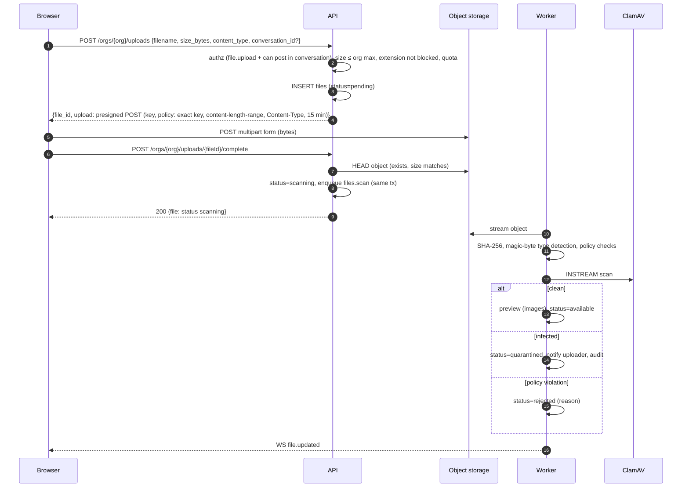
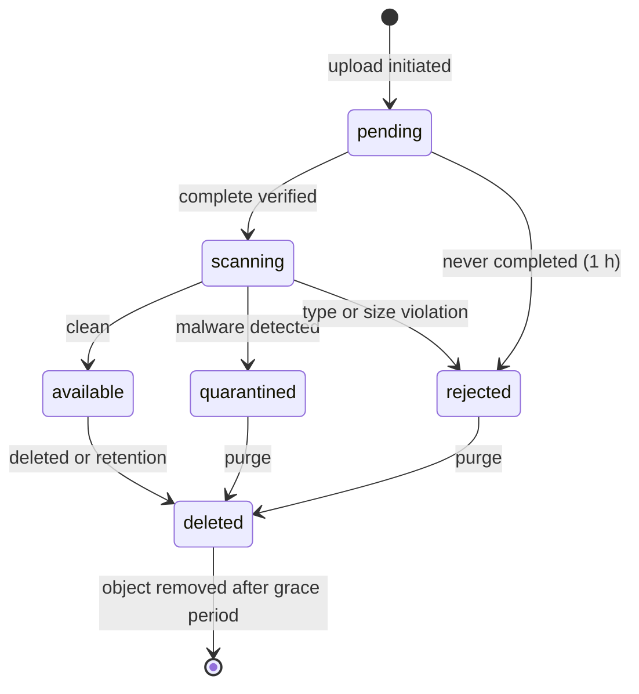

# Files and Object Storage

Status: Phase 0 proposal · Related: [ADR-010](DECISIONS.md#adr-010--object-storage--accepted), [ADR-015](DECISIONS.md#adr-015--malware-scanning), [DATABASE.md §4.5](DATABASE.md#45-files)

---

## 1. Principles

1. **Binaries never enter PostgreSQL.** PostgreSQL stores metadata, state and access context; bytes live in S3-compatible object storage.
2. **The browser talks to storage directly** using short-lived presigned requests; the API never proxies large uploads or downloads.
3. **Nothing is downloadable until it is verified**: size, type, checksum and malware scan.
4. **Access is derived from where a file is shared**, checked on every download, and never encoded in guessable URLs.
5. **User content is served from a separate origin** with download-safe headers.

---

## 2. Storage abstraction

```go
type ObjectStore interface {
    PresignUpload(ctx context.Context, key string, c UploadConstraints) (PresignedRequest, error) // POST policy (preferred) or PUT
    PresignDownload(ctx context.Context, key string, o DownloadOptions) (url.URL, error)          // GET with response headers
    Head(ctx context.Context, key string) (ObjectInfo, error)
    Open(ctx context.Context, key string) (io.ReadCloser, error)                                  // streaming read for workers
    Put(ctx context.Context, key string, r io.Reader, o PutOptions) error                       // previews, processed avatars
    Delete(ctx context.Context, keys ...string) error
}
```

Implementation: AWS SDK for Go v2 (`service/s3` + presign), path-style addressing configurable, works with MinIO locally and any S3-compatible provider in production.

**Presigning gotcha:** SigV4 signatures include the host. The API reaches storage at an internal address (`http://minio:9000`) but browsers need a public one (`http://localhost:9000` locally; in production a host on a **separate registrable domain** such as `https://files.<content-domain>`, see §6). A second S3 client configured with `MC_S3_PUBLIC_ENDPOINT` is used **only for presigning**.

### Object key layout (single bucket)

| Prefix | Content |
|---|---|
| `orgs/{orgId}/files/{fileId}/original` | Uploaded bytes |
| `orgs/{orgId}/files/{fileId}/preview` | Generated preview/thumbnail |
| `orgs/{orgId}/branding/logo-{version}` | Processed organisation logo |
| `users/{userId}/avatar-{version}-{size}` | Processed avatars (64, 256 px) |
| `orgs/{orgId}/exports/{jobId}` | Audit/data exports (expire after 7 days) |
| `tmp/{uploadId}` | Raw avatar/logo uploads before processing (lifecycle-expired after 1 day) |

Keys are generated server-side from IDs. Original filenames never appear in keys.

---

## 3. Upload flow



* The message referencing the file can be sent immediately; its attachment shows "Scanning…" until `file.updated` arrives, and downloads are refused until `available`.
* Uploads not completed within 1 hour are marked `rejected` and their objects deleted by cleanup.
* Multipart (resumable) uploads for very large files are a later enhancement; V1 limits (≤ 100 MB) fit single requests.

### File states



---

## 4. Validation

| Check | Where | Rule |
|---|---|---|
| Size | API (declared), storage policy (enforced), worker (actual) | ≤ organisation `files.max_upload_mb` (25/50/100) and ≤ platform cap (100 MB in V1); declared = actual |
| Quota | API at initiation | Organisation storage counter (maintained on complete/delete) below quota |
| Extension | API | Organisation block-list (default `exe, bat, cmd, com, scr, msi, ps1, vbs, js, jar, dll, sh`) — case-insensitive, checks every dot segment |
| Content type | Worker | Magic-byte detection; executables, scripts and HTML disguised under other extensions are rejected; detected type is stored and used for serving |
| Filename | API | Unicode-normalised (NFC); strip control and bidirectional-override characters, path separators and leading dots; max 255 chars |
| Images | Worker | Bounded decoding (≤ 50 megapixels, ≤ 20 frames); previews re-encoded (strips embedded payloads and metadata such as GPS) |
| Archives | ClamAV | Scanner limits on recursion depth, file count and expanded size; exceeding limits = rejected |
| Checksum | Worker | SHA-256 stored; optional client-supplied checksum must match |

---

## 5. Malware scanning

* ClamAV `clamd` via TCP `INSTREAM`, behind a `Scanner` interface (ADR-015).
* **Production fails closed:** if the scanner is unavailable the job retries with backoff (8 attempts); files remain `scanning` and are not downloadable; after exhaustion they become `rejected` with reason `scan_unavailable` and operators are alerted.
* Signatures are updated by `freshclam` in the ClamAV container; signature age is exported as a metric and alerted if older than 48 h.
* Local development defaults to the `noop` scanner (files marked "Not scanned — development") with an optional `scan` Compose profile running ClamAV; the EICAR test string verifies detection end to end.
* Infected files: status `quarantined`, object deleted after 7 days (kept for incident review), uploader notified, audit event `file.quarantined`.

---

## 6. Downloads and previews

* `GET /orgs/{org}/files/{id}/download` → authorization → `302` to a presigned GET valid for **60 seconds**, with:
  * `response-content-disposition: attachment; filename*=UTF-8''<encoded name>`
  * `response-content-type: <detected type>` (or `application/octet-stream` for anything not on the safe list)
* `GET /orgs/{org}/files/{id}/preview` → inline only for safe types: PNG, JPEG, GIF, WebP, MP4/WebM video, MP3/OGG/WAV audio, and PDF (rendered by the browser's viewer from the storage origin). **SVG, HTML, XML and Office documents are never inline**; text files are previewed by the app as escaped text (first 256 KB).
* User content is served from a **different registrable domain** than the app in production (e.g. `files.<content-domain>` or the storage provider's own domain — never a subdomain of the app's domain), so a malicious file can never run script on, or share cookies with, the application origin. Storage responses include `X-Content-Type-Options: nosniff` where the provider supports it.
* Avatars and organisation logos (small, frequent, already re-encoded by the worker) are streamed through the API with immutable caching keyed by version: `GET /api/v1/avatars/{userId}/{version}` (the caller must share at least one active organisation with that user; guests only with users who share a Space) and `GET /api/v1/orgs/{org}/logo/{version}` (organisation members).

---

## 7. Access policy

A user may view or download file *F* in organisation *O* when *F* is `available`, not deleted, and **any** of:

1. the user uploaded *F* (this includes files with no context yet — uploaded from the Files page or staged for a support request — which only the uploader can see until they are attached somewhere);
2. *F* is attached to a non-deleted message in a conversation the user can read, using the single read predicate in [MULTITENANCY.md §3.4](MULTITENANCY.md#34-resource-rules) (active member; or, for a public channel, member of its Space);
3. *F* is attached to a support request the user can see (the requester).

Guests additionally require the organisation's `files.guest_file_access` and see only files in their granted Spaces. Removing access to a conversation removes access to its files. Listing endpoints apply the same rule:

| View | Contents |
|---|---|
| Recent | Accessible files, newest first |
| Shared with me | Accessible files uploaded by others |
| Space files | Files attached in channels the user can read, grouped by Space (optionally one Space) |
| Conversation Files tab | Files attached in that conversation |
| My uploads | Files the user uploaded, including unattached ones |

Rename/delete: uploader; delete any: organisation Owner/Admin (audit-logged).

---

## 8. Deletion and retention

| Event | Effect |
|---|---|
| File deleted by user/admin | `deleted_at` set, status `deleted`, attachments show "File removed"; object deleted after a 7-day grace period by `files.purge_deleted` |
| Message deleted | Its attachments are unlinked; files no longer attached anywhere are soft-deleted |
| Organisation retention (`files.retention`) | Nightly purge of files older than the policy |
| Organisation deleted | All objects under `orgs/{orgId}/` purged after the deletion window |
| Incomplete uploads | Rejected after 1 h; bucket lifecycle aborts incomplete multipart uploads after 1 day |

---

## 9. Encryption

* In transit: HTTPS to storage (production); presigned URLs are single-object and short-lived.
* At rest: provider-side encryption (SSE-S3 or SSE-KMS) required in production; local MinIO runs unencrypted for development.
* Client-side encryption is out of V1 scope.

---

## 10. Local development (MinIO)

* MinIO's upstream repository is archived; local development uses the **last published community image, pinned by digest**, bound to `127.0.0.1` only. See [ADR-010](DECISIONS.md#adr-010--object-storage--accepted).
* `mcctl storage init` creates the bucket, lifecycle rules and (on providers that support it) bucket CORS limited to `MC_PUBLIC_URL`. MinIO uses its server-wide CORS setting, configured in Compose to the local app origin.
* Console (port 9001) is available for inspection; features of the community console were reduced in 2025 and are not relied upon.

---

## 11. Production storage options (decision pending)

| Option | Notes |
|---|---|
| Managed S3-compatible (AWS S3, Cloudflare R2, Backblaze B2, Wasabi) | Least operational burden; check data-residency needs |
| Self-hosted maintained alternative (SeaweedFS, Garage, Ceph RGW) | For on-premises/sovereign deployments; validate S3 feature coverage (presigned POST, lifecycle, CORS) |
| MinIO AIStor (commercial) | Supported successor to MinIO community edition |

The application is identical across options; only `MC_S3_*` settings and `mcctl storage init` behaviour differ.
