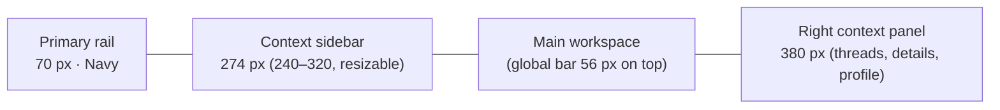

# Frontend Architecture

Status: Foundation implemented (tokens, primitives, shell, theming; see §15) · Related: [PHASE-0-AUDIT.md](PHASE-0-AUDIT.md), [BRANDING-ASSETS.md](../BRANDING-ASSETS.md), [ADR-007](DECISIONS.md#adr-007--nextjs-is-ui-only), [ADR-008](DECISIONS.md#adr-008--brand-accent-violet-replaces-prototype-blue--accepted), [ADR-009](DECISIONS.md#adr-009--typography)

The production web app must **faithfully preserve the approved MateCollab-UI visual language** — adaptive three-panel layout, premium restrained styling, light and dark parity — while replacing the prototype's simulation internals with production architecture.

---

## 1. Stack

| Concern | Choice |
|---|---|
| Framework | Next.js 16 (App Router, Node runtime, `output: "standalone"`), React 19, TypeScript strict |
| Styling | Tailwind CSS 4 with CSS-variable design tokens (`packages/ui/tokens`); component variants via `class-variance-authority` |
| Primitives | Radix UI in the shadcn pattern, owned in `packages/ui` (no runtime dependency on a component vendor) |
| Icons | lucide-react (as prototype) |
| Server state | TanStack Query v5 (infinite queries for timelines) |
| UI state | Zustand (shell, call UI, drafts) + URL search params for panels/tabs |
| Forms | react-hook-form + zod (UX validation; the API is authoritative) |
| Long lists | TanStack Virtual (message timelines, member lists, files) |
| Command palette, toasts | cmdk, sonner |
| Media | `livekit-client`, `@livekit/components-react` (hooks only) |
| i18n | next-intl; strings externalised from Phase 1; `en-GB` first |
| Dates | `Intl` APIs + date-fns; user time zone from profile |
| API types | Generated from OpenAPI (`openapi-typescript`) + a thin typed fetch client |

## 2. Rendering model

* Next.js serves the HTML shell and route code; **all data comes from the Go API** at the same origin (`/api/v1`), fetched by the browser. There are no Next.js route handlers, server actions or BFF layers with business logic (ADR-007).
* Public pages (login, reset, invitation) render server-side for speed; the authenticated app is client-rendered inside a server-rendered shell.
* `proxy.ts` (Next.js 16's request interception, formerly `middleware.ts`): generates a per-request CSP nonce and security headers, and redirects to `/login` when the session cookie is absent (presence check only — validation is the API's job). Pages using nonces render dynamically.
* Runtime configuration comes from `GET /api/v1/config`, so one image serves all environments.

## 3. Application structure

```
apps/web/
├─ app/
│  ├─ layout.tsx                         # <html>, Inter, theme bootstrap (nonce), providers
│  ├─ (public)/login, login/mfa, forgot-password, reset-password,
│  │            verify-email, invite          # one-time tokens read from the URL fragment (#token=…),
│  │                                          # POSTed in the body; pages send Referrer-Policy: no-referrer
│  ├─ (app)/select-organisation
│  └─ (app)/[org]/                       # [org] = organisation slug
│     ├─ layout.tsx                      # AppShell + realtime provider + call provider
│     ├─ home/
│     ├─ chats/[[...conversationId]]/
│     ├─ spaces/                         # browse
│     ├─ spaces/[spaceId]/               # overview (tabs via ?tab=)
│     ├─ spaces/[spaceId]/channels/[conversationId]/
│     ├─ meetings/, meetings/[meetingId]/
│     ├─ call/[meetingId]/               # full-screen pre-join → stage
│     ├─ files/, files/[fileId]/         # preview as intercepting modal route
│     ├─ activity/, actions/, saved/
│     ├─ support/, support/[requestId]/
│     ├─ settings/[section]/
│     └─ admin/[...section]/             # incl. integrations/smtp, integrations/helpdesk
├─ proxy.ts
├─ src/
│  ├─ features/<area>/{components,hooks,api,state}   # messaging, spaces, meetings, files, …
│  ├─ lib/{api,realtime,livekit,markup,time,i18n}
│  └─ providers/
└─ public/brand/                          # synced from MateCollab-Logo-Library (hash-verified)
packages/ui/                              # tokens + primitives + Storybook
packages/contracts/                       # OpenAPI + event schemas + generated TS
```

### URL design (replaces hash routes)

| Prototype | Production |
|---|---|
| `#/home` | `/{org}/home` |
| `#/chats/dm-shahbaj` | `/{org}/chats/{conversationId}` |
| `#/spaces/browse` | `/{org}/spaces` |
| `#/spaces/engineering` | `/{org}/spaces/{spaceId}?tab=overview` |
| `#/spaces/eng-general` | `/{org}/spaces/{spaceId}/channels/{conversationId}` |
| Thread panel | `?thread={messageId}` on any conversation URL; `?message={id}` deep-links and highlights |
| `#/meetings/Upcoming` | `/{org}/meetings?view=upcoming` |
| `#/files/Recent` | `/{org}/files?view=recent` |
| `#/support` | `/{org}/support`, `/{org}/support/{requestId}` |
| `#/settings/Profile` | `/{org}/settings/profile` |
| `#/admin/Integrations/SMTP` | `/{org}/admin/integrations/smtp` |
| `#/login` | `/login` → `/select-organisation` |
| `#/brand`, `#/prototype` | Not shipped — Storybook |

## 4. Shell layout (from the prototype, normative)



| Element | Spec |
|---|---|
| Primary rail | 70 px, `--rail` (Library Navy `#101A2D`); brand button (white Library mark, 28 px); six modules with icon + 11 px label (Home, Chats, Spaces, Meetings, Files, Activity); active item: tinted background + 3 × 24 px violet indicator; bottom: Help, Settings, avatar/presence menu |
| Context sidebar | 274 px default, drag-resizable 240–320 px, keyboard resizable with ←/→ (±10 px) on a focusable separator; width persisted per user; header = organisation switcher; content varies by module (Chats filters, Space tree, settings sections, admin sections, meeting/file views, activity filters); footer = connection status + small lockup |
| Global bar | 56 px: collapse toggle, breadcrumb (organisation › module), search trigger (⌘/Ctrl K), quick-create (+), notifications |
| Main workspace | Pages max 1500 px with padding 35/38 px (52 px ≥ 1650 px; 28 px ≤ 1320 px; 30 px ≤ 1100 px; 24/20 px mobile); conversation view is full-bleed |
| Right panel | 380 px; ≥ 1400 px it pushes the workspace; below it overlays (non-modal); 370 px ≤ 1100 px; full-screen ≤ 760 px |
| Floating call | Minimised call/huddle card that survives navigation |

| Breakpoint | Behaviour |
|---|---|
| ≥ 1650 px | Wider page padding; Home aside 330 px |
| ≥ 1400 px | Right panel docks beside content |
| ≤ 1320 px | Compact desktop: tighter paddings, breadcrumb trimmed |
| ≤ 1100 px | Context sidebar becomes a left drawer (85 %, max 300 px) |
| ≤ 760 px | Mobile: rail becomes a 62 px bottom navigation; global bar 53 px; panels full-screen; modals full-width |

## 5. Design tokens

Tokens are CSS custom properties in `packages/ui/tokens/*.css`, mapped into Tailwind via `@theme`. Components use semantic tokens only; raw hex values are lint errors outside the token files. `[data-theme="dark"]` swaps values.

### Colour tokens

Brand values come from the Logo Library; neutrals come from the prototype and were adjusted only where WCAG AA contrast failed. The implemented set lives in `packages/ui/src/styles/theme.css`; `packages/ui/test/tokens.test.ts` re-checks every text pairing (4.5:1) and control boundary (3:1) in both themes, and axe checks every Storybook story in both themes.

| Token | Light | Dark | Use / contrast |
|---|---|---|---|
| `--brand-violet` | `#7047D1` | `#7047D1` | Library primary |
| `--brand-navy` | `#101A2D` | `#101A2D` | Library navy |
| `--bg` | `#FFFFFF` | `#171E29` | App background |
| `--surface` | `#FAFBFD` | `#1A2230` | Hover rows, quiet surfaces |
| `--card` / `--popover` | `#FFFFFF` | `#1D2633` / `#202A39` | Cards, menus |
| `--sidebar` | `#F7F8FA` | `#1B2330` | Context sidebar |
| `--rail` | `#101A2D` | `#101A2D` | Primary rail (prototype `#142236`/`#101722`) |
| `--muted` / `--subtle` | `#F3F5F8` / `#F0F3F8` | `#242E3D` / `#222D3E` | Fills |
| `--fg` | `#253248` | `#DDE4EF` | Text — 12.9:1 / 13.1:1 |
| `--fg-muted` | `#667185` | `#95A2B5` | Secondary text — ≥ 4.6:1 on bg and sidebar (prototype `#778294` was 3.9:1) |
| `--border` | `#E5E9EF` | `#303A49` | Decorative dividers and card outlines |
| `--border-control` | `#8A95A7` | `#66758C` | Inputs, selects, checkboxes, radios, composer — **decided: 3:1** against the page (3.03:1 / 3.58:1) so form fields are identifiable without relying on placeholder text (WCAG 1.4.11) |
| `--primary` | `#7047D1` | `#7047D1` | Primary buttons and send — white text 5.98:1 (a labelled button is identified by its text; the fill itself needs no 3:1 against the page) |
| `--primary-hover` | `#5E37BD` | `#7B55DB` | Hover — white text 7.6:1 / 5.0:1 |
| `--primary-control` | `#7047D1` | `#8A66EC` | Fills whose colour *is* the state (switch on, checkbox checked, selected radio) — ≥ 3:1 against the surface and against the white thumb (light 5.98:1; dark 4.1:1 and 4.0:1) |
| `--primary-ink` | `#5A35B8` | `#A48AF0` | Links, active tab/nav text — 6.9:1 on accent / 5.96:1 on dark bg |
| `--accent` | `#F1ECFC` | `#2B2547` | Selected rows, active nav, mention highlight |
| `--focus-ring` | `#7047D1` | `#A48AF0` | 2 px outline, 3 px offset |
| `--rail-fg` / `--rail-fg-active` / `--rail-indicator` | `#9DAEC5` / `#C9B8F5` / `#9A7BEB` | same | 7.7:1 / 9.7:1 / 5.3:1 on Navy (raw Violet on Navy is only 2.9:1) |
| `--danger` | `#C64545` | `#EE9A9A` | Destructive text and buttons — 4.8:1 on white / 7.8:1 on dark bg |
| `--danger-badge-fg` / `--danger-badge-bg` | `#A33F3F` / `#F9E9E9` | `#EEAAAA` / `#452E33` | Red badges — 5.4:1 / 6.5:1 (prototype `#B34C4C` was 4.4:1) |
| `--success` (also on `--success-bg` `#E9F5EF`) | `#1F7A5C` | `#88D6B6` | Success text and badges — 5.3:1 on white, 4.7:1 on badge bg (prototype `#248766` was 4.4:1 / 4.0:1) |
| `--warning-fg` / `--warning-bg` | `#8A5B1E` / `#FAF1DF` | `#E1B774` / `#413522` | Amber badges — 5.2:1 / 6.4:1 (prototype light pair `#9C6A28` was 4.15:1) |
| Presence | available `#2E9775`, busy `#CF615C`, away `#C89639`, dnd `#CC5656`, offline `#9CA7B6` | same | Dots always paired with text labels/tooltips |
| `--shadow-popover` | `0 12px 40px rgb(16 26 45 / 9%)` | `0 12px 40px rgb(0 0 0 / 33%)` | Menus, modals |

### Shape, type, spacing, motion

| Token | Value |
|---|---|
| Radius — tooltip, badge, kbd | **4 px** |
| Radius — input, select, button, card, menu, file tile, composer | **6 px** (prototype buttons were 5 px) |
| Radius — modal, sheet | **8 px** |
| Radius — avatars, presence dots | full circle (only round elements) |
| Font | Inter variable, self-hosted from `@fontsource-variable/inter` (same files for the app and Storybook, served from the app origin), fallback `system-ui, -apple-system, "Segoe UI", Roboto, Arial, sans-serif`; tabular figures for times and counts |
| Type scale | 11 (minimum), 12, 13, 14 (body), 15, 16, 18, 19, 28 px (32 px Home title ≥ 1650 px); weights 400–650 (750 for org initials) |
| Heading style | Weight 650, tight tracking (−0.7 px at 28 px) as prototype |
| Spacing | 4 px scale with 2 px half-steps; prototype values rounded to the nearest step (≤ 1 px change) and verified by visual regression |
| Control heights | Buttons 35 px (31 px compact), icon buttons 30 px, inputs 38 px, tabs 46 px, sidebar items 36 px |
| Motion | 140 ms colour/opacity transitions; no bouncy easing; `prefers-reduced-motion` and the in-app "Reduce motion" setting disable non-essential animation |
| Z-index | rail 30 · sidebar resize 25 · right panel 40 · floating call 45 · mobile panels 50 · modal 60 · toast 70 · tooltip 80 |

Avoid: pill-shaped buttons, large radii, heavy shadows, gradients, generic dashboard styling.

## 6. Typography and brand

* UI text is **never** HemiHead. The wordmark appears only through `<BrandLockup>` / `<BrandMark>` components that render Library SVG files unchanged and pick the light or dark variant by theme ([BRANDING-ASSETS.md §5](../BRANDING-ASSETS.md#5-production-usage-map)).
* The rail shows the white Library mark on Navy; login and sidebar footer use `MateCollab-transparent.svg` (light) or `MateCollab-white.svg` (dark).
* Organisation avatars use the organisation initial (as in the prototype), never the MateCollab mark.

## 7. Theming

* Preferences: Light, Dark, System; density Comfortable/Compact; text size 16/18/20 (root font size; everything in `rem`); reduced motion; "always show message actions".
* Server-persisted in `user_preferences`, mirrored in a `mc_theme` cookie so the server renders the correct `data-theme` (`light`, `dark` or `system`). *Implemented without any script:* every colour token is a CSS `light-dark()` pair and `data-theme` only sets `color-scheme`, so "System" follows the OS in pure CSS before first paint (tokens use Tailwind `@theme inline` so nested `data-theme` scopes, such as theme previews, also resolve correctly). Until accounts exist, the cookie is the only store.
* `color-scheme` is set per theme so native controls and scrollbars match.

## 8. Component inventory

**`packages/ui` primitives:** Button (primary, secondary, ghost, danger), IconButton (tooltip required), Input, Textarea, Select, Combobox, Checkbox, Switch, RadioGroup, Tabs (underline), DropdownMenu, ContextMenu, Dialog (520/680 px), AlertDialog (destructive confirmations), Sheet/Drawer, Tooltip, Popover, Badge (neutral/brand/success/warning/danger), Avatar (+presence, initials tones), AvatarGroup, Kbd, EmptyState, Skeleton, Spinner, Toast, Field (label/hint/error), SettingRow, Table, Progress, ScrollArea, ResizeHandle, CommandPalette, VisuallyHidden, BrandMark, BrandLockup.

**`apps/web` features:** AppShell, PrimaryRail, ContextSidebar (per module), GlobalBar, OrgSwitcher, ConversationHeader/Tabs, MessageList (virtualised, date dividers, "New messages" divider from read cursor), MessageRow (toolbar, reactions, thread link, attachments, quote, edited/pinned/saved markers, tombstones), Composer (attachments, emoji, mention autocomplete, formatting, quote bar, Enter/Shift+Enter, drafts, failed-send retry), ThreadPanel, DetailsPanel, ProfilePanel, FileTile/FileViewer, SpaceTree, SpaceOverview, MeetingList/Detail/Schedule, PreJoin, MeetingStage (grid/speaker/share), FloatingCall, HuddleBanner, ActivityList, SearchPalette, ActionList, SupportRequestDialog (context selector + server preview), SupportRequestPage, Settings and Admin sections, the 15 state patterns.

## 9. Data and realtime in the client

* **Query keys** are scoped by organisation: `["org", orgId, "conversation", id, "messages"]`, etc. Switching organisation clears that scope.
* **Timelines** are infinite queries paged by `seq` (threads by `thread_seq`); realtime events are applied by a single event reducer that patches query caches (place by `seq`/`thread_seq`, apply `version`-guarded updates, reaction count snapshots) and tracks each loaded conversation's `last_change_seq`; any gap triggers a change-feed fetch — see [REALTIME.md §6](REALTIME.md#6-client-convergence).
* **Optimistic sends** with `client_msg_id`; failed sends persist locally with Retry/Delete.
* **One WebSocket per tab per organisation** (`lib/realtime`): ticket → connect → hello; backoff with jitter; visibility-aware resync; presence subscriptions limited to visible users.
* **Unread and badges** come from `unread.updated` and conversation summaries; the document title shows the unread count.
* **Desktop notifications** use the Notification API with the user's preferences, DND and quiet hours, and never show content for muted conversations.

## 10. Message markup

MateCollab markup v1 (stored as text in `messages.body`, rendered by `lib/markup` into React elements — no HTML injection, no `dangerouslySetInnerHTML`):

| Syntax | Result |
|---|---|
| `**bold**`, `_italic_`, `~~strike~~`, `` `code` `` | Inline styles (the prototype composer already inserts `**…**` and `_…_`) |
| ```` ```code block``` ```` | Monospace block, no execution, optional language label |
| `> quote` | Block quote |
| `- item`, `1. item` | Lists |
| Bare `https://`, `http://`, `mailto:` URLs | Auto-links (`rel="noopener noreferrer"`, `target="_blank"`); other schemes rendered as text. Custom link labels are not supported in V1 (phishing resistance). |
| `<@user-id>` | Mention chip with current display name (or "Unknown user" if not visible) |
| `<#conversation-id>` | Channel link (only if visible to the reader) |
| `<!channel>`, `<!here>` | Broadcast mentions (confirmation prompt when > 25 members) |

Emoji shortcodes (`:thumbsup:`) are converted to Unicode in the composer. Max 40,000 characters.

## 11. Accessibility (WCAG 2.2 AA)

* Minimum rendered text 11 px (the prototype used 6–10 px in places); contrast tokens as above; focus always visible.
* Keyboard: ⌘/Ctrl K search; Esc closes panels and dialogs; Enter sends, Shift+Enter new line; arrow keys within menus, lists and the sidebar separator; Tab order follows rail → sidebar → main → panel.
* Message list is a `role="log"` region with polite live announcements (throttled) for new messages in the focused conversation.
* Every icon-only button has an accessible name and tooltip (the prototype already does this well).
* Dialogs trap focus and restore it; the right panel is a labelled complementary region.
* Targets ≥ 24 × 24 px (2.2 minimum); 32–44 px on touch layouts.
* Automated axe checks in Playwright for every main screen in both themes ([TESTING.md](../development/TESTING.md#frontend-tests)).

## 12. Performance budgets

| Metric | Budget |
|---|---|
| Shell JavaScript (gzip, excluding call routes) | ≤ 200 KB |
| LCP (authenticated Home, mid-range laptop) | < 2.5 s |
| Conversation switch (cached) | < 150 ms |
| Timeline scroll | 60 fps with 10,000 loaded messages (virtualised) |
| LiveKit SDK | Loaded only on call routes / when a call starts |

## 13. Frontend security

* No tokens in `localStorage` or JavaScript-readable cookies; the session cookie is `HttpOnly`.
* All mutating requests send `X-CSRF-Token`; the fetch client adds it automatically.
* Strict CSP with nonces (see [SECURITY-BASELINE.md](../security/SECURITY-BASELINE.md#11-http-security-headers)); no inline event handlers; no `eval`.
* User content is rendered as text through React; files open from the storage origin; SVG/HTML never inline.
* Drafts and failed messages in `localStorage` are cleared on sign-out; nothing else sensitive is stored client-side.

## 14. Prototype → production mapping

| Prototype | Production |
|---|---|
| `store.tsx` single context + `useStored` | TanStack Query + Zustand + URL state; nothing business-critical in `localStorage` |
| `ui.tsx` `Btn`, `IconBtn`, `Modal`, `Pick`, `Toggle`, `Blank` | `packages/ui` primitives with tokens |
| `app.tsx` shell | `(app)/[org]/layout.tsx` AppShell |
| `messaging.tsx` `renderText` regex | `lib/markup` parser with ID-based mentions |
| `meeting.tsx` simulated stage | LiveKit-backed stage with the same layouts and controls |
| `overlays.tsx` monolithic overlay switch | Feature dialogs + intercepting routes for shareable modals |
| `settings.tsx` local-only settings | API-backed settings with optimistic updates and audit |
| Prototype states page | Storybook stories (visual regression baseline) |
| `webmcp.ts` | Not in V1 |

## 15. Implementation status (production foundation)

| Area | Implemented | Notes |
|---|---|---|
| Tokens | `packages/ui/src/styles/theme.css` | Tailwind 4 `@theme inline`; default palette, radii, type scale and breakpoints are replaced so only semantic tokens exist. Extra tokens beyond §5: `fg-nav`, `icon-muted`, `nav-count(-fg)`, `accent-strong(-fg)`, `org(-line/-fg)`, `tone-1…5(-fg)` (avatar initials, ≥ 4.6:1 both themes), `switch-off`, `tooltip(-fg)`, `rail-hover`, `rail-line`, `overlay`. Breakpoint variants: `max-phone` (≤ 760), `max-tablet` (≤ 1100), `max-compact` (≤ 1320), `dock` (≥ 1400), `wide` (≥ 1650). A lint rule rejects hex literals in TS/TSX outside the token file |
| Primitives | `packages/ui/src/components` | Button, IconButton (label required, tooltip), Tooltip, Field (label/hint/error wiring for every control), Input, Textarea, Select, Checkbox, RadioGroup, RadioCard, Switch, ChoiceLabel, Avatar (+ presence, tones), AvatarGroup, PresenceDot, Badge, Kbd, NavCount, DropdownMenu, ContextMenu, Tabs, Dialog, ConfirmDialog, Drawer, Toast/Toaster, EmptyState, Skeleton, Spinner, Progress, SearchTrigger (⌘/Ctrl K), ResizeHandle, BrandMark, BrandLockup, VisuallyHidden. Combobox, Popover, Table, ScrollArea and CommandPalette arrive with their first feature |
| Shell | `packages/ui/src/shell` + `apps/web/src/components/shell` | `AppFrame` (rail, resizable sidebar with keyboard separator, global bar, right `ContextPanel`, tablet/phone drawer, phone bottom navigation, skip link), `Rail`/`RailItem`, `GlobalBar`/`Breadcrumb`, `Sidebar`/`SidebarItem`/`OrgSwitcherButton`, `Page`/`PageHeader`/`SectionTitle`. The web app composes them with routes; panels use `?panel=` (Help panel today) |
| State patterns | `packages/ui/src/patterns/state-patterns.tsx` | The prototype's fifteen interaction-review states as one component and catalogue |
| Theming | cookie `mc_theme` + `light-dark()` | Settings → Appearance switches immediately; sidebar width persists in `mc_sidebar_w` |
| Routes | `/home`, `/actions`, `/saved`, `/support`, `/chats`, `/spaces`, `/meetings?view=`, `/files?view=`, `/activity?type=`, `/settings/appearance` | Unscoped until organisations exist; they move under `/{org}/` with membership. Pages show honest empty states, no sample data |
| Storybook | `packages/ui` (`pnpm storybook`) | Light/Dark toolbar; every story is a visual baseline in both themes and is checked with axe (WCAG 2.2 AA) in a pinned Playwright container (`pnpm visual:test`) |
| Accessibility linting | axe (Storybook stories and app pages) | `eslint-plugin-jsx-a11y` does not support ESLint 10; rendered-markup checks with axe replace it |
| i18n | Not yet | Strings are inline in this foundation; next-intl and externalised strings arrive with the first product screens |

