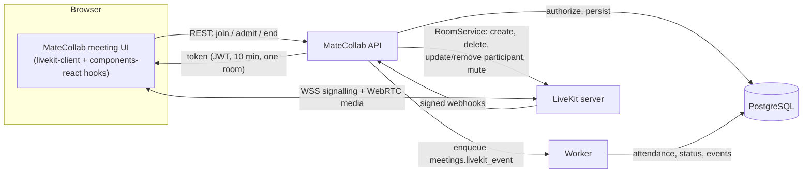
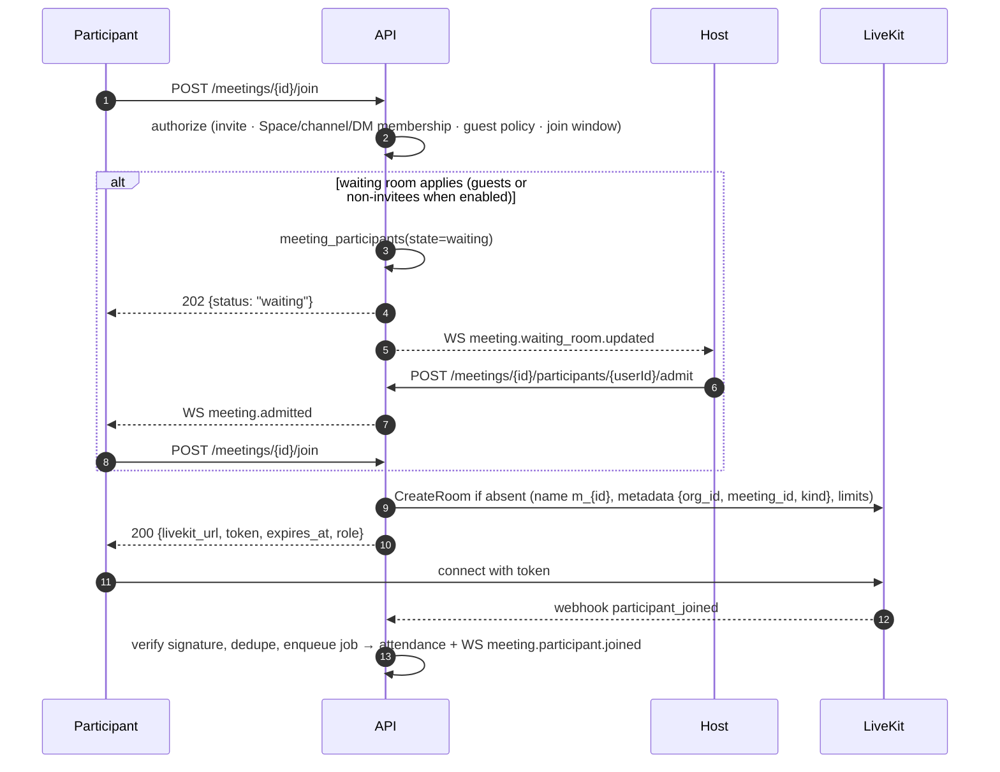

# Media Architecture — Calls, Huddles, Meetings (LiveKit)

Status: Phase 0 proposal · Related: [ADR-017](DECISIONS.md#adr-017--livekit-integration), [DATABASE.md §4.6](DATABASE.md#46-meetings), [API-DESIGN.md §9.6](../api/API-DESIGN.md#96-meetings-huddles-and-calls-phases-78)

MateCollab does **not** implement a WebRTC SFU. LiveKit moves media; MateCollab decides who may join, with which capabilities, and records what happened.

---

## 1. Responsibilities

| MateCollab owns | LiveKit owns |
|---|---|
| Meeting entities (scheduled, instant, huddle, call), invites, RSVP | WebRTC signalling and transport (UDP/TCP/TURN) |
| Authorization to join, roles (host, co-host, attendee), guest policy, waiting room | Selective forwarding of audio, video and screen share |
| Room creation/termination via the server API | Simulcast, adaptive stream, dynacast, congestion control |
| Token issuance with least-privilege grants | Enforcing grants carried by the token |
| Meeting chat (a MateCollab conversation), history and attendance | Participant/track state inside a live room |
| Host controls (admit, mute, remove, end for all) executed through the LiveKit server API | Delivering server-side mutes/removals to clients |
| Reminders, notifications, calendar data | — |

---

## 2. Architecture

---

## 3. Meeting kinds

| Kind | Started from | Chat lives in | Default capabilities | Status on creation | Ends when |
|---|---|---|---|---|---|
| `scheduled` | Meetings → Schedule (title, agenda, date/time/duration/timezone, Space, channel, invitees, guest access, waiting room) | Dedicated `meeting` conversation (members = invitees) | Audio, video, screen share (policy) | `scheduled` → `live` on `room_started` | Host ends for everyone, or the room stays empty for 5 min after the last participant leaves |
| `instant` | "Meet now" / "Start meeting" | Dedicated `meeting` conversation | Same as scheduled | `live` | Same |
| `huddle` | Channel header "Huddle" (one live huddle per channel) | Thread under the channel's "Huddle started" system message | Audio first; video and screen share allowed | `live` (so the one-live-huddle index blocks races) | 60 s after the last participant leaves |
| `call` | DM/group header audio or video button; rings participants | The DM/group itself | Audio, video (per mode), screen share | `live` (ringing state is in Redis) | 20 s after everyone leaves; unanswered after 45 s → "Missed call" |

**Rejoining after a room closed:** a scheduled meeting can be reopened (new LiveKit room session, status back to `live`) by any entitled participant until `starts_at + duration + 60 min`; attendance continues on the same meeting. Instant meetings and calls are final once ended. A new huddle in the same channel is a new meeting.

---

## 4. Join flow

* **No token without authorization.** A waiting participant receives nothing that can reach LiveKit until admitted.
* **Join window** for scheduled meetings: 15 minutes before start until the meeting ends; hosts can open the room at any time.
* **One identity per user per room:** LiveKit identity = MateCollab user ID. Joining from a second device replaces the first session (LiveKit's duplicate-identity behaviour) and the UI explains it.
* Names and avatars in the meeting UI are resolved from the MateCollab directory by identity, never from client-supplied participant names, so display names cannot be spoofed.

---

## 5. Tokens and grants

Tokens are LiveKit access tokens (JWT signed with the API secret), TTL **10 minutes** (only needed at connect; LiveKit refreshes the session internally).

| Grant | Host / co-host | Attendee | Guest attendee |
|---|---|---|---|
| `roomJoin`, `room = m_{meetingId}` | ✓ | ✓ | ✓ |
| `canSubscribe` | ✓ | ✓ | ✓ |
| `canPublish` sources | microphone, camera, screen_share, screen_share_audio | microphone, camera; screen share if `screen_share_policy = all` | as attendee, if organisation guest meeting access is on |
| `canPublishData` (reactions) | ✓ | ✓ | ✓ |
| `canUpdateOwnMetadata` | ✗ | ✗ | ✗ |
| `roomAdmin`, `roomCreate`, `roomList`, `recorder` | ✗ | ✗ | ✗ |
| Metadata (set by server) | `{"role":"host"}` | `{"role":"attendee"}` | `{"role":"attendee","guest":true}` |

Host powers are exercised **through the MateCollab API**, which calls LiveKit's RoomService (`MutePublishedTrack`, `RemoveParticipant`, `UpdateParticipant`, `DeleteRoom`) after checking the caller's meeting role. No browser ever holds an admin grant.

Raise hand is server-mediated (`PUT /meetings/{id}/hand {raised}` → participant attribute `hand_raised` via `UpdateParticipant`) so late joiners see consistent state. Emoji reactions are ephemeral LiveKit data messages.

---

## 6. Rooms

| Setting | Scheduled / instant | Huddle | Call |
|---|---|---|---|
| Name | `m_{meetingId}` | same | same |
| Creation | Explicit (`auto_create: false` on the server) | Explicit | Explicit |
| `empty_timeout` — room closes if **nobody ever joins** | 300 s | 60 s | 60 s (covers the 45 s ring) |
| `departure_timeout` — room closes this long **after the last participant leaves** | 300 s | 60 s | 20 s |
| `max_participants` (V1) | 100 | 50 | 25 |
| Metadata | `{org_id, meeting_id, kind}` | same | same |

"End meeting for everyone" calls `DeleteRoom`, which disconnects all participants; the resulting `room_finished` webhook closes the meeting record.

---

## 7. Webhooks

* Endpoint `POST /api/v1/webhooks/livekit`; LiveKit signs each request (JWT in `Authorization` containing the SHA-256 of the body), verified with `livekit/protocol`'s webhook receiver.
* Processing: verify → deduplicate by event ID (Redis `SET NX`, 24 h) → enqueue `meetings.livekit_event` (respond 200 quickly) → worker applies the event in a tenant transaction resolved from room metadata.
* Events handled: `room_started` (set `started_at`; scheduled meetings move to `live`), `room_finished` (status `ended`, `ended_at`, close open attendance rows, huddle system message "Huddle ended · 14 min · 3 people"), `participant_joined` / `participant_left` (attendance), `track_published` / `track_unpublished` for screen share (huddle banner indicator). Events may arrive out of order; handlers use event timestamps and are idempotent.
* A reconciliation job lists active rooms every 5 minutes and repairs meetings whose `room_finished` webhook was missed.

---

## 8. Huddles, calls and scheduling details

**Huddles.** `POST /conversations/{id}/huddle` returns the live huddle or creates one — inserted directly as `live`, so the `meetings_one_live_huddle` unique index makes a concurrent second start fail and return the existing huddle — posts the "Huddle started" system message (its thread holds huddle chat) and returns a join token. Channel members see the banner via `huddle.updated`. The minimised floating huddle card persists while navigating.

**Calls.** `POST /conversations/{id}/calls {mode}` creates a `call` meeting, sets a 45 s ringing key in Redis and emits `call.incoming` to other members. Answer → join; decline → `call.declined`; timeout → `call.missed` + "Missed call" system message in the DM/group.

**Scheduled meetings.** Times stored in UTC with the scheduling IANA time zone; reminders at `starts_at − 10 min` via scheduled jobs; updates/cancellations notify invitees. Recurrence is out of V1 scope. ICS calendar invitations by email are an optional Phase 8 deliverable (method `REQUEST`/`CANCEL`, UID = meeting ID).

**History.** Past meetings show participants and duration (from attendance), the chat conversation and shared files. Recording and AI summaries remain labelled as future features (LiveKit Egress/Agents) and will require consent indicators and retention policies before release.

---

## 9. Client design

* `livekit-client` with adaptive stream, dynacast and simulcast; `@livekit/components-react` used for hooks only, styled with MateCollab components (pre-join, stage, tiles, controls, panels from the prototype).
* The LiveKit `Room` lives in a provider in the organisation layout, so a call survives navigation and can be minimised into the floating card (prototype behaviour).
* Pre-join: real device enumeration and preview (`getUserMedia` requested only here), remembered device IDs (local), "join muted / camera off" defaults from preferences and organisation policy.
* Stage: grid, speaker and screen-share layouts; at most 16 video tiles rendered at once (pagination) to bound bandwidth and CPU.
* Reconnection: `Reconnecting` / `Reconnected` / `Disconnected` room events drive the prototype's connection-issue banner and recovery actions.
* Device and permission errors map to explicit states (blocked, not found, in use by another app).
* Background blur (client-side processors) is optional and off by default.

---

## 10. Deployment notes

| Port | Purpose |
|---|---|
| 7880/TCP | HTTP API + WebSocket signalling (behind TLS as `wss://rtc.<domain>` in production) |
| 7881/TCP | ICE over TCP fallback |
| 7882/UDP (dev) or 50000–60000/UDP (prod) | ICE/UDP media |
| 3478/UDP, 5349/TCP or 443/TLS | Embedded TURN for restrictive networks (production; needs a domain and certificate) |

* Single-node LiveKit is sufficient for V1; multi-node requires Redis (compatibility with Valkey to be verified — ADR-011).
* Production should run LiveKit on a host with a public IP and adequate bandwidth, separate from the API host when load grows.
* Local development uses `livekit-server` in dev mode with a single UDP port and `node_ip` set for Docker Desktop (see [LOCAL-DEVELOPMENT.md](../development/LOCAL-DEVELOPMENT.md#7-livekit)). No real TURN, domain or certificates are configured in Phase 0.

---

## 11. Security summary

* Tokens are minted only by the API after authorization, scoped to one room, short-lived, without admin grants.
* Room names are opaque; rooms cannot be auto-created by clients.
* Webhooks are signature-verified, deduplicated and processed asynchronously.
* API key/secret are deployment secrets; rotation supported by configuring two keys during transition.
* Media is encrypted in transit (DTLS-SRTP). End-to-end media encryption (LiveKit E2EE) is out of V1 scope and would disable server-side features such as future recording.
