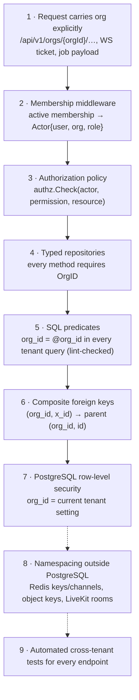

# Multi-Tenancy and RBAC

Status: Phase 0 proposal · Related: [ADR-002](DECISIONS.md#adr-002--tenant-isolation-in-depth), [DATABASE.md](DATABASE.md), [SECURITY-BASELINE.md](../security/SECURITY-BASELINE.md)

---

## 1. Tenant model

| Concept | Definition |
|---|---|
| **Organisation** | The tenant. Owns all collaboration data: spaces, conversations, messages, files, meetings, action items, support requests, integrations, settings, audit logs. |
| **User** | A global identity (credentials, sessions, profile name, avatar, timezone). A user can belong to several organisations. |
| **Membership** | The link between a user and an organisation, carrying the **organisation role** (Owner, Admin, Member, Guest), status, and job title. All tenant data references members through `(org_id, user_id)`. |
| **Guest** | A membership with role `guest` that can access only explicitly granted Spaces. |

Rules:

* Tenant data never crosses organisations. A DM, file, meeting or support request belongs to exactly one organisation. A user who belongs to two organisations has two separate conversation sets.
* There is no implicit "current organisation" stored server-side. The organisation is part of every tenant request (URL path for REST, ticket binding for WebSocket, job payload for background work).

---

## 2. Isolation layers



The layers protect against different failure classes, so one defect alone should not expose another organisation's data:

* Layers 1–3 decide **which tenant** a request acts for and whether the actor may act. A mistake here (wrong organisation resolved) is caught by the membership check and the cross-tenant test suite (layer 9).
* Layers 4–7 protect against **query and data-integrity mistakes** once the tenant is known: a missing `WHERE`, a wrong join, a row pointing at another tenant. They are independent of each other, but they all trust the tenant resolved by layers 1–2 — they are not a defence against that resolution being wrong.
* Row-level security is a **backstop for application query bugs**, not a security boundary against someone who can run arbitrary SQL as `mc_app` or as an operator: the tenant setting is a session variable that any such session could set. SQL injection is prevented separately (sqlc-generated parameterised queries only), and operator access is controlled operationally (§2.5).

### 2.1 Request → tenant context

1. `session` middleware resolves the cookie to a user (cached).
2. `orgcontext` middleware parses `{orgId}` from the path, loads the membership `(orgId, userId)` (Redis cache, 60 s TTL, invalidated on any membership change) and rejects with **404** if there is no active membership (indistinguishable from a non-existent organisation).
3. The handler receives an `Actor` (`UserID`, `OrgID`, `Role`, `SessionID`, `IsGuest`) via `context.Context`.
4. The service opens a transaction with `db.InTenantTx(ctx, actor, fn)`, which first executes:

```sql
SELECT set_config('mc.org_id',  $1, true),   -- true = transaction-local
       set_config('mc.user_id', $2, true);
```

Transaction-local settings cannot leak to the next request that borrows the pooled connection.

### 2.2 Typed repository API (layer 4)

```go
// Every tenant repository method takes the tenant explicitly; there is no "global" variant.
type SpaceRepo interface {
    Get(ctx context.Context, tx pgx.Tx, org tenant.OrgID, id SpaceID) (Space, error)
    ListVisible(ctx context.Context, tx pgx.Tx, org tenant.OrgID, viewer tenant.UserID, page Page) ([]Space, Cursor, error)
}
```

`tenant.OrgID` is a distinct type constructed only from an `Actor` or a job payload, so it cannot be confused with other UUIDs at compile time.

### 2.3 SQL lint (layer 5)

A Phase 1 CI check parses `db/queries/**/*.sql` and fails if a query touching a tenant table lacks an `org_id = @org_id` predicate (or an explicit, reviewed `-- tenant:exempt <reason>` annotation).

### 2.4 Composite foreign keys (layer 6)

Every tenant table that references another tenant table includes `org_id` in the foreign key, and parents expose `UNIQUE (org_id, id)`:

```sql
-- Excerpt (full definition in DATABASE.md §4.3)
CREATE TABLE space_members (
  org_id   uuid NOT NULL,
  space_id uuid NOT NULL,
  user_id  uuid NOT NULL,
  PRIMARY KEY (space_id, user_id),
  FOREIGN KEY (org_id, space_id) REFERENCES spaces (org_id, id),
  FOREIGN KEY (org_id, user_id)  REFERENCES organisation_memberships (org_id, user_id)
);
```

A row in organisation A can therefore never point at a space, message, file or member of organisation B — the database rejects it. Referencing members through `organisation_memberships` also guarantees authors, assignees and invitees belong to the same organisation.

### 2.5 Row-level security (layer 7)

Database roles:

| Role | Used by | Privileges |
|---|---|---|
| `mc_owner` (NOLOGIN) | Owns all schema objects | DDL |
| `mc_migrator` (LOGIN, member of `mc_owner`, `BYPASSRLS`) | `mcctl migrate` only | Migrations and backfills |
| `mc_app` (LOGIN) | API and worker | `SELECT/INSERT/UPDATE/DELETE` on application tables (audit tables: `INSERT/SELECT` only); **no** `BYPASSRLS`, not an owner |
| Operator access | Support/analytics | No standing direct access to production data. Investigations use audited break-glass credentials or per-tenant `SECURITY DEFINER` views that take the organisation as an explicit argument and log every call — RLS alone cannot constrain a human with a SQL prompt |

Helper functions and the policy template applied to every organisation-owned table:

```sql
CREATE FUNCTION mc_current_org_id() RETURNS uuid
  LANGUAGE sql STABLE PARALLEL SAFE
  AS $$ SELECT nullif(current_setting('mc.org_id', true), '')::uuid $$;

CREATE FUNCTION mc_current_user_id() RETURNS uuid
  LANGUAGE sql STABLE PARALLEL SAFE
  AS $$ SELECT nullif(current_setting('mc.user_id', true), '')::uuid $$;

ALTER TABLE spaces ENABLE ROW LEVEL SECURITY;
ALTER TABLE spaces FORCE ROW LEVEL SECURITY;
CREATE POLICY tenant_isolation ON spaces
  USING (org_id = mc_current_org_id())
  WITH CHECK (org_id = mc_current_org_id());
```

When the tenant setting is absent, `mc_current_org_id()` is `NULL` and **no rows are visible** — RLS fails closed.

Table classes and their policies:

| Class | Tables | Policy |
|---|---|---|
| Organisation-owned content | spaces, space_members, conversations, conversation_members, messages and all message sub-tables, files, meetings and sub-tables, action_items, notifications, support_* , integrations, integration_deliveries, organisation_settings, invitations, invitation_space_grants, audit_logs | `org_id = mc_current_org_id()` |
| Memberships | organisation_memberships | `org_id = mc_current_org_id() OR user_id = mc_current_user_id()` (lets a user list their own organisations); writes require the org context. Co-members see a member's `contact_email`, title and per-organisation status — never the user's other email addresses |
| Organisations | organisations | `id = mc_current_org_id() OR id IN (memberships of mc_current_user_id())` |
| Users | users | own row, or rows of users who are members of the current organisation (global identity fields only: name, avatar, time zone) |
| User emails | user_emails | **own rows only** (`user_id = mc_current_user_id()`) |
| Identity and infrastructure (RLS-exempt) | user_credentials, user_totp_factors, user_recovery_codes, sessions, auth_tokens, account_audit_events, user_preferences, idempotency_keys, River job tables | Not tenant data. Accessed only by the `auth`, `users` (preferences) and `platform` packages; an import-lint test forbids other packages from querying them. |

Pre-context lookups use narrow `SECURITY DEFINER` functions owned by `mc_owner`, with a pinned `search_path` and `EXECUTE` granted only to `mc_app`:

| Function | Purpose | Returns only |
|---|---|---|
| `mc_auth_login_lookup(email)` | Login before a user context exists | user ID, status, password hash, TOTP enabled flag |
| `mc_invitation_by_token(token_hash)` | Accepting an invitation before membership exists | invitation ID, org ID, email, role, expiry, state |
| `mc_maintenance_orgs()` | Scheduled jobs that iterate organisations (retention, purges) | org IDs and their retention settings |

Background jobs carry `org_id` in their payload; the job runner opens a tenant transaction before invoking the handler, so RLS applies to the worker exactly as to the API. LiveKit webhooks resolve the tenant from signed room metadata (`{org_id, meeting_id}`); HelpDesk webhooks use org-scoped URLs.

Pitfalls guarded against: the runtime role is never the table owner or superuser; `FORCE ROW LEVEL SECURITY` is set anyway; views are created `WITH (security_invoker = true)`; only `set_config(..., true)` is used (never session-level `SET`); a migration test asserts that every table with an `org_id` column has RLS enabled and a policy.

### 2.6 Namespacing outside PostgreSQL (layer 8)

| System | Namespacing |
|---|---|
| Redis keys | `mc:org:{orgId}:…` for tenant caches and presence (presence is per organisation, so activity in one organisation is never visible in another); user-level keys `mc:user:{userId}:…` only for non-tenant data such as sessions; rate-limit keys include the scope subject |
| Redis pub/sub | `mc:rt:org:{orgId}`, `mc:rt:user:{userId}` |
| Object storage | `orgs/{orgId}/files/{fileId}/…`; keys are generated server-side from IDs and never accepted from clients |
| LiveKit | Room `m_{meetingId}`, room metadata `{org_id, meeting_id}`; tokens grant one room only |
| Search | Every query filtered by org (RLS) and the caller's readable conversations (§3.4 read predicate) |
| Logs and traces | `org_id` attribute on spans and log lines (not a metric label) |

---

## 3. Roles

### 3.1 Organisation roles

| Role | Summary |
|---|---|
| **Owner** | Exactly one per organisation (partial unique index). Everything an Admin can do, plus manage Admins, transfer ownership, delete the organisation, billing (future). |
| **Admin** | Manages organisation settings, members (except Owner and other Admins), Spaces, integrations, security policy, audit logs. |
| **Member** | Full participation: browse and join public Spaces, create Spaces and channels (subject to policy), DMs and groups, meetings, files, action items, support requests. |
| **Guest** | Access only to explicitly granted Spaces and their channels, plus two organisation-controlled exceptions tied to those Spaces: DMs with people who share a Space (if allowed) and meetings they are explicitly invited to (if guest meeting access is on). No directory, no Space creation, no group chats, no organisation-wide browsing. |

### 3.2 Space roles

| Role | Summary |
|---|---|
| **Space Admin** | Manages the Space (name, description, overview note, visibility, archive), its members and channels; moderates messages in its channels. |
| **Member** | Reads and joins the Space's public channels, creates channels, posts. |

Organisation Owners and Admins can manage any Space (moderation override), which is audit-logged.

### 3.3 Permission catalogue (initial)

Permissions are named constants in `internal/authz`; roles map to permissions in code, organisation settings refine them, and resource relationships (membership, authorship, hosting) complete the decision. Custom roles are out of V1 scope but the catalogue makes them possible later.

| Permission | Owner | Admin | Member | Guest |
|---|:-:|:-:|:-:|:-:|
| `org.settings.manage` (general, messaging, meetings, files, notifications, support) | ✓ | ✓ | – | – |
| `org.security.manage` (2FA requirement, session lifetime, invite policy) | ✓ | ✓ | – | – |
| `org.directory.view` (full member list) | ✓ | ✓ | ✓ | – ¹ |
| `org.members.invite` (Member role) | ✓ | ✓ | policy ² | – |
| `org.guests.invite` | ✓ | ✓ | – ³ | – |
| `org.members.manage` (role Member↔Guest, suspend, deactivate, remove) | ✓ | ✓ ⁴ | – | – |
| `org.admins.manage` (grant/revoke Admin, deactivate Admins) | ✓ | – | – | – |
| `org.ownership.transfer`, `org.delete`, `org.billing.manage` | ✓ | – | – | – |
| `integrations.manage` (SMTP, HelpDesk) | ✓ | ✓ | – | – |
| `audit.view`, `audit.export` | ✓ | ✓ | – | – |
| `spaces.manage_any` | ✓ | ✓ | – | – |
| `space.create.public` / `space.create.private` | ✓ | ✓ | policy ⁵ | – |
| `space.browse` (public Spaces) | ✓ | ✓ | ✓ | – |
| `dm.start` | ✓ | ✓ | ✓ | policy ⁶ |
| `group.create` | ✓ | ✓ | ✓ | – |
| `meeting.schedule`, `meeting.start` | ✓ | ✓ | policy ⁷ | – |
| `file.upload` | ✓ | ✓ | ✓ | policy ⁸ |
| `support.create` | ✓ | ✓ | policy ⁹ | policy ⁹ |
| `action.create` | ✓ | ✓ | ✓ | ✓ ¹⁰ |

¹ Guests see only users who share at least one Space with them, and never see email addresses.
² `security.invite_permission` = `admins` (default) or `members`.
³ "Allow guest invitations" must be on; only Owner/Admin may invite guests.
⁴ Admins cannot change, suspend or deactivate the Owner or other Admins.
⁵ `messaging.public_space_creation` / `private_space_creation` = `all` (default) or `admins`.
⁶ Requires organisation setting `messaging.guest_direct_messages` (default **off**, ADR-025) and the recipient's personal privacy setting "Allow direct messages from guests"; only with people who share an accessible Space with the guest.
⁷ `meetings.who_can_start` = `all` (default) or `admins`.
⁸ `files.guest_file_access`.
⁹ `support.members_can_create` (default on), `support.guests_can_create` (default off).
¹⁰ Only inside conversations the guest can access, and only assigned to users the guest can see.

### 3.4 Resource rules

**Read predicate.** Every feature (timelines, search, files, notifications, Activity, realtime subscriptions, support context) uses the same definition of "can read conversation *C*" for an active member *U*:

| Conversation kind | *U* can read *C* when |
|---|---|
| Public channel | *U* is a member of the channel's Space (granted guests included). Browsing a public Space shows its name, description and channel list, **not** channel content, until *U* joins the Space |
| Private channel | *U* is an active member of the channel |
| DM, group, meeting chat | *U* is an active member of the conversation |

| Resource | Can view | Can act |
|---|---|---|
| Public Space | Non-guest members can discover it (metadata only); content per the read predicate | Join: non-guest members. Manage: Space Admins, org Owner/Admin |
| Private Space | Space members | Members added by Space Admins or org Owner/Admin |
| Public channel | Per the read predicate | Join and post: Space members. Manage: channel creator, Space Admins, org Owner/Admin |
| Private channel | Channel members | Add members: channel members (must be Space members). Remove/manage: creator, Space Admins, org Owner/Admin |
| DM / group | Participants only — **not** visible to Admins | Group: any participant can add members who are visible to them; guests cannot be added to groups in V1 |
| Message | Anyone who can read the conversation | Edit own (within `messaging.edit_window`); delete own if `messaging.deletion = own`; Space Admins delete in their Space's channels; Owner/Admin delete in any **channel** (moderation, audit-logged). Nobody can moderate DMs or groups they cannot read |
| Meeting | Invitees; members of the linked Space or source conversation; guests only when `meetings.guest_access` is on and they are explicitly invited | Edit/cancel: host, co-hosts, org Owner/Admin. Host controls (admit, mute, remove, end for all): host and co-hosts |
| File | Uploader; anyone who can view a non-deleted message or support request it is attached to | Rename/delete: uploader; delete any: org Owner/Admin |
| Action item | Creator and assignee | Edit/complete: creator and assignee. Delete: creator |
| Support request | Requester | Reply/close: requester. (Agents act in the HelpDesk.) Org Admins see audit entries, not content |
| Notification | Recipient only | — |
| Audit log | Owner, Admin | Export: Owner, Admin |

### 3.5 Guest rules (summary)

* Access is granted per Space (`space_members` rows created from `invitation_space_grants` on acceptance).
* Guests see only Spaces they are granted, the public channels in those Spaces, and private channels they are explicitly added to.
* Outside their Spaces, guests can only (a) exchange DMs with people who share a Space with them, when the organisation and the other person allow it, and (b) join meetings they are explicitly invited to, when guest meeting access is on. Both are organisation settings; turning them off restricts guests to their Spaces only. *(Approved policy: [ADR-025](DECISIONS.md#adr-025--guest-policy--accepted); guest DMs default to off.)*
* Guests see presence, profiles and display names only for people who share a Space with them; they never see email addresses or the organisation directory.
* Search, files, meetings, Activity and notifications are all filtered through the same access rules — there is no guest-specific code path that could forget a filter.
* Guests cannot create Spaces or groups, be added to groups, schedule meetings, invite anyone, or view administration.

### 3.6 Error semantics

| Situation | Response |
|---|---|
| Resource does not exist, belongs to another organisation, or the caller cannot see it | `404 Not Found` (`code: not_found`) |
| Caller can see the resource but lacks the permission for this action | `403 Forbidden` (`code: forbidden`, with a reason such as `edit_window_expired`) |
| Organisation suspended | `403` with `code: org_suspended` |
| Organisation requires 2FA and the user has not enrolled | `403` with `code: mfa_enrollment_required` (only enrolment endpoints allowed) |

---

## 4. Authorization implementation

```go
// Handlers never inspect roles. Services ask the policy engine with a resource snapshot.
if err := s.authz.Check(ctx, actor, authz.MessageEdit, authz.MessageRef{
    ConversationID: msg.ConversationID,
    SenderID:       msg.SenderID,
    CreatedAt:      msg.CreatedAt,
}); err != nil {
    return err // authz.ErrNotVisible → 404, authz.ErrForbidden → 403
}
```

* Policies are pure functions of `(actor, permission, resource facts, org settings)`; facts that require queries (membership of a conversation, Space role) are loaded by small, cached resolvers inside the request.
* The full role × permission × resource-state matrix is expressed as a data table in tests (see [TESTING.md](../development/TESTING.md#permission-tests)); a policy change without a matrix change fails CI.
* Membership and role caches are invalidated on every change, and changes are pushed to clients (`org.member.updated`) so UI capabilities refresh immediately.
* Sessions are global (one login can serve several organisations), so losing access to one organisation never revokes sessions. Deactivation or removal invalidates the membership cache, makes every endpoint of that organisation return `404` for the user, and closes the user's WebSockets for that organisation with code `4004`; their access to other organisations is unaffected.

---

## 5. Organisation lifecycle

| Event | Behaviour |
|---|---|
| Creation | `mcctl org create` (operator) or self-service flow if enabled; creator becomes Owner; default settings rows are created. |
| Ownership transfer | Owner selects an Admin; roles swap in one transaction; audit-logged; both notified by email. |
| Member deactivation | Membership `deactivated`; organisation access ends immediately (cache invalidation, `404`s, WebSockets closed with `4004`); sessions stay valid for the user's other organisations; content retained and attributed as "(deactivated)". "Remove member" = deactivate + remove from Spaces and conversations + clear contact email. |
| Suspension (operator) | All tenant endpoints return `org_suspended`; data retained. |
| Deletion | Owner requests; 30-day soft-delete window; then a purge job deletes database rows, objects and LiveKit state; an operator-level audit record remains. |
| Export (post-V1) | Organisation data export job for Owners. |
