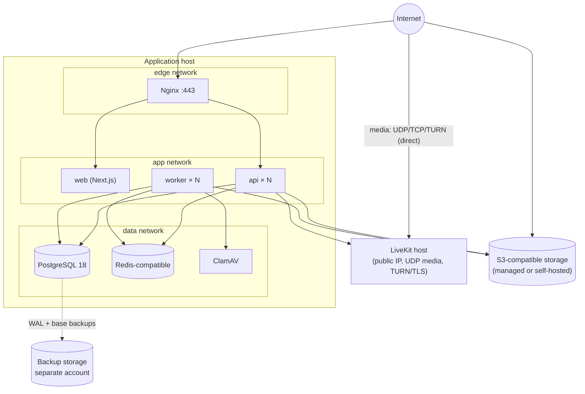
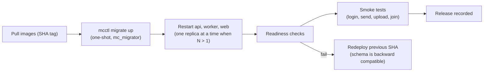

# Operations — Deployment, Observability, Backups

Status: Phase 0 proposal · Nothing in this document is deployed or configured yet. Production domains, TLS, real SMTP, TURN and production secrets are explicitly out of Phase 0.

---

## 1. Environments

| Environment | Purpose | Shape |
|---|---|---|
| Local | Development | Docker Compose infrastructure + native or containerised apps ([LOCAL-DEVELOPMENT.md](../development/LOCAL-DEVELOPMENT.md)) |
| CI | Automated tests | Ephemeral containers (testcontainers, Compose for E2E) |
| Staging | Release verification, restore drills, load tests | Production-like Compose stack, synthetic data only |
| Production | Customers | Single host Compose initially; scale-out path below |

## 2. V1 production topology (single host, Docker Compose)

### Nginx routing

| Host / path | Upstream | Notes |
|---|---|---|
| `app.<domain>` `/api/v1/realtime` | `api` | WebSocket upgrade, `proxy_read_timeout 75s`, buffering off, ticket query parameter redacted from logs |
| `app.<domain>` `/api/` | `api` | `client_max_body_size 1m` (files go directly to storage), 30 s timeouts |
| `app.<domain>` `/_next/static/` | `web` | `Cache-Control: public, max-age=31536000, immutable` |
| `app.<domain>` `/` | `web` | HTML no-store |
| `rtc.<domain>` | LiveKit `:7880` | WebSocket **signalling** over TLS — terminated by this Nginx when LiveKit shares the host, or by LiveKit's own TLS on a dedicated host. **Media** (UDP/TCP ICE, TURN) always goes directly to LiveKit's published ports, never through Nginx |
| `files.<separate-domain>` | Object storage | Only if storage is self-hosted; a separate registrable domain isolates user content |

Internal ports (`/healthz`, `/readyz`, `/metrics` on `MC_ADMIN_ADDR`) are never routed publicly.

## 3. Build and release

* **Images** (multi-stage, digest-pinned bases): `api`, `worker`, `mcctl` (Go → `distroless/static:nonroot`), `web` (Next.js standalone on a minimal Node image), all non-root, read-only root filesystem.
* **CI pipeline:** lint → unit tests → integration tests → contract tests → build images → scan (Trivy) + SBOM → E2E on Compose → push to registry (tag = git SHA).
* **Deploy:**

* Migrations follow expand/contract so the previous release keeps working against the new schema; destructive steps ship one release later.
* API nodes drain WebSockets gracefully (`reconnect` event, close 1012) on shutdown.

## 4. Configuration and secrets

* Compose files and Nginx templates live in the repository (`infra/`); environment values do not.
* Production secrets are provided as Docker secrets/files (`*_FILE`) from a secret store; `.env` files never leave developer machines.
* Secret rotation runbooks cover database passwords, Redis ACL passwords, storage keys, LiveKit API keys, SMTP credentials, `MC_HMAC_SECRET` (invalidates only ephemeral values — CSRF tokens, pagination cursors, pending WebSocket tickets — which clients re-fetch; sessions and recovery codes are unaffected) and the encryption keyring (`mcctl keys rotate` re-encrypts secrets; recovery codes keep their key ID until regenerated).

## 5. Scaling path

| Stage | Change |
|---|---|
| 1 | Single host; LiveKit on the same or a separate small host |
| 2 | Multiple `api` and `worker` replicas behind Nginx upstreams (stateless; Redis pub/sub already coordinates realtime) |
| 3 | Managed PostgreSQL (or primary + streaming replica), managed Redis-compatible service, managed object storage |
| 4 | LiveKit multi-node with Redis; TURN on dedicated addresses |
| 5 | Orchestrator (e.g. Kubernetes) when operational needs justify it; read replicas for search/analytics; dedicated search engine if needed |

## 6. Observability

| Signal | Implementation |
|---|---|
| Logs | JSON (`log/slog`) to stdout; request ID, org ID, user ID, route, status, duration; redaction rules from [SECURITY-BASELINE.md §16](../security/SECURITY-BASELINE.md#16-logging-and-privacy); shipped by a collector (e.g. Grafana Alloy) to Loki or equivalent |
| Metrics | Prometheus endpoint on the admin port of `api` and `worker`; LiveKit, PostgreSQL (exporter), Redis (exporter), Nginx and ClamAV metrics |
| Traces | OpenTelemetry SDK (HTTP, pgx, Redis, River jobs, outbound connectors) via OTLP to Tempo/Jaeger; trace IDs in logs and Problem Details `request_id` |
| Frontend | Optional error reporting and Web Vitals with URL/content scrubbing |
| Local | `grafana/otel-lgtm` all-in-one container behind the `observability` Compose profile |

### Key metrics and alerts

| Area | Metrics | Alert examples |
|---|---|---|
| API | Request rate, error rate, latency per route class | Error-budget burn for 99.9 % availability; p95 > 500 ms for 10 min |
| Realtime | Connections, connect failures, fanout latency, slow-consumer closes, publish failures | Fanout p95 > 1 s; publish failures > 0 for 5 min |
| Jobs | Queue depth and age per queue, failures, discards per kind | Oldest job > 5 min; any discarded support delivery |
| Database | Connections, slow queries, locks, bloat, disk | Connections > 80 %; disk > 80 % |
| Redis | Memory, evictions, pub/sub channels | Evictions > 0 |
| Files | Scan latency, scanner availability, signature age | Scanner down 5 min; signatures > 48 h |
| LiveKit | Rooms, participants, packet loss, node health | Node down; packet loss > 5 % sustained |
| Security | Login failures, rate-limit hits, webhook signature failures, admin exports | Spikes versus baseline |
| Backups | Last successful base backup, WAL lag | Backup older than 26 h; WAL archiving stalled 15 min |
| TLS | Certificate expiry | < 14 days |

### Health endpoints

* `/healthz` — process is alive (no dependencies).
* `/readyz` — PostgreSQL reachable and schema version matches; Redis reachable; for the worker, River client running. Used by Compose health checks and load balancers.

## 7. Backups and disaster recovery

| Data | Method | Retention |
|---|---|---|
| PostgreSQL | Continuous WAL archiving with `archive_timeout = 60s` (a WAL segment ships at least every minute even when traffic is low) + daily base backups (pgBackRest or WAL-G, decided in Phase 12) to object storage in a **separate account/bucket**, encrypted | 30 days point-in-time recovery |
| PostgreSQL (portable) | Weekly `pg_dump` logical backup | 8 weeks |
| Object storage | Provider versioning + cross-region/second-location replication (or nightly sync for self-hosted) | 30 days of versions |
| Redis, LiveKit | Not backed up (ephemeral by design) | — |
| Configuration | Repository (`infra/`) + secret store | — |

Targets: **RPO ≤ 15 min, RTO ≤ 4 h**. Restore drills run monthly in staging (automated restore + integrity checks + smoke tests); results are recorded.

## 8. Scheduled maintenance (River periodic jobs)

| Job | Schedule |
|---|---|
| Expired sessions, auth tokens, idempotency keys, WebSocket tickets cleanup | Hourly |
| Read notifications older than 90 days; integration delivery log older than 90 days | Daily |
| Support request retention (`support.retention`) and snapshot text past `messaging.retention` | Nightly, per organisation |
| Organisation retention purge (messages, files) | Nightly, staggered per organisation |
| Soft-deleted file objects (7-day grace) | Daily |
| Organisation purge after the 30-day deletion window | Daily |
| Incomplete uploads (> 1 h) | Hourly |
| LiveKit room reconciliation | Every 5 min |
| Support sync for polling connectors | Every 5 min |
| Audit log and account audit event retention | Monthly |

## 9. Initial capacity assumptions (to validate in Phase 12)

| Component | Starting point |
|---|---|
| Application host | 8 vCPU / 32 GB RAM / NVMe for API, worker, PostgreSQL, Redis, ClamAV — targeting ~2,000 concurrently connected users |
| LiveKit host | 8 vCPU / 16 GB / 1 Gbps — on the order of 100+ concurrent video participants with simulcast and adaptive stream |
| PostgreSQL storage | ~1 KB per message row + indexes; 10 M messages ≈ 20–30 GB with indexes |

## 10. Runbooks to produce (Phase 12)

Deploy and rollback · restore from backup · rotate each secret type · revoke all sessions for a user/organisation · disable a compromised integration · quarantine/remove a file · LiveKit outage handling · Redis outage (degraded realtime) · scanner outage · storage provider outage · incident communication.
