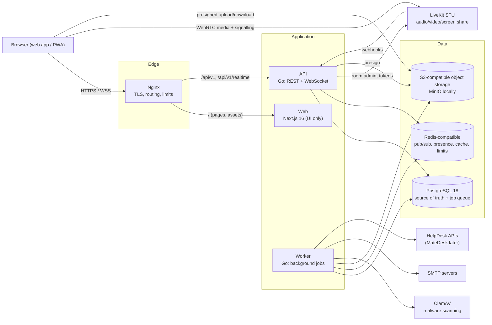
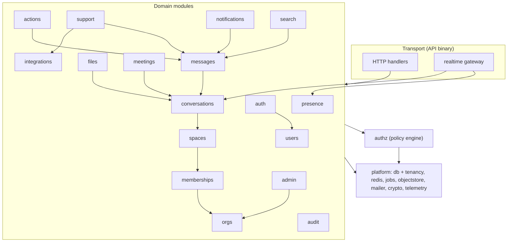
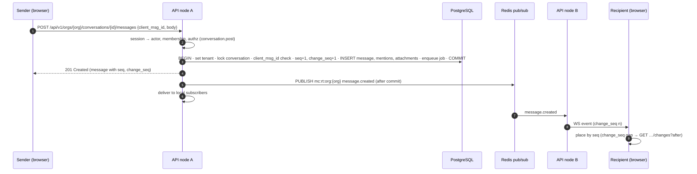
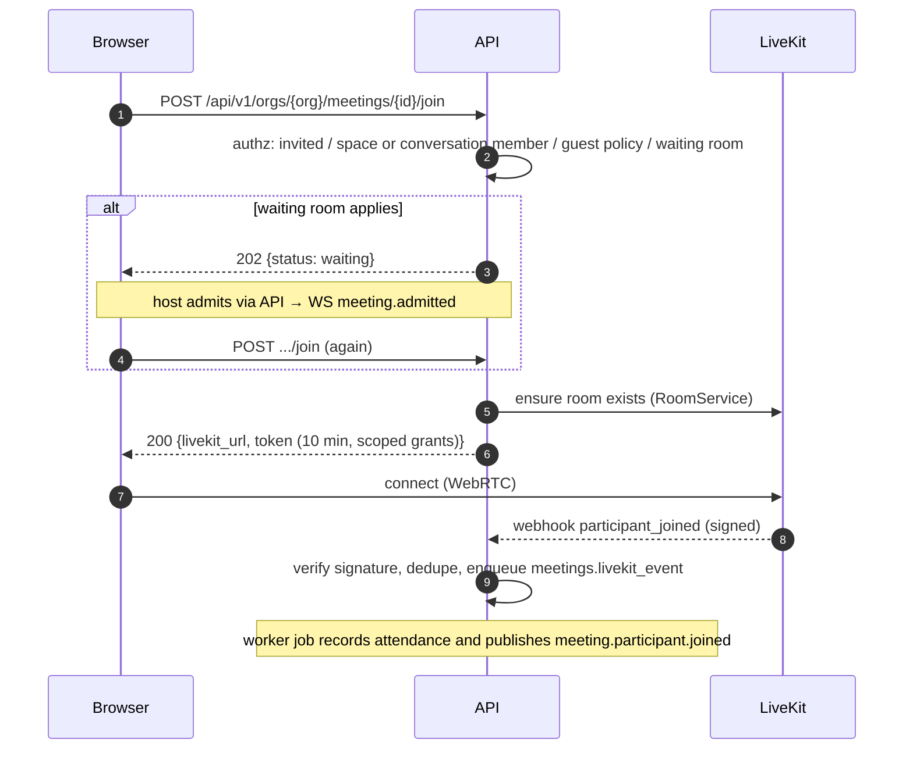

# MateCollab Production Architecture — Overview

Status: Approved production architecture (Phase 0 approved 2026-10-12)

MateCollab is an enterprise collaboration platform by NetaMate Solutions: direct and group messaging, Spaces with channels, threads, calls, huddles and meetings, files, search, notifications, lightweight action items, and support requests raised from conversations. It takes the useful parts of Slack, Microsoft Teams and Discord while staying deliberately simpler. It is **not** a community platform, social network or project-management suite.

This document is the entry point to the architecture. Detailed designs are linked throughout; decisions and deviations from the original brief are recorded in [DECISIONS.md](DECISIONS.md).

---

## 1. V1 scope

**In scope:** direct messages, group chats, Spaces, channels, threads, reactions, mentions, presence, typing, read state, pins, saved messages, audio/video calls, screen sharing, channel huddles, scheduled meetings with chat and history, files, search, notifications and Activity, action items, support requests (SMTP fallback + native HelpDesk connector architecture), organisation administration, guest access, RBAC, audit logging, light and dark appearance, responsive web (desktop → mobile).

**Out of scope for V1:** native desktop/mobile apps (the web app is installable as a PWA), SSO/SAML (architecture leaves room), recording and AI summaries (LiveKit Egress/Agents later), billing, end-to-end encryption, federation, public communities, task boards, custom roles, message translation, link unfurling of external URLs (SSRF-sensitive; evaluate post-V1).

---

## 2. Architectural principles

1. **Modular monolith.** One Go codebase, two runtime roles (API, worker). Modules have explicit boundaries and own their tables. No microservices in V1.
2. **PostgreSQL is the source of truth.** Every state change commits to PostgreSQL before anything is announced. Redis holds only ephemeral or reconstructible state.
3. **Persist, then fan out.** Messages are durable before realtime delivery; realtime is a notification channel with sequence numbers and resync, never the store.
4. **Tenant isolation in depth.** The organisation is explicit in every request path, every repository call, every row, every foreign key, and enforced again by PostgreSQL row-level security.
5. **Authorization is centralised.** Handlers never decide permissions; a policy layer does, with tests for every rule.
6. **Security and privacy by default.** Server-side sessions, Argon2id, TOTP, CSRF defences, encrypted secrets, least-privilege data access, minimal data in logs, explicit consent for any content leaving the system.
7. **Do not build commodity infrastructure.** LiveKit is the SFU; S3-compatible storage holds binaries; a proven job queue runs background work.
8. **Contracts first.** REST (OpenAPI) and WebSocket event schemas live in `packages/contracts` and generate client types.
9. **Simple to run.** One `docker compose` command for local development; single-host Compose deployment first, with a clear path to scale out.

---

## 3. System context

### Containers

| Container | Technology | Responsibility | State | Scaling |
|---|---|---|---|---|
| Nginx | Nginx | TLS termination, HTTP→upstream routing, WebSocket upgrade, coarse rate limits, static caching, security headers for static responses | none | 1–2 instances |
| Web | Next.js 16, React 19, TypeScript | Renders the application shell and UI; **no business logic or data API** | none | horizontal |
| API | Go 1.27 (`services/api`) | REST API, WebSocket gateway, authn/authz, domain services, LiveKit token issuance and webhooks, presigned URLs | none (sessions in PG + Redis cache) | horizontal; Redis coordinates realtime |
| Worker | Go 1.27 (`services/worker`) | Background jobs: notifications, emails, file scanning and previews, support/HelpDesk delivery, reminders, retention, cleanup | none | horizontal (job queue coordinates) |
| PostgreSQL | PostgreSQL 18 | All durable data, background job queue (River), full-text search | durable | vertical first; replicas later |
| Redis-compatible | Valkey 8 or Redis 8 (decision ADR-011) | Pub/sub fanout, presence, typing, session cache, rate limits, WebSocket tickets | ephemeral | single → managed/HA |
| Object storage | S3 API (MinIO locally) | File binaries, previews, avatars, exports | durable | provider-managed |
| LiveKit | LiveKit server (self-hosted) | WebRTC SFU for calls, huddles, meetings, screen sharing | ephemeral | single node → multi-node |
| ClamAV | clamd | Malware scanning of uploads | signatures | 1 instance |

---

## 4. Backend modules

The backend is one Go module with packages per domain module ([BACKEND.md](BACKEND.md)). The 21 logical modules in the brief map to 18 packages: channels live in `conversations`, and threads/reactions live in `messages`, because they share tables and invariants.

Rules: modules call each other only through exported service interfaces; a module's tables are read and written only by that module's repository (documented exceptions: `search` read models, `admin` aggregations). See [BACKEND.md](BACKEND.md#module-boundaries).

---

## 5. Key flows

### 5.1 Send a message

### 5.2 Join a meeting

### 5.3 Upload a file

Presign → direct upload to object storage → `complete` → background scan and preview → `file.updated` event → downloadable. See [FILES.md](FILES.md#3-upload-flow).

### 5.4 Create a support request from a thread

The requester explicitly picks *selected message*, *selected thread* or *no context* and sees a preview. The API re-authorizes, builds an immutable snapshot from the database (never from client-supplied text), commits it with a delivery job, and the worker sends it through the configured connector (HelpDesk API or SMTP). See [SUPPORT-AND-INTEGRATIONS.md](SUPPORT-AND-INTEGRATIONS.md).

---

## 6. Consistency model

| Path | Guarantee | Mechanism |
|---|---|---|
| Domain writes | Atomic, strongly consistent | One PostgreSQL transaction per command |
| Background side effects (notifications, emails, scans, HelpDesk delivery, reminders) | At-least-once, durable, retried | Jobs inserted **in the same transaction** (River on PostgreSQL); handlers are idempotent |
| Realtime events | Best effort, may duplicate or drop under failure; placed by `seq`/`thread_seq` | Post-commit publish; a per-conversation change feed (`change_seq`) lets clients detect any missed event and fetch exactly what changed |
| Presence and typing | Ephemeral, eventually consistent | Redis TTL keys and pub/sub |
| Search | Synchronous with writes | PostgreSQL generated `tsvector` columns |

---

## 7. Technology choices

Exact versions are pinned in Phase 1; the targets below are the evaluated baseline.

| Layer | Choice | Why |
|---|---|---|
| Frontend | Next.js 16 (App Router), React 19, TypeScript 5.9 strict | Brief; prototype already targets this API |
| Styling | Tailwind CSS 4 + CSS-variable design tokens; Radix primitives in shadcn pattern | Matches the prototype's foundations |
| Client data | TanStack Query v5, small Zustand stores, TanStack Virtual | Server-state caching, realtime cache patching, long lists |
| Media client | `livekit-client` + `@livekit/components-react` (headless use, MateCollab styling) | Official SDKs |
| Backend | Go 1.27 (1.25 is out of security support since August 2026), `chi` v5 router, `log/slog`, OpenTelemetry | Small, standard, observable |
| Database access | `pgx` v5 + `sqlc` (queries in `db/queries`) | Type-safe SQL without an ORM |
| Migrations | `goose` SQL migrations in `db/migrations`, run by `mcctl` | Explicit, versioned, never at API start-up |
| Jobs | River (PostgreSQL) | Transactional enqueue, scheduling, retries (**ADR-004**, deviation) |
| WebSocket | `github.com/coder/websocket` | Maintained, context-aware |
| Redis client | `go-redis` v9 | Standard |
| Object storage | AWS SDK for Go v2 (S3 API, path-style option) | Works with any S3-compatible provider |
| Email | `github.com/wneessen/go-mail` | STARTTLS/TLS, auth, attachments |
| Media | LiveKit server + `server-sdk-go` v2 / `livekit/protocol` | Brief |
| Passwords / 2FA | `golang.org/x/crypto/argon2`; RFC 6238 TOTP | Brief |
| Contracts | OpenAPI 3.1 (JSON Schema 2020-12) for REST and WebSocket events in `packages/contracts`; `openapi-typescript` for the web | Contract-first, one schema dialect |

---

## 8. Initial non-functional targets

Planning targets for V1 (validated by load tests in Phase 12):

| Area | Target |
|---|---|
| Organisation size | Up to 5,000 members per organisation; thousands of organisations per deployment |
| Message send (server, p95) | < 150 ms from request to commit |
| Realtime delivery (p95, same region) | < 500 ms commit → recipient render |
| API reads (p95) | < 250 ms |
| WebSocket connections | ≥ 10,000 per API node |
| Reconnect and resync | < 5 s after network restoration |
| Availability | 99.9 % monthly once multi-node; single-host phase accepts brief maintenance windows |
| Durability | RPO ≤ 15 min (WAL archiving), RTO ≤ 4 h |

---

## 9. Document map

| Topic | Document |
|---|---|
| Decisions and deviations | [DECISIONS.md](DECISIONS.md) |
| Prototype and workspace audit | [PHASE-0-AUDIT.md](PHASE-0-AUDIT.md) |
| Frontend | [FRONTEND.md](FRONTEND.md) |
| Backend modules, jobs, notifications, search | [BACKEND.md](BACKEND.md) |
| Realtime (WebSocket, Redis, presence) | [REALTIME.md](REALTIME.md) |
| Data model and ERD | [DATABASE.md](DATABASE.md) |
| Calls, huddles, meetings (LiveKit) | [MEDIA.md](MEDIA.md) |
| Files and object storage | [FILES.md](FILES.md) |
| Tenancy and RBAC | [MULTITENANCY.md](MULTITENANCY.md) |
| Support, SMTP, HelpDesk | [SUPPORT-AND-INTEGRATIONS.md](SUPPORT-AND-INTEGRATIONS.md) |
| Observability, deployment, backups | [OPERATIONS.md](OPERATIONS.md) |
| Security baseline | [../security/SECURITY-BASELINE.md](../security/SECURITY-BASELINE.md) |
| REST API | [../api/API-DESIGN.md](../api/API-DESIGN.md) |
| WebSocket events | [../api/WEBSOCKET-EVENTS.md](../api/WEBSOCKET-EVENTS.md) |
| Local development | [../development/LOCAL-DEVELOPMENT.md](../development/LOCAL-DEVELOPMENT.md) |
| Testing strategy | [../development/TESTING.md](../development/TESTING.md) |
| Phased roadmap | [../development/PHASES.md](../development/PHASES.md) |
| Brand assets | [../BRANDING-ASSETS.md](../BRANDING-ASSETS.md) |
