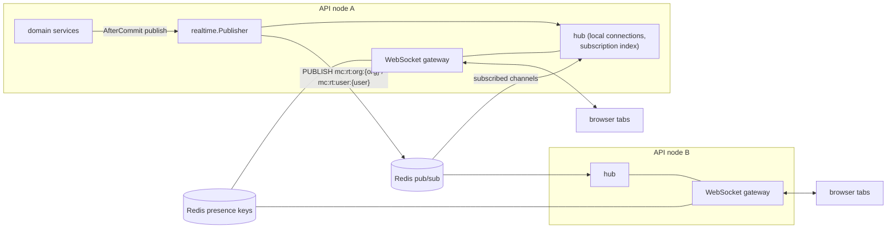
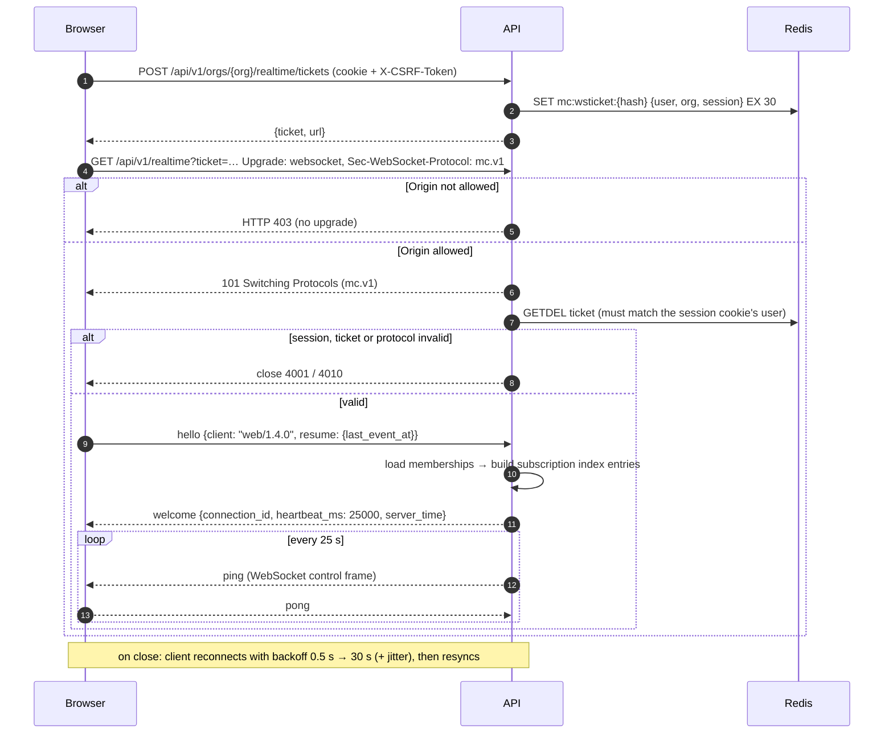

# Realtime Architecture

Status: Phase 0 proposal · Related: [ADR-005](DECISIONS.md#adr-005--realtime-delivery-without-an-outbox), [ADR-012](DECISIONS.md#adr-012--websocket-gateway), [WEBSOCKET-EVENTS.md](../api/WEBSOCKET-EVENTS.md), [DATABASE.md §4.4](DATABASE.md#44-messages)

---

## 1. Guarantees

| Property | Guarantee |
|---|---|
| Durability | A message exists only once it is committed to PostgreSQL. Realtime delivery never precedes the commit. |
| Ordering | Top-level messages by `seq` per conversation; replies by `thread_seq` per thread (both gap-free, assigned in the write transaction). No global ordering. |
| Delivery | Best effort over WebSocket; events may be duplicated or missed during failures. **Clients converge** through the per-conversation change feed (`change_seq`) and REST resync. |
| Idempotent writes | Message sends carry `client_msg_id`; retries — including concurrent ones — return the original message. |
| Latency target | p95 < 500 ms from commit to recipient render (same region). |
| Ephemeral data | Presence and typing live in Redis only and expire automatically. |

The three sequences (defined in [DATABASE.md §4.4](DATABASE.md#44-messages)):

| Sequence | Used by the client for |
|---|---|
| `seq` | Placing top-level messages in the timeline, paginating, read cursors, unread counts |
| `thread_seq` | Placing replies in an open thread, thread read cursors |
| `change_seq` | Detecting missed events of **any** kind in a conversation (new messages, replies, edits, deletions, reactions, pins) and fetching exactly what changed |

---

## 2. Components



| Component | Responsibility |
|---|---|
| WebSocket gateway | Upgrade, authentication, protocol (`mc.v1`), heartbeats, command handling, per-connection send queue |
| Hub (per node) | Local connections and the subscription index: `user → conns`, `conversation → conns`, `space → conns`, `org → conns` |
| Publisher | Builds the client envelope, delivers to the local hub immediately, and publishes to Redis with an `origin` node ID (nodes ignore their own messages) |
| Redis bus | One channel per organisation (`mc:rt:org:{orgId}`) for all tenant events, plus one per user (`mc:rt:user:{userId}`) for account-level events such as session revocation; each node subscribes only to channels with local interest (reference-counted) |
| Presence store | Redis sorted sets/hashes with TTL heartbeats, per organisation |

---

## 3. Connection lifecycle



* **Why two failure styles:** browsers report a refused handshake only as a generic error (close code 1006), so any failure the client must react to (expired ticket, signed-out session, unsupported protocol) is reported **after** the upgrade with an application close code. A disallowed `Origin` is refused **before** the upgrade on purpose — cross-site pages must never obtain a socket — and legitimate clients never hit it.
* Tickets are single-use (`GETDEL`), expire after 30 s, and bind the socket to **one organisation**. Switching organisation in a tab opens a new socket.
* The ticket travels in the query string; Nginx and API access logs redact the `ticket` parameter.
* A revoked session receives `session.revoked` and close `4009` (sign out). Losing access to the organisation (deactivation, removal, suspension) closes that organisation's sockets with `4004`; other organisations are unaffected.

---

## 4. Subscriptions and routing

| Subscription | How it is created | Events |
|---|---|---|
| **Implicit — user** | Every connection | Account-level events (session revocation) |
| **Implicit — conversations** | Conversations where the user is an active member (loaded at connect, maintained by `conversation.member.*` events) | `message.*`, `conversation.*`, `typing`, huddle state |
| **Implicit — spaces** | Spaces the user belongs to | `space.*`, channel created/archived in that Space |
| **Implicit — organisation** | Every connection | Organisation-wide changes (settings, public Space created, member profile updates) and user-targeted tenant events (notifications, read-marker sync) routed by `user_ids` |
| **Explicit** | Client `subscribe` command, authorised per request | Viewing a public channel of one of the user's Spaces without having joined the channel; a meeting lobby/room roster |
| **Presence** | Client `presence.subscribe` with ≤ 500 user IDs it is displaying | `presence.updated` for those users only |

Thread replies need no separate subscription: they are messages of the conversation and arrive through it.

Routing: every bus message carries an internal `audience` (`conversation_id`, `space_id`, `user_ids`, or `org`) that is stripped before delivery. The node looks up local connections for that audience in its index — O(local recipients) per event.

Per-recipient filtering happens in the hub before sending: guest connections carry their visible-user set (members of shared Spaces), so presence and member events about invisible users are dropped; payloads never contain fields the recipient could not fetch over REST.

---

## 5. Publish path

1. Service commits the transaction.
2. `AfterCommit` → `Publisher.Publish(event)`:
   * deliver to the local hub (no Redis round-trip for same-node recipients);
   * `PUBLISH` the bus message with `origin = nodeID` (retried twice with short backoff).
3. Other nodes receive, skip if `origin` is themselves, route to local connections.
4. Failure to publish is logged and counted (`realtime_publish_failures_total`); clients recover through resync (§6). If Redis is unavailable, nodes enter **degraded mode**: local delivery continues, connections receive `realtime.degraded`, and clients switch to polling sync every 15 s until `realtime.recovered`.

Events larger than 64 KB (e.g. very long messages with many attachments) are sent as `message.created` with `truncated: true`; the client fetches the full message.

---

## 6. Client convergence

### 6.1 Per loaded conversation

The client keeps `last_change_seq` for each conversation it has loaded (timeline or open thread). Every conversation-scoped message event carries the conversation's `change_seq`.

```text
on conversation-scoped message event e (created | updated | deleted | reaction | pin):
  conv = cache[e.conversation_id]
  if conv not loaded:                    update badges from e (unread flag, mention count); return
  if e.change_seq <= conv.last_change_seq: return                     # duplicate or already fetched
  apply(e)                                                            # see below
  if e.change_seq > conv.last_change_seq + 1:
      fetch GET …/conversations/{id}/changes?after=conv.last_change_seq   # fills every missed change
  conv.last_change_seq = max(conv.last_change_seq, e.change_seq)

apply:
  message.created (top-level)  → insert in timeline by message.seq; reconcile optimistic copy via client_msg_id
  message.created (reply)      → update the root's thread summary; insert in the open thread by message.thread_seq
  message.updated / deleted    → replace if message.version > local version
  message.reaction.*           → set the emoji's count to e.count; set "reacted by me" if e.user_id is me
  message.pinned / unpinned    → update pin state
```

The change feed returns the **current state** of every message changed after the cursor (top-level, replies and tombstones, with reaction summaries), so edits, deletions and reactions on old messages converge as reliably as new messages.

### 6.2 Resync triggers

| Trigger | Action |
|---|---|
| Reconnect | `GET /api/v1/orgs/{org}/sync?since=<last_sync_at − 5 s>` → changed conversations with `last_message_seq`, `last_change_seq`, unread and membership; for each loaded conversation whose `last_change_seq` advanced, fetch `…/changes?after=`; re-send explicit and presence subscriptions |
| Gap detected | `…/changes?after=` for that conversation |
| Window regains focus / tab becomes visible | Same as reconnect, rate-limited to once per 10 s |
| Periodic (visible tabs) | Lightweight `sync` every 60 s — bounds the delay of any lost event |
| Change feed too far behind (> 1,000 changes) | Drop the cached conversation and reload its newest page |

### 6.3 Optimistic sends

The composer inserts a pending message keyed by a fresh `client_msg_id` (UUIDv7), POSTs it, and replaces it with the server copy on `201` or on the matching `message.created` event, whichever arrives first. Failed sends stay visible with **Retry**/**Delete** actions; retry reuses the same `client_msg_id`. Unsent drafts and failed messages persist in `localStorage` per conversation and are cleared on sign-out.

---

## 7. Read state

* Sending a top-level message advances the sender's own `last_read_seq` to that message's `seq` (own messages never make a conversation unread); sending a reply advances the sender's thread cursor.
* The client sends `PUT /api/v1/orgs/{org}/conversations/{id}/read-marker {seq}` when the newest visible top-level message is on screen and the window is focused, debounced to at most once per 2 s per conversation.
* The server stores `GREATEST(last_read_seq, $seq)` (monotonic), then emits `conversation.read` to the user's connections in that organisation (syncs badges across tabs and devices).
* A conversation is unread when `last_message_seq > last_read_seq`; the badge shows the capped count of non-deleted top-level messages after the cursor ([DATABASE.md §5](DATABASE.md#5-query-patterns-and-indexing)). Thread replies never affect the channel badge; they surface through thread subscriptions and Activity.
* In DMs and small groups (≤ 10 members), when both the reader and the sender have read receipts enabled, the server also emits `conversation.member.read` to the other members, from which the "Seen" indicator is derived.
* Threads use `PUT …/threads/{rootId}/read-marker {thread_seq}` and `thread_subscriptions.last_read_thread_seq`.

---

## 8. Typing indicators

* Client command `typing {conversation_id, thread_root_id?}` at most once every 3 s while the user types; stop is implicit (expiry) or explicit on send.
* Server checks active membership (cached), rate-limits, and publishes an ephemeral `typing` event with `expires_in_ms: 6000`. Nothing is stored.
* Clients render "Name is typing…" (up to three names, then "Several people are typing…").

---

## 9. Presence

Presence is **per organisation**: sockets are bound to one organisation, and manual status lives on the membership, so being active (or what a status says) in one organisation is never visible to another.

### 9.1 Model

| Input | Source |
|---|---|
| Connections | Each live socket for organisation *O* registers under *O* with a heartbeat |
| Idle | Client reports `presence.idle` after 10 min without input and `presence.active` on input |
| Manual override | `organisation_memberships.presence_override` (`auto`, `busy`, `dnd`, `away`, `invisible`) + optional status text and expiry |
| Privacy | "Show presence" off → others see `offline`; guests see only shared-Space users |

Effective status in *O*: `invisible` → *offline*; `busy`/`dnd`/`away` → that value while connected to *O* (offline when not connected); `auto` → *available* if any active connection to *O*, *away* if all of them are idle, *offline* otherwise.

### 9.2 Redis keys

| Key | Type | Content |
|---|---|---|
| `mc:org:{orgId}:presence:conns:{userId}` | sorted set | `connectionId` scored by expiry (now + 90 s, refreshed every 30 s) |
| `mc:org:{orgId}:presence:idle:{userId}` | set | Connection IDs currently idle |
| `mc:org:{orgId}:presence:state:{userId}` | hash | Last published effective status (to publish only real changes) |
| `mc:presence:expiry` | sorted set | `{orgId}:{userId}` scored by the earliest connection expiry — swept every 15 s to detect crashed nodes |

### 9.3 Behaviour

* Transitions to *offline* wait a 30 s grace period so page reloads and brief network drops do not flap.
* Changes publish `presence.updated` on that organisation's channel only; nodes deliver it only to connections that subscribed to that user.
* `GET /api/v1/orgs/{org}/presence?user_ids=…` returns a snapshot for initial render.

---

## 10. Limits and backpressure

| Limit | Value (initial) |
|---|---|
| Per-connection outbound queue | 256 events; overflow → close `4008 slow_consumer`; client reconnects and resyncs |
| Inbound frame size | 16 KB |
| Client commands | 20/s per connection; `typing` 1 per 3 s per conversation |
| Explicit subscriptions | 50 per connection |
| Presence subscriptions | 500 user IDs per connection |
| Connections per user | 20 (oldest closed beyond that) |
| New connections per IP | 60/min |

---

## 11. Scaling and deployments

* Nodes are interchangeable; no sticky sessions. Nginx proxies `/api/v1/realtime` with upgrade headers and `proxy_read_timeout 75s` (> heartbeat).
* Capacity planning: ~30–50 KB memory per connection (two goroutines + buffers) → ≥ 10,000 connections per node with headroom.
* **Graceful drain:** on `SIGTERM` a node stops accepting sockets, sends `reconnect {retry_after_ms: random 0–5000}` to its clients, and closes with `1012` after 10 s, spreading reconnect load across remaining nodes.
* Redis pub/sub throughput is ample for V1; if a single channel per organisation becomes hot, shard by conversation hash (`mc:rt:org:{org}:{n}`) without changing the client protocol.

---

## 12. Failure modes

| Failure | Effect | Recovery |
|---|---|---|
| API node crash | Its clients disconnect | Reconnect to another node, resync |
| Redis unavailable | Cross-node fanout and presence stop; local delivery continues | Degraded mode with polling sync; presence shows "unknown" until recovery |
| Publish lost between commit and Redis | Recipients miss one event | `change_seq` gap on the next event, focus/periodic/reconnect sync |
| PostgreSQL slow | Sends slow; realtime unaffected for already-committed data | Timeouts surface as retryable errors; optimistic UI keeps drafts |
| Client asleep/offline | Missed events | Resync on wake (visibility change + reconnect) |
| Duplicate delivery | Same event twice | Ignored by `change_seq` (and message `version`) |
| Clock skew | — | Server timestamps are authoritative; sync uses a 5 s overlap |

---

## 13. Security

* Authentication: session cookie **and** single-use org-bound ticket **and** `Origin` allow-list (enforced before upgrade); subprotocol required.
* Authorization: implicit subscriptions derive from memberships; every explicit subscription is checked with the same read predicate as the equivalent REST read ([MULTITENANCY.md §3.4](MULTITENANCY.md#34-resource-rules)).
* Payloads are filtered per recipient (guests, privacy settings) and never include data unavailable over REST.
* Commands are validated (schema, size) and rate-limited; unknown commands close the socket after repeated violations.
* No message bodies, tickets or cookies in logs. Connection metrics are aggregated; no per-user metric labels.

---

## 14. Observability

Metrics: `ws_connections` (gauge), `ws_connects_total{result}`, `ws_send_queue_depth` (histogram), `ws_slow_consumer_closes_total`, `realtime_publish_failures_total`, `realtime_fanout_latency_seconds` (commit → hand-off to socket), `realtime_change_feed_fetches_total`, `presence_transitions_total`. Traces link the REST write span to the publish span via the event ID.
