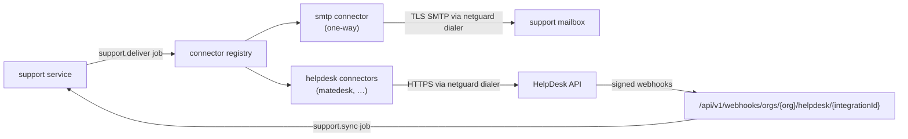

# Support Requests, SMTP and HelpDesk Connectors

Status: Phase 0 proposal · Related: [ADR-019](DECISIONS.md#adr-019--support-context-snapshot), [DATABASE.md §4.8](DATABASE.md#48-integrations-and-support), [SECURITY-BASELINE.md](../security/SECURITY-BASELINE.md)

---

## 1. Scope

* Members (and optionally guests) raise **support requests** from a direct message, group chat, channel message or thread — or from scratch.
* Requests are delivered to a **destination** (e.g. "IT HelpDesk") through an organisation **integration**:
  * a **native HelpDesk connector** (API-based, preferred; MateDesk first, added when its API is available), or
  * the **SMTP fallback** (one-way email to a support address).
* Organisations may also configure their own **SMTP server** for MateCollab notification emails.

---

## 2. User experience contract (from the prototype)

| Element | Behaviour |
|---|---|
| Entry points | Message action menu → "Create Support Request"; thread panel; quick-create "+" → Support request; Home "Need a hand?"; My support requests → Create |
| Form | Destination/support team, priority (Low/Normal/High/Urgent), subject (prefilled from the message, editable), description |
| **Context selector** | "Selected message only" (default when started from a message) · "Selected thread" (offered only when the message belongs to a thread with replies) · "No conversation context" (only option when started from scratch) |
| **Context preview** | Locked panel stating exactly what will be shared ("Only this message will be shared" / "Only this thread will be shared" / "No conversation will be shared"), the content, source and message count |
| Attachment toggle | "Include selected attachment" — shown only when the selected message has attachments; off unless chosen |
| Requester block | Name, email, verified badge |
| After submit | Toast + navigate to the request page: status badge, description, shared context with "View source conversation", attachments, updates & replies, request details |
| Status | Open / Pending / Resolved (+ Closed); for SMTP-only destinations the page states that updates arrive by email |

Production removes the prototype's "Simulate ticket status" control and replaces timers with real delivery state ("Sending…", "Delivered", "Delivery failed — Retry").

---

## 3. Context-sharing rules (normative)

1. **Explicit only.** Context is shared only in the mode the requester selected and previewed. There is no implicit expansion — never "the last N messages", never the whole conversation.
2. **Server-built.** The API builds the snapshot from the database using `(conversation_id, message_id, mode)`. Client-supplied text is never trusted as context.
3. **Re-authorised.** At submission the requester must still be able to read the conversation and the selected message/thread; deleted messages are excluded.
4. **Bounded.** Thread mode includes the root and its replies, capped at 100 messages / 200 KB; the preview shows the cap if hit.
5. **Immutable record, bounded lifetime.** The snapshot is stored in `support_request_context_items` (author display name, body, timestamp, source message ID). The request page and the delivered ticket show this snapshot, so later edits or deletions in the conversation do not change what was shared. The copy never outlives the organisation's policies: snapshot text is cleared once older than `messaging.retention`, and whole requests are deleted after `support.retention` ([DATABASE.md §7](DATABASE.md#7-deletion-retention-and-privacy)).
6. **Attachments are opt-in** and limited to `available` (scanned) files on the selected message(s) the requester can access, within the destination's size limits. Requests started from scratch can include files the requester uploads in the form; these are staged as private uploads (visible only to the requester) and linked to the request on submission.
7. **Mentions are rendered to plain names** in the snapshot; internal IDs are not sent externally.
8. **Audited.** `support_request.created` records the context mode, item count and attachment count — not the content.
9. **"View source conversation"** re-checks access when clicked; the support agent never gets a link that bypasses MateCollab access control.
10. **Guests** can create requests only when `support.guests_can_create` is enabled, and only from conversations they can access.

---

## 4. Connector architecture



```go
type Connector interface {
    Provider() string
    Capabilities() Capabilities                 // see table below
    ValidateConfig(cfg json.RawMessage) error   // non-secret settings
    Test(ctx context.Context, c Conn) error
    CreateTicket(ctx context.Context, c Conn, t TicketInput) (TicketRef, error)
    AddComment(ctx context.Context, c Conn, ref TicketRef, m CommentInput) (CommentRef, error)
    FetchUpdates(ctx context.Context, c Conn, since time.Time) ([]TicketUpdate, error)      // polling connectors
    ParseWebhook(ctx context.Context, c Conn, r *http.Request) ([]TicketUpdate, error)      // push connectors
}

type Capabilities struct {
    TwoWaySync, StatusSync, Comments, Attachments, Webhooks, Polling, RequesterIdentity bool
}
```

`Conn` carries decrypted secrets only for the duration of the call (see §6).

| Capability | SMTP fallback | Native connector (target, e.g. MateDesk) |
|---|:-:|:-:|
| Create ticket | ✓ (email) | ✓ |
| Attachments | ✓ (MIME, within size limit) | ✓ |
| Requester identity | Reply-To header | ✓ (API) |
| Agent replies shown in MateCollab | ✗ | ✓ |
| Status sync | ✗ | ✓ |
| Requester follow-up replies | ✗ (user emails the helpdesk directly) | ✓ |

**SMTP is never presented as two-way synchronisation.** For SMTP destinations, `support_requests.two_way_sync = false`; the UI says: "Sent by email to support@example.com. Replies will arrive in your email inbox; status here won't update automatically." The requester can mark the request resolved manually.

### 4.1 Delivery

* `support.deliver` job (enqueued in the creation transaction) renders the ticket from the snapshot and calls `CreateTicket`.
* Idempotency: connectors that support idempotency keys receive the support request ID; for SMTP, a deterministic `Message-ID` (`<support-{requestId}@{instance-domain}>`) lets helpdesks de-duplicate retries.
* Retries: 12 attempts over ~24 h with backoff; then `delivery_status = failed`, the requester is notified, and a **Retry** action re-enqueues.
* Every attempt writes an `integration_deliveries` row (operation, outcome, HTTP status, error code, duration — never payloads).

### 4.2 Email format (SMTP fallback)

* Subject: `[MateCollab #1425] Production deployment failure`
* From: the organisation SMTP sender (or platform sender); Reply-To: requester's verified email.
* Body (text + HTML): description, priority, requester name/email, organisation, destination, shared context items (author, time, text), attachment list, and a link to the request in MateCollab (access-controlled).
* Attachments: MIME parts when enabled and within the total size limit (default 20 MB); otherwise listed by name only.

### 4.3 Inbound updates (native connectors)

* Webhooks: per-integration HMAC secret, timestamp tolerance ±5 min, replay cache (Redis, 24 h), then `support.sync` job.
* Polling: `support.sync` every 5 min for connectors without webhooks, using `last_synced_at`.
* Updates map external status → MateCollab status via per-integration mapping; agent comments become `support_request_messages` (direction `inbound`, deduplicated by `external_message_id`); requester is notified (`support_update`).

### 4.4 MateDesk connector (later)

Planned as the first native connector once MateDesk exposes a stable API: OAuth2 client-credentials or scoped API token; create ticket with requester identity; comments both ways; attachments; status webhooks. Until then the HelpDesk tab shows MateDesk as "Native API (coming soon)" and SMTP as available. A mock HelpDesk server in tests exercises the full connector contract. V1 therefore ships the **connector architecture plus the SMTP connector**; whether any other HelpDesk must work natively at launch is a product decision ([ADR-022](DECISIONS.md#adr-022--v1-helpdesk-connector-scope--accepted)).

### 4.5 Destinations without an organisation SMTP server

A destination may point at a support email address without any organisation integration (`support_destinations.integration_id IS NULL`). Tickets are then sent by the **platform mailer** — From: the platform sender with the organisation's name, Reply-To: the requester — with exactly the same one-way semantics and honest UI as the SMTP connector.

---

## 5. Organisation SMTP integration

| Aspect | Design |
|---|---|
| Purpose | Send organisation notification emails (and SMTP-fallback support tickets) through the organisation's mail server so mail comes from their domain |
| Fields | Display name, sender email, host, port, encryption (STARTTLS / SSL/TLS / None — None allowed only for allow-listed private relays), username, password (write-only) |
| Actions | Test connection (EHLO + AUTH, no message), Send test email (to the acting admin), Save, Disconnect |
| Deliverability | Admin guidance on SPF/DKIM/DMARC for the sender domain; MateCollab does not sign DKIM in V1 |
| Fallback | If the organisation SMTP fails repeatedly, notification emails fall back to the platform mailer (configurable) and admins are alerted; support tickets do **not** silently fall back to a different route |

---

## 6. Credentials and outbound security

* Secrets (SMTP password, API tokens, webhook secrets) are accepted only on create/update, **encrypted with AES-256-GCM** using the keyring (`MC_ENCRYPTION_KEYRING`) with associated data binding them to `(org_id, integration_id, "integration-secret")`, and stored in `integrations.secret_ciphertext`. They are **never returned** by the API, never logged, and never written to audit metadata (audit records only "secret updated").
* Decryption happens only inside connector execution (worker) and connection tests; plaintext is held in memory only for the call.
* Key rotation: new key ID becomes active; `mcctl keys rotate` re-encrypts all secrets; old key retained until rotation completes.
* **SSRF protection** for every admin-configured endpoint (SMTP host, HelpDesk URL, webhooks): the `netguard` dialer resolves DNS once, rejects loopback, private (RFC 1918), link-local, CGNAT, multicast, unique-local IPv6 and cloud metadata addresses (unless allow-listed via `MC_OUTBOUND_ALLOW_PRIVATE_CIDRS` for on-premises installs), connects to the resolved IP (no DNS rebinding), restricts ports (SMTP 25/465/587/2525; HTTPS 443 + explicit allow-list), disables redirects to disallowed targets, and enforces timeouts and response-size caps.
* TLS certificates are verified; "None" encryption is refused for public hosts.
* Connection-test results shown to admins are sanitised (no internal network details, no secrets).

---

## 7. Administration UI mapping

| Prototype element | Production behaviour |
|---|---|
| Integrations → Overview cards (HelpDesk, SMTP) with "Simulated" badge | Real status badges: Not configured / Active / Error (last error time) |
| SMTP form + Test connection + Send test email + Save + Disconnect | As §5; secrets write-only ("Saved · enter to replace") |
| HelpDesk: Provider (MateDesk / Other), Connection type (Native API preferred / SMTP email), URL, token, default support address | Provider list from the connector registry; connection type determines connector; URL validated by `netguard` |
| Toggles: Members can create requests, Guests can create requests, Allow attachments, Notify requester on updates | `organisation_settings.support` |
| Support destinations per Space (Engineering → IT HelpDesk) | `support_destinations` + `support_routes` |
| "Simulate connection failure" | Removed |

---

## 8. Observability

* Metrics: `integration_calls_total{provider,operation,outcome}`, `support_delivery_latency_seconds`, `support_delivery_failures_total`.
* Admin view: last test result, last delivery outcome, recent deliveries list.
* Alerts: N consecutive delivery failures per integration; webhook signature failures spike.
