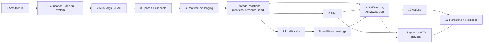

# Implementation Roadmap

Status: Phase 0 complete — **awaiting approval**. No phase starts without explicit approval of the previous one.

Each phase ends with: working software behind the documented exit criteria, green CI (including tenant-isolation, permission and security suites for everything the phase adds), updated documentation, and a phase report.

---

## Overview

| Phase | Name | Headline outcome |
|---|---|---|
| 0 | Architecture and audit | This documentation set |
| 1 | Production foundation and design system | Monorepo, local stack, platform skeleton, CI, tokens, primitives, app shell |
| 2 | Authentication, organisations and RBAC | Real accounts, 2FA, sessions, organisations, invitations, guests, authz engine, audit log |
| 3 | Spaces and channels | Spaces, membership, channels, guest Space access |
| 4 | Realtime messaging | DMs, groups, channel messages, WebSocket gateway, multi-node fanout |
| 5 | Threads, reactions, mentions, presence, read state | The full conversation experience |
| 6 | Files | Presigned uploads, scanning, previews, Files pages |
| 7 | LiveKit calls and screen sharing | Instant meetings, DM/group calls, stage UI |
| 8 | Huddles and scheduled meetings | Channel huddles, scheduling, reminders, waiting room, history |
| 9 | Notifications, Activity and search | Activity feed, email notifications, ⌘K search, Home |
| 10 | Lightweight actions | Action items from messages and meetings |
| 11 | Support requests, SMTP and HelpDesk | Conversation-to-support with explicit context, connectors |
| 12 | Security hardening, QA and production readiness | Pen test, load, DR drills, runbooks, go-live checklist |

Phases 6 and 7 can overlap if two engineers are available; 10 is small and can merge into 9 or 11.

---

## Phase 0 — Architecture and audit ✅ (pending approval)

* Workspace, prototype and Logo Library audit; architecture, data model, API/event contracts, security baseline, local development, testing and this roadmap.
* **Exit:** human approval of the documents and of the decisions marked *Needs approval* in [DECISIONS.md](../architecture/DECISIONS.md).

## Phase 1 — Production foundation and design system

**Goal:** a running skeleton that every later phase builds on, and a design system that reproduces the prototype's visual language with Library branding.

Scope:
* Monorepo layout (`apps/web`, `services/{api,worker,mcctl,internal}`, `packages/{ui,contracts,config}`, `db/{migrations,queries,seeds}`, `infra/{docker,nginx,livekit,monitoring}`), pnpm workspace, Go module, root scripts, `.editorconfig`, `.gitattributes`, `.gitignore`, `.env.example`, root README.
* `docker-compose.yml` + `docker-compose.dev.yml` (PostgreSQL 18, Redis-compatible, MinIO pinned, LiveKit dev, Mailpit, Nginx; optional ClamAV and observability profiles); `pnpm setup`, `pnpm dev`, `pnpm dev:docker`.
* Go platform: config, logging, HTTP server and middleware chain, Problem Details, health/readiness/metrics, OpenTelemetry, pgx pool + `InTenantTx`; database roles via the bootstrap step (Postgres init script locally, `mcctl db bootstrap` elsewhere) and RLS helper functions + grants in the first migration, Redis client, River wiring (worker binary running a heartbeat job), object store client + `mcctl storage init`, mailer to Mailpit, crypto keyring, `mcctl migrate/seed/config check`.
* Contracts: OpenAPI skeleton (`/config`, health), event envelope schema, codegen pipeline.
* Web: Next.js 16 app with `proxy.ts` (CSP nonce, headers), Inter via `next/font`, theme system (light/dark/system, no flash), tokens (Violet/Navy per ADR-008 once approved), `packages/ui` primitives, AppShell (rail, resizable sidebar, global bar, right panel, drawer/bottom-nav breakpoints) with static content, Storybook with the 15 state patterns, `pnpm brand:sync` + favicons/manifest from the Logo Library.
* CI: lint, unit, integration, build, image scan, gitleaks, licence check, Storybook visual baseline, axe.

**Exit criteria:** fresh clone → `pnpm setup && pnpm dev` works on Windows and Linux; `/api/v1/config` served through Nginx; shell matches prototype screenshots (approved visual baseline) in light and dark; CI green; security headers verified by tests.

## Phase 2 — Authentication, organisations and RBAC

**Goal:** real identity and tenancy with security controls in place before any collaboration data exists.

Scope:
* Users, emails, credentials (Argon2id), sessions (cookie, Redis cache, revocation), CSRF, login/logout, email verification, password reset, TOTP + recovery codes, step-up, session list (Settings → Security).
* Organisations, settings sections, memberships (role, title, contact email, per-organisation status), ownership transfer, member/admin invitations, organisation switcher and `select-organisation`, `mcctl org create` / `user create-owner`, account emails and account deletion requests.
* `authz` engine + permission catalogue + policy matrix tests; org-context middleware; organisation 2FA enforcement.
* Rate limiting (auth classes + defaults); audit log framework + account and admin events; Settings → Profile/Appearance/Privacy/Security; Admin → General, Members, Roles & Permissions, Security, Audit Logs (list/export).
* Transactional email templates (verification, reset, invitation, security alerts) via the platform mailer (Mailpit locally).

**Exit criteria:** tenant-isolation harness (schema/database/API suites) and permission matrix running in CI; authentication security tests (enumeration, throttling, CSRF, TOTP replay, session rotation/revocation) green; E2E for login + 2FA + reset + invitation.

## Phase 3 — Spaces and channels

Scope: Spaces (create, browse, join/leave, archive, delete, overview note), Space roles, **guest invitations with Space grants** (`invitation_space_grants` needs `spaces`) and guest access enforcement, channels as conversations (public/private, topic, default `#general`, archive), channel membership, Spaces sidebar tree, Space overview tabs (Overview, Channels, Members; Files/Meetings placeholders), Admin → Spaces and Messaging policy (Space creation settings), audit events, realtime-ready event constructors.

**Exit criteria:** isolation and permission suites cover every new endpoint including guest scenarios; E2E create/browse/join/private/guest flows.

## Phase 4 — Realtime messaging

Scope: DMs (deduplicated) and group chats; message send/list/edit/delete with organisation edit/deletion policies; `client_msg_id` idempotency (lock-first); per-conversation `seq` and `change_seq` with the change-feed endpoint; tombstones and revisions; message markup v1 (parser + composer: formatting, emoji, Enter/Shift+Enter, drafts, failed-send retry); WebSocket gateway (tickets, `mc.v1`, hub, Redis pub/sub, routing, backpressure, drain); client realtime layer with resync; Chats UI and channel timeline (virtualised, date dividers); `search_tsv` column and index created now; system messages.

**Exit criteria:** two-browser and two-node realtime E2E; WebSocket security tests; event schema conformance; baseline k6 (≥ 1,000 sockets locally, fanout p95 < 500 ms).

## Phase 5 — Threads, reactions, mentions, presence and read state

Scope: threads (replies, panel, subscriptions, "Notify me about replies", thread unread), reactions (allow-listed emoji, snapshots), mentions (autocomplete, tokens, `@channel`/`@here` with confirmation), quote replies (reference), pins, saved messages, read markers and unread counts, "New messages" divider, DM read receipts (privacy settings), typing indicators, presence (online/idle/manual status/DND, privacy), conversation favourites/hide/notification level, conversation details/profile panels.

**Exit criteria:** unread and read-receipt correctness tests; presence privacy tests (guests, "show presence" off); reducer property tests; E2E covering every message action from the prototype's hover menu (except actions/support, delivered later).

## Phase 6 — Files

Scope: object storage abstraction, presigned POST uploads, completion, validation, ClamAV scanning (fail closed) with `noop` dev mode, previews, attachments in composer and messages, file viewer, Files pages (Recent, Shared with me, Space files), conversation Files tab, rename/delete, quotas, organisation file policy (Admin → Files), avatars and organisation logo, retention and purge jobs.

**Exit criteria:** upload security tests (spoofing, EICAR, size, SVG, filenames); file access tests across conversations, organisations and guests; E2E upload → preview → download → delete.

## Phase 7 — LiveKit calls and screen sharing

Scope: meetings core (instant meetings, DM/group calls with ringing), LiveKit room service integration, token issuance with grants, webhooks + reconciliation, attendance, pre-join with real devices, stage (grid/speaker/share), participants and chat panels (meeting conversations), reactions, raise hand, host controls (mute/remove/end), floating minimised call across navigation, reconnection UX, Settings → Audio & Video.

**Exit criteria:** LiveKit integration tests in CI; Playwright fake-media E2E (two participants, screen share, minimise, leave, call ring/decline/missed); token/authorization tests.

## Phase 8 — Huddles and scheduled meetings

Scope: channel huddles (banner, one live per channel, thread chat, system messages, auto-end), scheduled meetings (create/edit/cancel, invites, RSVP, time zones, join window), reminders (scheduled jobs), waiting room and guest meeting policy, Meetings pages (Upcoming/Today/Past) and meeting detail/history, Admin → Meetings, optional ICS email invitations.

**Exit criteria:** scheduling tests incl. time zones and DST, reminder job tests, waiting-room security tests, E2E huddle and scheduled meeting flows.

## Phase 9 — Notifications, Activity and search

Scope: notification fanout pipeline and preference evaluation, Activity page and bell (filters, unread, mark read), unread summaries and badges, desktop notifications, DND/quiet hours, email notifications (delayed, content-free by default per ADR-020), search API (FTS + trigram, access-filtered) and ⌘K palette with filters, Home aggregation (resume conversations, attention, recent files, calendar, support/action placeholders).

**Exit criteria:** notification correctness tests (mute, DND, levels, guests); search leak tests across conversations, organisations and guests; search p95 targets on synthetic volume; E2E mention → Activity → email in Mailpit.

## Phase 10 — Lightweight actions

Scope: action items (create from message/meeting or standalone, assignee, due date, completion), Actions page (Assigned/Created/Completed), Home "Your action items", assignment and due-reminder notifications, source links with access re-check.

**Exit criteria:** permission tests (creator/assignee only), E2E create-from-message flow.

## Phase 11 — Support requests, SMTP and HelpDesk architecture

Scope: support requests with server-built context preview and immutable snapshots (adds `files.support_request_id` and its foreign key), support retention, attachments opt-in, My support requests pages, replies, destinations and per-Space routes, connector framework, SMTP fallback connector (one-way, honest UI), organisation SMTP integration (notifications via org SMTP, test connection, test email), HelpDesk admin UI, encrypted write-only secrets, `netguard` SSRF protection, delivery log, retries, mock HelpDesk API connector proving the native contract (MateDesk connector when its API is ready).

**Exit criteria:** context-privacy E2E (email contains exactly the snapshot), credential-handling tests (never returned/logged; AAD), SSRF tests, delivery failure/retry E2E.

## Phase 12 — Security hardening, QA and production readiness

Scope: threat-model review, external penetration test and fixes, ZAP full scans, load and soak tests at target scale, chaos tests, backup/restore drill, observability dashboards and alerts, runbooks, production Compose and Nginx TLS templates, LiveKit TURN/TLS deployment guide, retention job verification, WCAG 2.2 AA audit, documentation completion, `security.txt` and disclosure policy, release checklist.

**Exit criteria:** go-live checklist signed off; no open critical/high findings; RPO/RTO demonstrated.

---

## Changes from the proposed sequence

| Change | Reason |
|---|---|
| **Platform mailer and background jobs move into Phases 1–2** (Phase 11 keeps organisation SMTP and support connectors) | Authentication needs verification, reset and invitation emails; a job runner is needed for reliable sending |
| **Security foundations start in Phases 1–2** (headers, CSRF, rate limiting, audit framework, CI security gates, RLS) | Security is a first-class requirement; retrofitting in Phase 12 is costlier and riskier. Phase 12 becomes verification and hardening |
| **DMs and group chats explicitly in Phase 4** | They share the conversation model and realtime pipeline with channels |
| **Search columns and indexes are created with their tables** (Phases 4 and 6); search UX stays in Phase 9 | Avoids large backfill migrations later |
| **Home is assembled incrementally** and completed in Phase 9 (actions/support widgets in 10–11) | Home aggregates data from almost every module |
| **Guest access is enforced in every phase** rather than as a separate step | Each feature must respect guest boundaries from day one |
| **Guest invitations ship in Phase 3**, member/admin invitations in Phase 2 | Guest invitations carry Space grants, which reference `spaces` (Phase 3) |
| **Administration screens ship with their owning feature** | Settings are only meaningful once the feature exists |
| **Phase 10 may merge** into Phase 9 or 11 | It is small and depends on notifications |

## Decisions needed before Phase 1

From [DECISIONS.md](../architecture/DECISIONS.md): ADR-004 (River vs Redis Streams), ADR-008 (Violet accent), ADR-010 (MinIO for local only; production storage later), ADR-011 (Valkey vs Redis), plus the repository/GitHub organisation for the production codebase. Practical prerequisite: upgrade the development machine from Go 1.25 (out of security support) to Go 1.27 and start Docker Desktop. ADR-020, ADR-022, the guest-scope confirmation and the remaining open questions can be decided before the phase that needs them.
