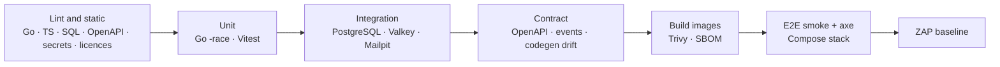

# Testing Strategy

Status: Strategy + implemented foundation gates (see “Running the tests”) · Related: [PHASES.md](PHASES.md), [SECURITY-BASELINE.md](../security/SECURITY-BASELINE.md), [MULTITENANCY.md](../architecture/MULTITENANCY.md)

Tests are part of every phase's definition of done. A feature without its tenant-isolation and permission tests is not finished.

---

## Principles

* **Real dependencies for integration tests.** PostgreSQL, Redis-compatible server, LiveKit and Mailpit run in containers; SQL is never mocked.
* **Tests run with production privileges, not superuser.** Database tests connect as `mc_app`, so row-level security is exercised everywhere.
* **Deterministic.** Injected clock, seeded randomness, no fixed sleeps (poll with timeouts).
* **Leak-detecting data.** Factories embed unique tokens per organisation so any cross-tenant leak is detectable by string search.
* **Fictional data only.** No production or personal data in fixtures, ever.

## Running the tests (implemented)

| Command | What it runs | Needs |
|---|---|---|
| `pnpm check` | Every gate that needs no Docker, with a summary: Prettier, gofmt, ESLint + Redocly, `go vet` (default and `integration` build tags), TypeScript, Vitest (web, design system, contracts), Go unit + contract tests, generated-contract freshness, brand-asset hashes, licence policy | Node, Go |
| `pnpm test:go:integration` | Go integration tests (`-tags integration`): roles and bootstrap, migrations up/down/up, RLS isolation and fail-closed behaviour, runtime-role restrictions, transactional River enqueue, Valkey, MinIO (put/head/presigned download), Mailpit delivery | Docker. A throwaway PostgreSQL 18 container on a random loopback port (roles are cluster-wide, so tests never touch the dev database); Valkey, MinIO and Mailpit from `pnpm infra:up` — their tests skip, with a warning, when the stack is down |
| `pnpm visual:test` (`visual:update` to re-baseline) | Every Storybook story in light and dark: screenshot compared with `packages/ui/visual/baseline`, then axe with the WCAG 2.0/2.1/2.2 A and AA rule sets (including colour contrast). Stories tagged `novisual` are skipped; `vp-<width>` sets the viewport for shell stories | Docker. Runs in the pinned Playwright image (`packages/ui/visual/runner`), so baselines are identical on Windows, macOS, Linux and CI. Report: `packages/ui/visual/.results/report` |
| `pnpm audit:deps` | `pnpm audit --audit-level high` + govulncheck | Network |
| `pnpm licenses` | npm and Go licence allow-list (strong copyleft and unknown licences fail) | — |
| `pnpm doctor` | Connectivity and schema check of PostgreSQL, Valkey, object storage, SMTP and LiveKit | Local stack |

Supporting checks inside the suites: `packages/ui/test/tokens.test.ts` asserts WCAG contrast for every token pairing in both themes; `services/internal/apiserver/contract_test.go` validates real API responses against the bundled OpenAPI schemas; `packages/contracts/test` validates every OpenAPI example and the documented WebSocket frames.

### Full Docker verification

`pnpm dev:docker` builds the production images (`infra/docker/go.Dockerfile` targets `api`, `worker`, `mcctl`; `infra/docker/web.Dockerfile`), runs `mcctl prepare` in the one-shot `migrate` container and waits until every service reports healthy. Verify it with:

| Check | How |
|---|---|
| Application and API through Nginx | `http://localhost:8080` and `http://localhost:8080/api/v1/config` (the version shows the checked-out commit) |
| API and worker readiness | Container health checks (`api healthcheck`, `worker healthcheck` probe `/readyz` on the internal admin listeners `:8091`/`:8092`, which are never routed publicly) |
| Dependencies from inside the network | `docker compose -f docker-compose.yml -f docker-compose.dev.yml --profile app run --rm --no-deps migrate doctor` |

`pnpm dev` removes the application containers again, so the two modes never run two workers on one queue.

## CI jobs (GitHub Actions, `.github/workflows/ci.yml`)

| Job | Gates |
|---|---|
| Web, design system and contracts | Prettier, ESLint + Redocly, TypeScript, Vitest, contract freshness + schema tests, brand-asset hashes, web production build, Storybook build |
| Go services | gofmt, `go vet` (both tag sets), unit and contract tests with `-race`, integration tests against PostgreSQL/Valkey/Mailpit service containers (MinIO tests skip: no published image), binary build, govulncheck |
| Visual regression and accessibility | `pnpm visual:test`; the report is uploaded when it fails |
| Secrets, dependencies and licences | gitleaks over the full history, `pnpm audit --audit-level high`, licence policy, dependency review on pull requests |
| Container images build | `go.Dockerfile` (`api`, `worker`, `mcctl`) and `web.Dockerfile` |

Actions are pinned to commit SHAs. Dependency advisories that have no patched release are handled with the smallest compatible change and documented where they are applied (for example the `fast-glob` → `tinyglobby` override in `pnpm-workspace.yaml`).

## Test matrix

| Layer | Tooling | Runs |
|---|---|---|
| Go unit | `go test -race`, `go-cmp`, fakes | Every PR |
| Go repository/integration | `testcontainers-go` (PostgreSQL 18, Valkey/Redis), River test helpers | Every PR |
| Tenant isolation | Schema, database, API, WebSocket, storage and search suites | Every PR |
| Permissions | Policy matrix (data-driven) + API wiring tests | Every PR |
| Realtime/WebSocket | Hub unit tests, two-node integration with Redis, schema conformance, k6 | PR (functional), nightly (load) |
| LiveKit | Grant/webhook unit tests, `livekit-server` dev container integration, Playwright fake media | PR (unit/integration), nightly (E2E) |
| Frontend unit/component | Vitest, React Testing Library, MSW | Every PR |
| Design system | Storybook + Playwright visual regression + axe | Every PR (changed stories), nightly (all) |
| End-to-end | Playwright against the Compose stack | PR smoke, nightly full |
| Contract | OpenAPI lint + breaking-change diff, response validation, event schema validation, codegen drift | Every PR |
| Security | Authn/authz/CSRF/upload/SSRF/secret suites, SAST, dependency and image scans, ZAP | PR (baseline), nightly (full) |
| Migrations | Up/down/up, upgrade-with-data, sqlc compile | Every PR touching `db/` |
| Performance/resilience | k6, chaos scenarios, restore drill | Nightly / staging / monthly |

## Go unit tests

* Domain services with fake stores, clock, job enqueuer and publisher: validation, invariants, policy outcomes, emitted events and enqueued jobs.
* Pure packages: `authz` policies, markup mention extraction, `platform/crypto` (known-answer vectors; AAD mismatch must fail), rate-limiter maths, `netguard` address classification, cursor signing, Problem Details mapping.
* Connectors against `httptest` servers and a fake SMTP server (timeouts, TLS failures, retries, idempotency).
* Targets: domain services ≥ 80 % line coverage; `authz`, `crypto`, `netguard`: every branch.

## Repository and integration tests

* Migrations are applied once per run into a template database; each package clones a fresh database from it (`CREATE DATABASE … TEMPLATE …`) for speed and isolation.
* Every sqlc query has a happy-path test and a wrong-tenant test.
* Constraint tests: composite foreign keys reject cross-organisation references; unique indexes (DM pairs, channel names, one owner, one live huddle); check constraints.
* Concurrency: 100 concurrent top-level sends and replies to one conversation produce gap-free `seq` (top-level only), gap-free `thread_seq` per thread and gap-free `change_seq`; reactions/edits interleaved with sends keep `change_seq` gap-free and visible in order; **concurrent** retries with the same `client_msg_id` all return the original message (no unique-violation errors).
* Retention: a seeded graph (thread with old root and recent replies, quotes, action items and support requests pointing at old messages, attachments) survives the two-step purge without foreign-key errors; content is tombstoned on schedule and rows disappear only when the whole thread has expired.
* RLS specifics: `user_emails` returns only the caller's own rows; co-members see `contact_email` only; `account_audit_events` is unreachable from tenant packages (import lint) and holds no organisation data.
* Transactional jobs: a rolled-back transaction leaves no River job; a committed one does.

## Tenant isolation tests

1. **Schema suite** — enumerates every table with an `org_id` column and asserts: RLS enabled and forced, a tenant policy exists, and every foreign key to another tenant table is composite with `org_id`.
2. **Database suite** — for each tenant table, rows for organisations A and B; with tenant context A as `mc_app`: B's rows are invisible, inserting a B row fails `WITH CHECK`, and with no context nothing is visible.
3. **API suite** — the router exposes its route table; a generated test calls **every** `/api/v1/orgs/{orgId}/…` route as a member of organisation B using organisation A's IDs (both A's org path and B's org path with A's resource IDs) and expects `404`. A route without a fixture fails the build.
4. **Realtime suite** — B's users cannot obtain tickets for A, cannot subscribe to A's topics, and never receive A's events (tokens searched in all received frames).
5. **Storage suite** — download/preview endpoints never issue URLs for another organisation's objects; generated keys always carry the caller's organisation prefix.
6. **Search suite** — searching for A's unique tokens as B returns nothing.

## Permission tests

* The policy matrix lives as data (`services/internal/authz/testdata/matrix.yaml`): rows = permission × resource state (e.g. public/private Space, archived channel, message older than edit window); columns = actor kinds (Owner, Admin, Member, Space Admin, guest with grant, guest without grant, non-member, suspended member, deactivated member); cells = `allow`, `forbidden` or `not_visible`.
* Table-driven tests run every cell against the policy functions; a wiring test per permission proves the API endpoint consults the right policy.
* Organisation settings variants (invite permission, Space creation, edit window, deletion policy, guest messaging, guest files, support creation) are covered with the injected clock.
* Changing a policy without updating the matrix fails CI.

## Realtime and WebSocket tests

* **Unit:** audience routing, subscription index maintenance on membership events, per-recipient filtering (guests, presence privacy), backpressure (slow consumer closed with 4008), command validation and rate limits.
* **Schema conformance:** every event the Go code can emit is generated in tests and validated against `packages/contracts/events/*.schema.json`; the TypeScript reducer parses the same fixtures.
* **Two-node integration:** two in-process API nodes + real Redis; a send on node A reaches a socket on node B; publish failure → client resync; Redis restart → `realtime.degraded`/`recovered`.
* **Security:** wrong `Origin` → HTTP 403 and no upgrade; missing/invalid session, reused or expired ticket, or a ticket for another organisation → upgrade then close 4001; unsupported subprotocol → close 4010; subscribe to a private channel or to a public channel of a Space the user is not in → `error` reply; session revoked → close 4009 within 1 s; membership deactivated → close 4004 while the user's sockets for other organisations stay open.
* **Convergence:** drop selected events in transit (fault-injecting test hub) and assert that clients reach the server state through `change_seq` gap detection and the change feed, including edits, deletions and reactions on old messages.
* **Client convergence:** property-based tests (fast-check) of the event reducer with shuffled, duplicated and missing events always converge to the server timeline after resync.
* **Load (nightly):** k6 ramps 10,000 sockets on one node, measures fanout p95 and reconnect storms after a drain.

## LiveKit integration tests

* **Unit:** grants per role and policy (decode the JWT: room, identity, sources, TTL, metadata, no admin grants), waiting-room transitions, webhook verification (valid, tampered body, wrong key, replayed event).
* **Integration (CI container `livekit-server --dev`):** the API creates the room; a Go participant joins with an issued token; an unauthorised user cannot obtain one; host mute/remove/end via the API take effect; webhooks update attendance; the reconciliation job repairs a missed `room_finished`.
* **E2E:** Chromium with `--use-fake-ui-for-media-stream --use-fake-device-for-media-stream`; two contexts join, see tiles, share screen, minimise/return, leave; huddle start/join from a channel; DM call ring/answer/decline/missed.

## Frontend tests

* **Unit/component:** Vitest + React Testing Library + MSW (handlers generated from OpenAPI examples) for features, hooks (realtime reducer, optimistic sends, read markers, unread badges) and the markup renderer (security cases: `javascript:` URLs, HTML injection, bidi characters, broken tokens).
* **Design system:** Storybook stories for every primitive and the 15 state patterns in light and dark; Playwright screenshot regression against approved baselines (initial baselines reviewed side by side with the prototype screenshots captured in Phase 0); lint forbids raw hex colours and non-token radii.
* **Accessibility:** axe checks in the Storybook test runner and in E2E for each main screen in both themes; keyboard journeys (rail → sidebar → main → panel, sidebar resize with arrows, menus, dialogs, composer).
* **Responsive:** 390, 768, 1024, 1280, 1440 and 1920 px viewports for shell behaviours (drawer, bottom navigation, panel docking).

## End-to-end tests (Playwright)

Run against the full Compose stack with seeded fictional data:

* Authentication: login; TOTP enrolment and login; recovery code; password reset through the Mailpit link; revoking another session.
* Administration: invite a member and a guest (Mailpit), accept, change role, deactivate (access disappears live).
* Spaces and channels: create, browse/join, private visibility, guest restrictions.
* Messaging across two browsers: send/receive, edit, delete, react, thread reply, mention → Activity, pin, save, read state and badges, typing, presence.
* Files: upload → scanning → available, preview, download, delete; EICAR quarantine (nightly, scan profile).
* Meetings, huddles and calls with fake media.
* Search: finds accessible content, never private content of others.
* Actions: create from a message, assign, complete.
* Support: create with selected message / selected thread / no context; the Mailpit email contains exactly the snapshot and **none** of the other messages in the conversation; SMTP failure → "Delivery failed" → retry.
* Appearance: light/dark/system on key screens.

PRs run a smoke subset; the full suite runs nightly and before every release.

## Contract tests

* Redocly lint and an OpenAPI breaking-change diff against `main` (breaking changes inside v1 fail CI).
* Integration tests validate real Go responses against the OpenAPI schemas.
* `pnpm gen` drift check: generated TypeScript and sqlc code must be committed and current.

## Security tests

* **Authentication:** enumeration resistance (status, body, timing tolerance), throttling, TOTP replay rejected, recovery codes single-use, reset tokens single-use and expiring, session token rotation on login, cookie attributes.
* **CSRF:** unsafe requests without the token or with a foreign `Origin` are rejected; no `GET` mutates state.
* **Authorization:** tenant and permission suites above, plus IDOR fuzzing that substitutes IDs across all routes.
* **Headers:** CSP, HSTS (production profile), `nosniff`, frame protection, Permissions-Policy on HTML and API responses.
* **Uploads:** declared vs actual size, executable renamed as image, SVG with script never served inline, EICAR quarantined, decompression bomb rejected, traversal/bidi filenames sanitised.
* **SSRF:** integration targets `127.0.0.1`, `169.254.169.254`, RFC 1918 ranges and a DNS-rebinding hostname are refused.
* **Secrets:** a known secret set on an integration never appears in API responses, captured logs or audit metadata; swapping ciphertexts between rows fails decryption (AAD).
* **Rate limits:** each class returns `429` with `RateLimit` and `Retry-After` headers.
* **Static and supply chain:** govulncheck, gosec, golangci-lint, Semgrep custom rules (handlers importing `store` packages, raw SQL strings, missing `org_id` predicates), ESLint security rules, `pnpm audit`, gitleaks, Trivy, licence policy.
* **Dynamic:** OWASP ZAP baseline on PRs; authenticated full scan nightly; external penetration test before GA.

## Migration tests

* Empty → latest → zero → latest.
* Upgrade with data: previous release schema + seeded data → new migrations → smoke queries.
* sqlc compiles against the migrated schema.
* Review-time checks: new tenant tables covered by the schema suite; large-table indexes built `CONCURRENTLY`.

## Performance and resilience tests

* k6 scenarios: mixed API traffic, message send p95, search p95 with ~10 M synthetic messages, WebSocket fanout.
* Chaos in staging: kill an API node under load, restart Redis, restart PostgreSQL, restart LiveKit, stop ClamAV — verify degraded behaviour and recovery.
* Monthly automated backup restore drill with integrity checks.

## CI pipeline (target)

The implemented jobs are listed under “CI jobs” above. The target pipeline adds stages as the product grows:

Nightly adds: full E2E, k6 load smoke, ZAP full scan, ClamAV/EICAR flows, migration upgrade tests.
